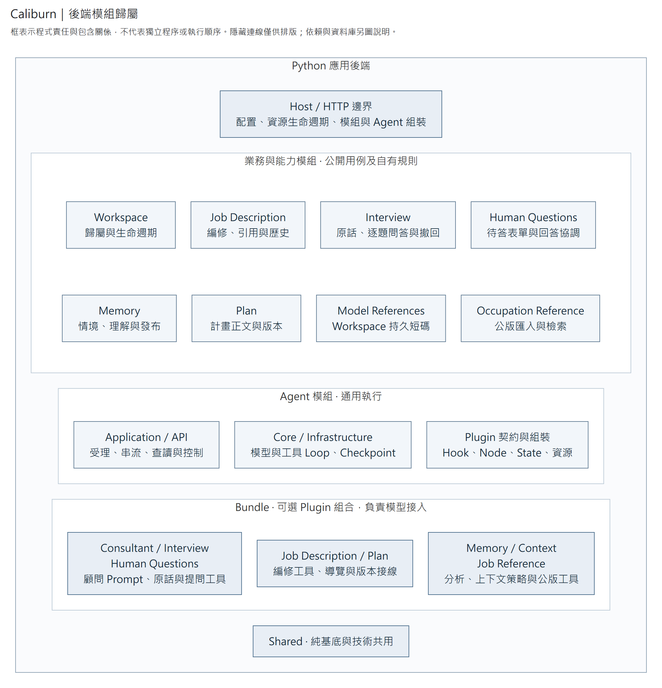

# Caliburn 後端

Caliburn 的正式 Python 後端，與 [Web 前端](../frontend/README.md)共同提供本機職務分析應用。採 FastAPI、Pydantic、SQLAlchemy、PostgreSQL；確切版本由 `uv.lock` 固定。

第一次閱讀可先從[架構導覽](../../ARCHITECTURE.md)選擇系統、流程或資料視角，再看[各模組圖面入口](architecture.md#模組讀圖入口)。

## 完整系統模組分區

完整分責沿[系統架構與責任規格](architecture.md)：Host 組裝應用程式，模組管規則與資料，Plugin 管模型接入，Agent Core 管執行。該頁另有部署、資料 owner、插件依賴、Loop 與時序圖，以及新增功能的位置判準。



[放大 SVG](../../docs/diagrams/system/module-map.svg) · [Mermaid 圖源](../../docs/diagrams/system/module-map.mmd)

本圖是責任契約，無箭頭的包含關係不表示流程或驗收進度。系統使用單一 Python 後端、一個 PostgreSQL（業務表與 Checkpoint 表分責）、一個 Qdrant。公版是後端獨立模組，不另拆服務。各能力的實際接線及操作限制沿下方模組文件。

## 檔案位置

- [Workspace](src/caliburn/modules/workspace/README.md)：檔案管理與 HTTP CRUD。
- [JD](src/caliburn/modules/job_description/README.md)：職務內容、完整快照歷史、差異比較與恢復。
- [Plan](src/caliburn/modules/plan/README.md)：最新計畫正文、原子 patch、取消所需版本恢復與唯讀 HTTP。
- [Plan Bundle](src/caliburn/bundles/plan/README.md)：可選的計畫讀改工具、提示詞與輪前版本準備。
- [Interview](src/caliburn/modules/interview/README.md)：正式原話、逐題問答、略過、有序查讀與整輪撤回。
- [Human Questions](src/caliburn/modules/human_questions/README.md)：待答查詢、整批回答、原輪恢復及執行紀錄投影。
- [Consultant Bundle](src/caliburn/bundles/consultant/README.md)：顧問主提示與正常完成規則。
- [Memory](src/caliburn/modules/memory/README.md)：同 Workspace 的情境／理解聚合、訪談來源與不可變發布。
- [Memory Bundle](src/caliburn/bundles/memory/README.md)：顧問固定版本查讀、B1／B2 分析及完成後整理。
- [模型定位](src/caliburn/modules/model_references/README.md)：各 Bundle 共用 Workspace 持久短碼；正式業務關聯仍為 UUID。
- [Context Bundle](src/caliburn/bundles/context/README.md)：兩個獨立插件提供輪前換窗及原生壓縮；各能力 Plugin 透過固定服務集合提供窗口回呼，A／B1／B2 可使用原生壓縮。
- [Agent](src/caliburn/modules/agent/README.md)：LangGraph 循環、原生 SDK／工具、官方 PostgreSQL Checkpoint 與逐工具恢復。
- [Occupation Reference](src/caliburn/modules/occupation_reference/README.md)：公版 PDF 轉換、固定來源索引、本機模型搜尋及獨立 HTTP 回讀。
- [Job Reference Bundle](src/caliburn/bundles/job_reference/README.md)：提供公版搜尋、來源／任務讀取兩個工具；直接查找，不另存選用狀態。
- [Shared](src/caliburn/shared/README.md)：共用基底與技術機制。
- [Host 應用程式](src/caliburn/host/app.py)組裝 HTTP 路由、能力模組與共用資源，並管理程序生命週期。
- [Host 顧問組裝](src/caliburn/host/consultant.py)接入 Agent、完成輪 JD 查讀與 Memory 整理。
- [Host 工作區接線](src/caliburn/host/workspaces.py)為 [Workspace 生命週期用例](src/caliburn/modules/workspace/application/lifecycle.py)提供初始化交易、停工、Checkpoint 清理與刪除工作管理。

Application 依賴 Domain 與自有契約；Infrastructure 實作儲存，Presentation 呼叫用例。Shared 不反向依賴業務模組。以 [.importlinter](.importlinter)檢查層向與循環；命名、註解及測試沿[專案規範](../../CONTRIBUTING.md#程式規範)。

## 安裝與檢查

使用 Python 3.14 與 uv，在此目錄執行。OpenAPI 正則測試另需專案 Node.js 24。

```powershell
uv sync --locked
uv run --locked python -m pytest -q
uv run --locked ruff check .
uv run --locked ruff format --check .
uv run --locked python -m mypy
uv run --locked lint-imports --no-cache
```

使用本目錄 `.venv`。本機公版搜尋另安裝 `uv sync --locked --extra local-models`；Linux 使用官方 CPU wheel，Windows 沿鎖定的 CUDA wheel，來源由 `pyproject.toml` 與 `uv.lock` 固定。

真 PostgreSQL 測試須設定 `CALIBURN_REBUILD_TEST_DATABASE_URL`：`postgresql+psycopg://…`、loopback host、資料庫名以 `_test` 結尾，URL 不帶 query，環境不設 `PGHOSTADDR`／`PGSERVICE`。測試帳號須能增刪 schema；每例使用隨機 schema 並清理，隔離測試也會在 `public` 增刪隨機測試表。**只能使用專用合成資料庫**。未設定時整合測試會 skip，不代表儲存已驗收。

## 啟動

準備獨立空 PostgreSQL。複製 [.env.example](.env.example) 為本目錄 `.env`，填入自己的連線；另複製 [reference.example.json](reference.example.json) 為 `.local/reference.json`，設定公版資源。`CALIBURN_REBUILD_DATABASE_URL` 與 `CALIBURN_REBUILD_REFERENCE_CONFIG` 都必填。`.env` 與 `.local/` 已忽略，不提交帳密。由 uv 明示載入環境；部署也可直接提供程序環境，此時省略 `--env-file .env`。

```powershell
uv run --env-file .env --locked python -m caliburn.migrate upgrade head
uv run --env-file .env --locked python -m caliburn.server
```

預設監聽 `127.0.0.1:8101`，使用單 worker；啟動不自動遷移。尚無登入／授權，僅供本機使用。

正式同源部署設定 `CALIBURN_REBUILD_WEB_DIST` 指向包含 `index.html` 的前端建置目錄；Host 將 API 掛在 `/api`，其餘頁面導航由同一份 SPA 提供。未設定時保留開發用根路徑 API，供 Vite proxy 連接。容器可用 `python -m caliburn.server --host 0.0.0.0 --port 8101` 指定監聽位置。

`GET /health` 只表示程序可回應，不檢查資料庫或載入搜尋模型。使用 `uv run --env-file .env --locked python -m caliburn.status` 唯讀檢查業務 schema、Checkpoint schema 與公版索引 manifest；全部就緒回 exit 0，缺配置、待遷移或無法連接回 exit 1。`ready` 不代表已驗證模型推理。遷移與 status 都可從已安裝 wheel 執行，不依賴 checkout。

FastAPI 處理 HTTP，Uvicorn 提供 ASGI Server。[server.py](src/caliburn/server.py) 設定監聽及平台事件迴圈，並使用 [Host 啟動工廠](src/caliburn/host/entrypoint.py)讀取部署配置及建立應用程式。Windows 使用 Psycopg async 支援的 Selector loop，其他平台沿 Uvicorn 預設。參考 [FastAPI 部署說明](https://fastapi.tiangolo.com/deployment/manually/)及 [Psycopg async 平台限制](https://www.psycopg.org/psycopg3/docs/advanced/async.html)。

Agent 預設停用。要啟用時，將非秘密設定 [agent.example.json](agent.example.json) 複製到 `.local/agent.json` 再調整，並設定 `.env.example` 中的 Agent 區段；`.local/` 不進版本控制，API key 仍由 OpenAI SDK 讀取程序環境。Checkpoint 沿 LangGraph 官方 PostgreSQL Saver，首次 setup 與限制見 [Agent 部署](src/caliburn/modules/agent/README.md#明示設定)。Memory／Plan 等業務資料仍由各自模組負責。

啟停以 Plugin 為單位，一個 Bundle 可提供多個 Plugin。每項 Bundle 的 `plugins` 省略／`null` 表示全選，`[]` 表示選空，名稱清單按 factory 原順序選取；必要 Plugin 與服務缺漏在啟動拒絕，不自動補開。詳細契約沿 [Agent 設定](src/caliburn/modules/agent/README.md#明示設定)。Context 預設輪前歷史門檻為 96,000 token、完整請求門檻為 160,000 token，條件及停止規則沿 [Context](src/caliburn/bundles/context/README.md)。

## API 文件與實作範圍

依上方開發指令啟動後，可開啟；正式同源部署則在各路徑前加 `/api`：

| 入口 | 用途 |
|---|---|
| [Swagger UI](http://127.0.0.1:8101/docs) | 查看參數、Request／Response、錯誤格式，並送出請求試用 |
| [ReDoc](http://127.0.0.1:8101/redoc) | 閱讀分組接口與資料結構 |
| [OpenAPI JSON](http://127.0.0.1:8101/openapi.json) | 機器可讀契約，供工具與 SDK 生成使用 |

目前包含 Workspace CRUD、JD 內容資源 CRUD／整份查詢／歷史／Diff／恢復、Plan 目前內容、Interview 原話查讀，以及 Agent 輪次受理、查讀、SSE、人工回答、故障恢復與整輪取消。Swagger 依業務能力分組；JD 的四個局部查詢、Plan 寫入及 Interview 保存／撤回只保留 Application。

Occupation Reference 常設於 Host，提供三個獨立 HTTP 入口與 PDF／索引維護 CLI；`CALIBURN_REBUILD_REFERENCE_CONFIG` 明示配置，本機搜尋套件使用 `local-models` extra。啟動不載入權重、不建立索引；Agent 是否取得公版工具仍由 `job_reference` Plugin 選取決定。設定及限制見[公版模組](src/caliburn/modules/occupation_reference/README.md)。

Memory 另提供目前及指定發布版的 Map、單項正文與來源查讀；Agent 停用仍可讀取。選取 `memory_consolidation` 及其必要 Plugin 後，Host 沿公開 coordinator factory 接入顧問完成後的整理通知與重啟恢復；替代 Bundle 可提供同一契約，不依模組名稱啟用。來源與固定引用沿 [Memory 模組](src/caliburn/modules/memory/README.md)，角色組裝、失敗及接續規則沿 [Memory Bundle](src/caliburn/bundles/memory/README.md)。

Interview 的唯讀 API 不依賴 Agent 啟用。選取 `interview` Plugin 保存首尾原話，再選 `human_questions` Plugin 即可保存中途逐題問答；問題 UUID 由 Interview 產生。兩張表隨 Alembic `upgrade head` 建立，啟動不自動遷移。細節與 ER 圖見 [Interview](src/caliburn/modules/interview/README.md)。

Plan 使用 `GET /workspaces/{workspace_id}/plan` 讀最新保存內容與版本，無根回空值、不自動建立；不依賴 Agent 配置。[Plan Bundle](src/caliburn/bundles/plan/README.md) 的工具、提示、輪前準備及窗口投影可分別選取。輪前準備固定取消基準，工具提供按需讀取、patch；選取窗口投影並配合換窗插件時，首次／Memory 換版會注入正文與版本，同版沿已見版本，原生壓縮後不重貼。Agent 取消時恢復輪前內容，相同內容不增版；下一輪排除取消輪窗口並重新固定基準。具體責任沿 [Plan 模組](src/caliburn/modules/plan/README.md)。

Workspace DELETE 先停止新執行、等待在途 Agent／Memory 工作，再刪業務資料與全部所屬官方 Checkpoint；全部確認後才回 204。兩種保存不共用交易，500／失聯可能留下待清理 Checkpoint，可用同一 Workspace ID 重試。停用模型配置仍保留 `CALIBURN_REBUILD_AGENT_CHECKPOINT_CONNINFO`，供刪除清理原保存資料；不會因此建立 SDK client 或呼叫模型。

完整 App 的 `POST /workspaces` 在同一交易建立 Workspace、空 JD 首版與固定 App 開場，全部提交後才回 201；不依 Agent 或顧問插件開關，也不啟動模型。啟動、GET 與首次顧問輪不補建既有資料。Workspace 模組的獨立 Service 仍只建立 Workspace。

JD 在 Workspace 範圍內操作。以 `GET /workspaces/{workspace_id}/job-description` 查找該檔案的 JD；已知 JD 及其子項、歷史、Diff、恢復使用 `/workspaces/{workspace_id}/job-descriptions/{jd_id}`。獨立 JD 建立能力供已自行管理初始化的呼叫端使用，完整 App 不需第二次建立。

請求只傳本次修改；內容寫入、恢復與整份查詢直接回傳完整 JD 欄位及 `version`。除首次建立外，寫入須帶原 `expected_version`；歷史以同一 JD 的 `version` 定位，恢復帶 `target_version`，成功產生目前下一版。一般無變更不增版；明確恢復即使內容相同也增版。提交結果未知時不能自動重送，應重新讀取核對；具體 Request／Response 與錯誤沿 OpenAPI。

Task PATCH 可一起修改本體欄位、`placement` 與有序 `changes`（O/P、K/S 引用及新建並連結 K/S），整次共同提交或回滾。其他內容資源以自身 PATCH 處理內容與 `placement`；Condition 也可同次更改分類。省略 `placement` 不移動，提供空位置物件代表組末；Task 位置另須明示目的職責或 `null`（未分類）。這是具型別的自訂 PATCH 文件，並非 JSON Patch／JSON Merge Patch。

文件由已註冊的 FastAPI routes 與 Request／Response models 自動生成；接口細節以此為準，README 保留入口與狀態，不另外維護完整接口表或截圖。

JD 的 PDF 下載為 `GET /workspaces/{workspace_id}/job-descriptions/{jd_id}/export.pdf`，不依 Agent 啟用。以 `CALIBURN_REBUILD_PDF_FONT_PATH` 指定可讀且授權使用的繁中文字型檔；瀏覽器可用 `CALIBURN_REBUILD_PDF_CHROMIUM_PATH` 明示指定，省略時使用已安裝的 Playwright Chromium。字型與瀏覽器不由應用程式自動下載；設定範例見 [.env.example](.env.example)。未配置或資源不可用回 503，不能當成空 PDF。Host 共用一個 renderer，關閉時等待其工作收尾；內容與列印保障沿 [JD](src/caliburn/modules/job_description/README.md)。

不啟動 HTTP／PostgreSQL 也可匯出同一份契約：

```powershell
uv run --locked python -m caliburn.export_openapi --output output/openapi.json
```

輸出供前端生成 wire types／client 使用，不手改生成檔或另寫一份 DTO。匯出沿正式組裝與 FastAPI `app.openapi()`，不讀部署連線設定；生成型別不取代前端對回覆的執行時驗證。參見 [FastAPI OpenAPI 生成](https://fastapi.tiangolo.com/how-to/extending-openapi/)。

## 前端使用順序

1. **建立與開啟檔案**：POST Workspace 成功後，直接查詢已建立的 JD 與訪談開場。重開時先 GET Workspace，存在才查其 JD；不要因 GET 缺少 JD 自動補建。兩個請求之間 Workspace 仍可能被刪除，收到 `404 / workspace_not_found` 時應離開該檔案。
2. **編修**：同頁同 JD 串行送出局部修改，使用上次成功回覆的 `version`；成功回完整 JD。保留後來輸入、尚未確認的草稿，不用較早回覆覆蓋它。省略 PATCH 欄位表示不修改，`null` 是否可清除依各欄位契約。
3. **恢復**：先完成目前輸入的保存；保存失敗或結果未知就停止。帶目前 `expected_version` 與歷史 `target_version`，成功以完整新 JD 同步畫面，不把恢復前待送操作套上去。
4. **整份刪除**：Workspace DELETE 的 `204` 沒有 JSON body，確認成功才離開並清除該檔案快取／草稿。JD 子項 DELETE 則回 `200` 與完整 JD。切換或刪除後，晚到的舊請求回覆不能填回目前畫面。

錯誤依 HTTP 狀態與 `detail.code` 分類，並讀取可用的 `reason`／`commit_status`：

| 回覆 | 呼叫端處理 |
|---|---|
| `400`／`422` | 修正請求或輸入，保留尚未保存內容 |
| `409` | 已拒絕；保留輸入、停止後續寫入。版本衝突須重讀確認，不偷偷換版強寫 |
| JD `500` 且 `commit_status=committed` | 已提交，但回覆或收尾失敗；重新讀取，不重送 |
| JD `500` 且 `commit_status=not_committed` | 已確認未提交；保留輸入，仍不自動重送 |
| 其他 `500`／失聯／逾時 | 效果未確認；重新讀取核對，不自動重送，也不宣稱未保存 |

GET 只回目前狀態，不是原操作的收據；一次查不到資料不證明先前請求未提交。Workspace 建立不使用冪等鍵、不自動重送；改名採最後寫入生效，與 JD 的版本前置不同。
