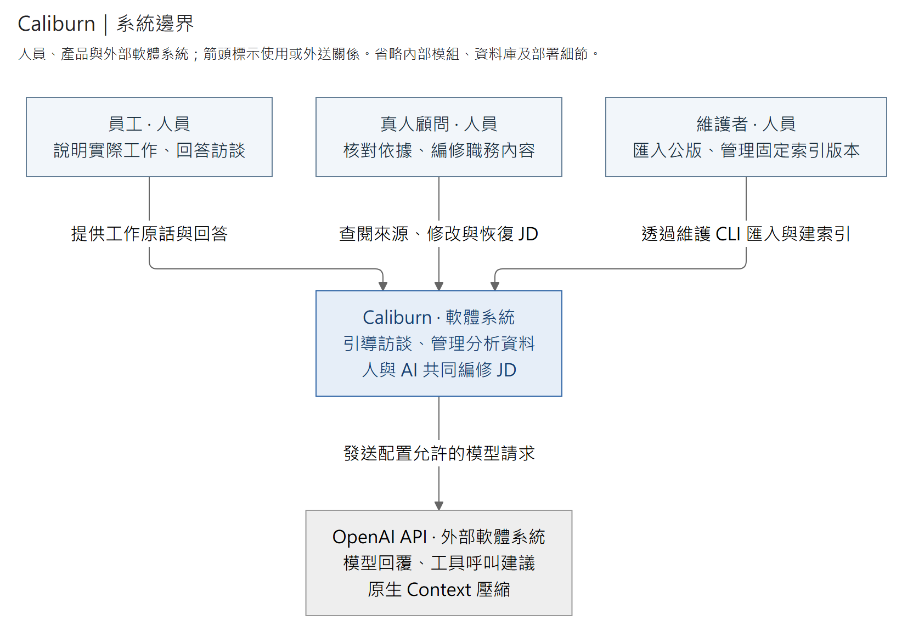
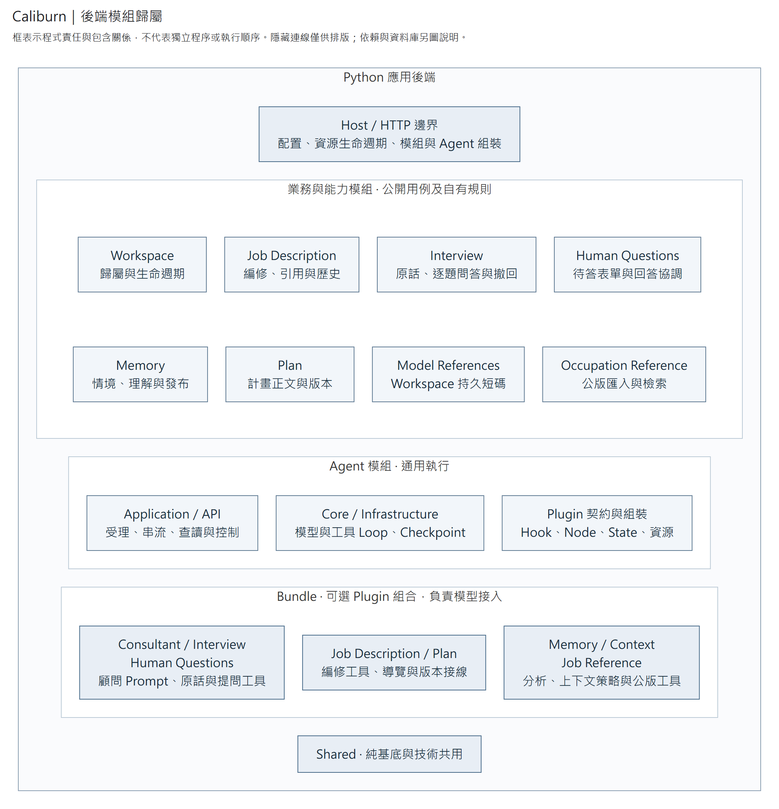
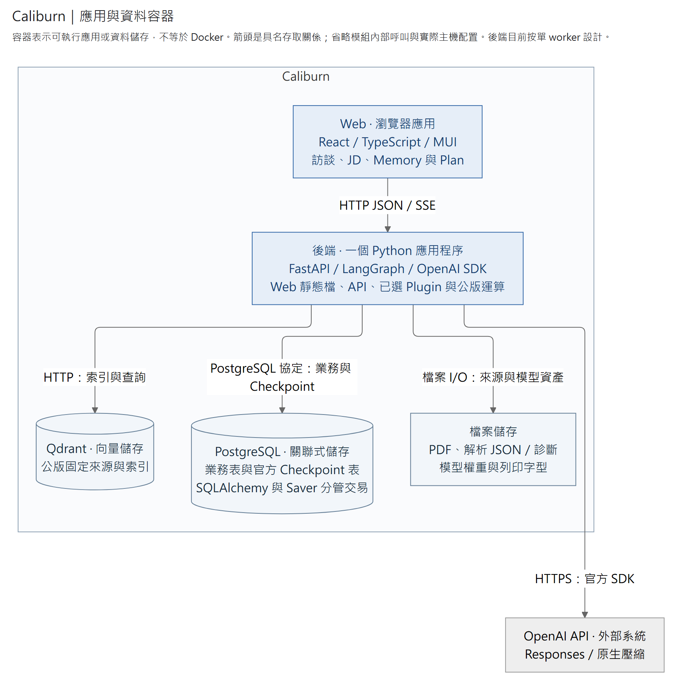
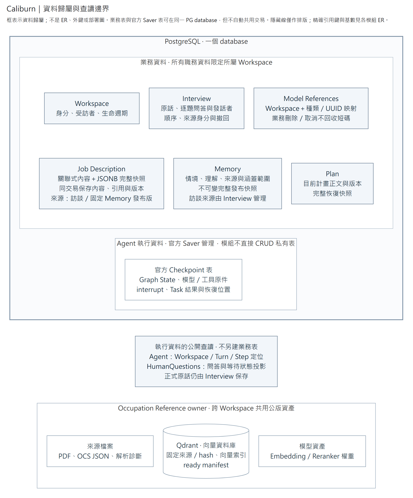
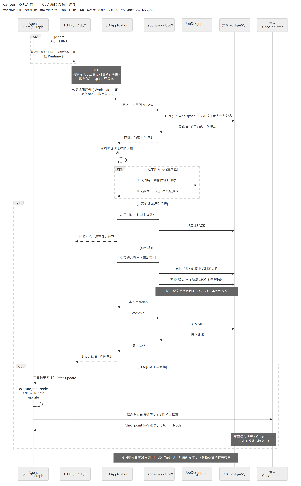
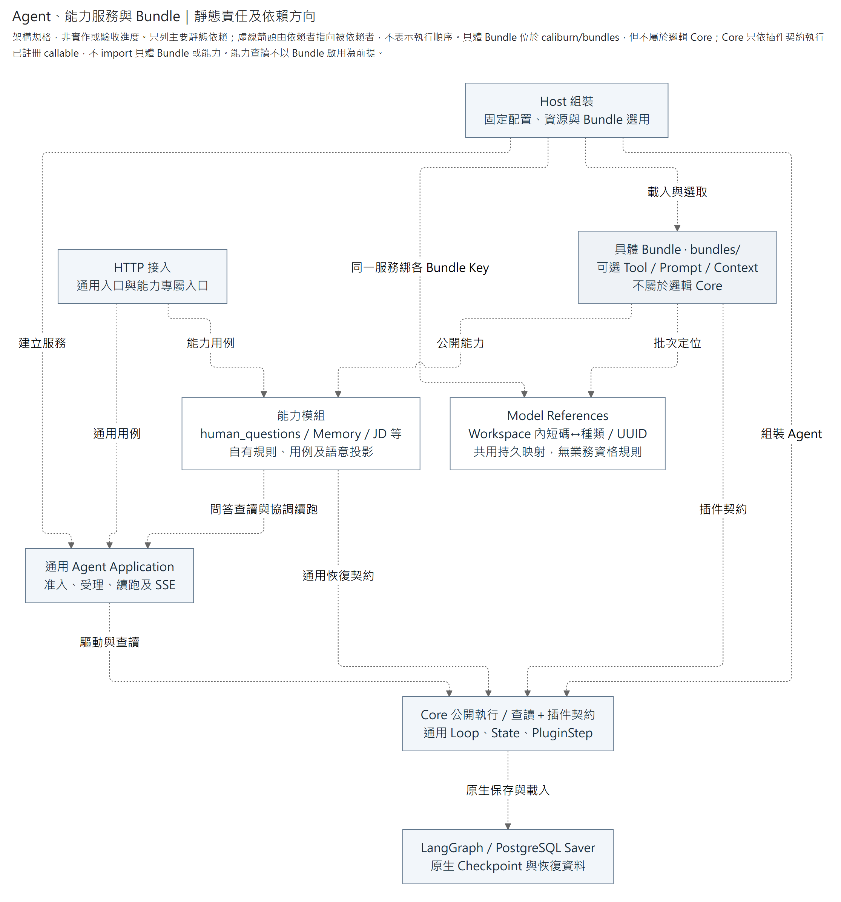
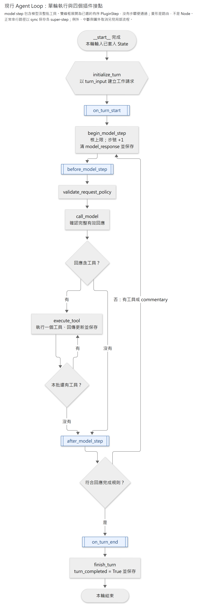
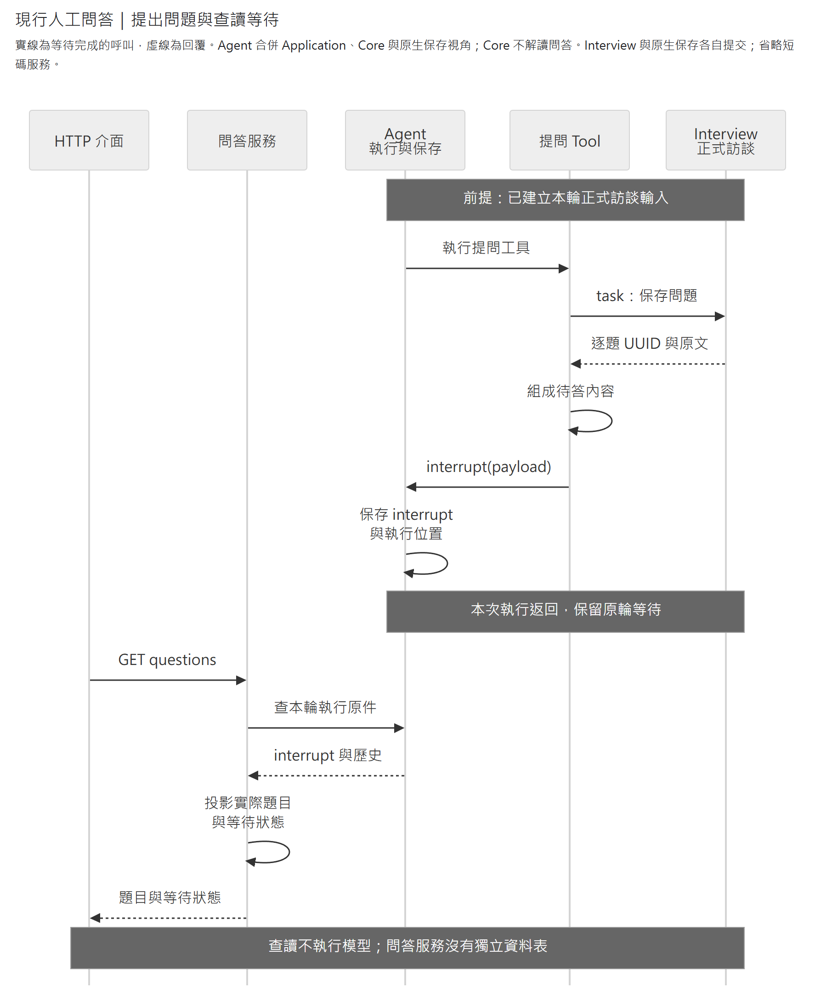
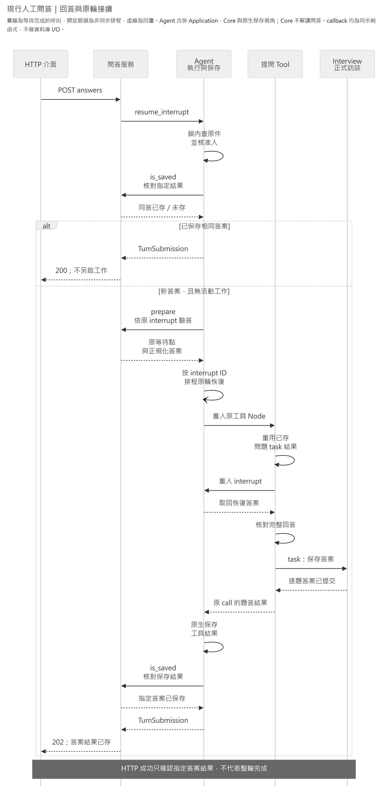
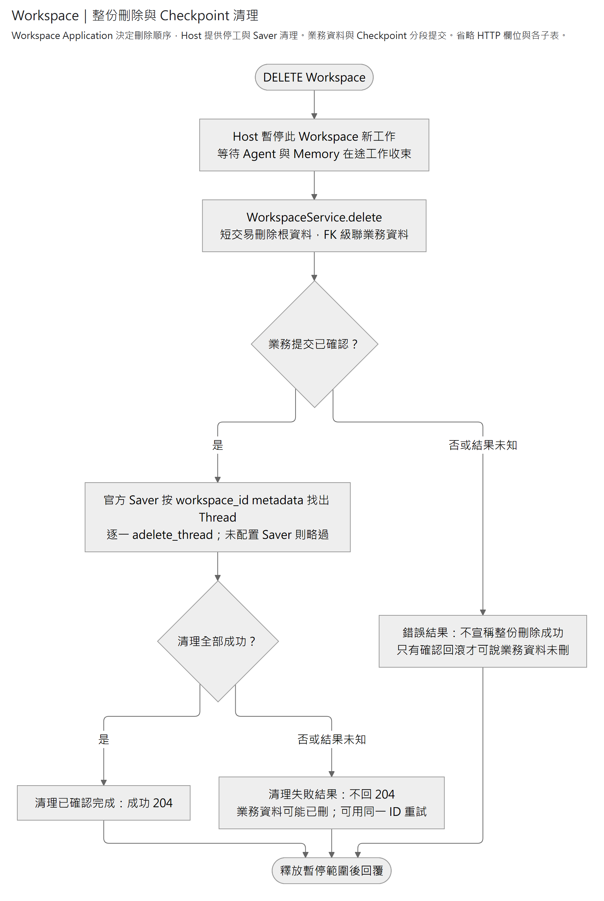

# Caliburn 系統架構與責任規格

本規格定義整套 AI 顧問後端的責任、依賴與資料歸屬。**能力模組管資料與規則，Agent 插件管模型如何使用能力，Agent Core 管執行。** Web 與工具使用同一套業務用例；停用某個 Agent 插件，不會移除模組的資料、查讀或必要收尾能力。

這是架構契約，不是完成率或部署驗收報告。圖中的框表示責任，不代表都已接線，也不要求每個框各開程序或各建資料表。執行及操作細節見 [後端 README](README.md)、[Agent](src/caliburn/modules/agent/README.md)、[JD](src/caliburn/modules/job_description/README.md) 與各模組的正式契約。

閱讀順序：[模組全圖](#1-系統分區) → [責任與位置](#2-模組責任與公開能力) → [資料](#3-資料所有權與保存) → [Bundle／Plugin](#4-bundleplugin-與依賴) → [一輪執行](#5-agent-一輪的流程與狀態) → [新增功能放哪裡](#9-新增功能的歸屬判準)。

## 1. 系統分區

### 系統邊界



[放大 SVG](../../docs/diagrams/system/system-context.svg) · [圖源](../../docs/diagrams/system/system-context.mmd)

此圖先回答「誰使用系統、系統向誰提出請求」。以下逐層展開後端責任、程序與資料；不在同一張圖混入所有類別、路由和欄位。

### 後端模組歸屬

下圖是無箭頭的模組歸屬圖。後面的依賴、容器與時序圖才使用具名箭頭，避免把檔案包含關係誤讀成呼叫流程。



[放大 SVG](../../docs/diagrams/system/module-map.svg) · [圖源](../../docs/diagrams/system/module-map.mmd)

### 程序與技術



[放大 SVG](../../docs/diagrams/system/deployment.svg) · [圖源](../../docs/diagrams/system/deployment.mmd)

標準部署是一個 Python／FastAPI 應用程序、PostgreSQL 與 Qdrant。應用程序提供建置後的 Web 與 `/api`；公版解析、Embedding／Reranker 由 `occupation_reference` 模組負責，不另拆 HTTP 或 GPU 服務。PDF 匯入與建索引走維護 CLI，HTTP 搜尋在應用程序執行。整套由同一部署入口啟停；PG／QD 仍各自是資料庫程序，不嵌進 Python。

| 技術 | 明確用途 |
|---|---|
| React、TypeScript、Vite、MUI | Web；Workspace、JD 編修、對話、問答、歷史與分析資料呈現 |
| React Router、TanStack Query、OpenAPI 生成 client | 頁面路由、遠端資料同步、HTTP 契約；不重寫後端業務規則 |
| FastAPI、Pydantic、Uvicorn | HTTP／SSE、邊界資料驗證、ASGI 執行與 lifespan |
| OpenAI 官方 Python SDK | Responses 請求、串流、型別、用量及原始回覆；不另外抽象一套模型協定 |
| LangGraph | Graph／State、Node 排程、interrupt／resume、Checkpoint、串流 |
| `langgraph-prebuilt`、`langchain-core` | 官方 ToolNode／ToolRuntime、StructuredTool 與必要轉接；不是第二套 Agent Loop |
| SQLAlchemy、Psycopg、Alembic | 模組業務資料、短交易及業務 Schema 遷移 |
| `langgraph-checkpoint-postgres` | 官方 PostgreSQL Saver；不自製 Checkpoint 格式、排程或恢復表 |
| PostgreSQL | 一個關聯式資料庫，保存業務表與官方 Checkpoint 表；兩種存取責任分開 |
| Qdrant、Embedding／Reranker | 公版檢索索引與模型運算；底稿使用 BGE-M3／BGE-reranker-v2-m3 |
| pdfplumber 等解析工具 | 公版 PDF→結構化 JSON 的匯入實作；解析失敗與來源可追查 |
| Playwright／Chromium | JD 的唯讀 PDF 列印；Host 明示配置字型與瀏覽器、管理 renderer 生命週期，列印不持有資料庫交易 |
| pytest、HTTPX、Playwright、靜態型別／依賴檢查 | 行為、真資料庫、瀏覽器與架構驗證 |

套件版本由各套件管理器的 lockfile 固定，文件不另維護第二份版本清單。後端部署目前按單 worker 設計；記憶體活動工作鎖不能被描述成多 worker 或多主機鎖。程序環境保存機密與連線，Agent 配置保存非機密模型設定及 Bundle 清單。

## 2. 模組責任與公開能力

模組是內聚的能力邊界，不等於一個聚合根，也不強制都具有四個空的 DDD 資料夾。只有維護業務不變條件的物件才建領域模型。Application 協調用例、交易與外部能力；Domain 維護規則；Infrastructure 實作存取；HTTP 和工具是不同接入方式。

| 模組 | 擁有的規則及資料 | 公開能力／輸入與輸出 | 不承擔 |
|---|---|---|---|
| `workspace` | Workspace 身分、受訪者、資料歸屬與生命週期 | 建立、查詢、列出、改名、刪除；以 Workspace ID 定位 | 模型執行、JD 內部規則、共用公版內容 |
| `job_description` | 單一 JD 聚合；職責、任務、O/P、共用 K/S、引用、協作、條件、排序；完整歷史 | Workspace／JD ID＋局部操作＋版本前置；回完整 JD／版本；查版、Diff、恢復、匯出 | 訪談原文、模型短 ID、Prompt、Memory 分析 |
| [`interview`](src/caliburn/modules/interview/README.md) | 正式原話、逐題問題／答案、順序與整輪撤回 | 保存、依 Workspace／輪次列出有序訪談、指定原件查讀、撤回；近期範圍由使用者選取 | 模型推理、工具排程、等待回答的恢復位置 |
| `memory` | 工作情境與工作理解、修訂、來源關係、發布版本、整理進度 | 讀取、編修、來源查驗、發布及版本查詢；回固定版本資料／導覽 | B1／B2 的模型 Prompt、模型 Loop |
| [`plan`](src/caliburn/modules/plan/README.md) | 顧問工作安排的最新正文、修改與恢復快照 | 查目前內容、初始化、patch、取消所需的指定版本恢復；HTTP 只讀目前內容 | 判定 JD 已完成、另外扮演規劃 Agent、管理 Agent 取消流程 |
| `human_questions` | 待答表單、整批回答配對及執行狀態投影；單題規則共用 Interview | 取得待答問題、驗證整批答案、回答及歷史查讀；以 Turn／Step／call 定位 | Core 執行狀態機、把所有問答自動授予正式訪談資格 |
| `agent` | 執行准入、去重、Turn／Step、模型與工具、串流、Checkpoint、通用恢復／取消裁決 | 受理訊息、續跑、查輪次／步驟／工具／用量、訂閱；輸入 Workspace、Turn、使用者內容 | 解讀 JD、Memory、Plan 或問答專屬資料 |
| [`model_references`](src/caliburn/modules/model_references/README.md) | Workspace 內短碼與種類／正式 UUID 的持久映射 | 批次配置及解析；相同目標永遠同碼，Workspace 刪除才清理 | 業務存在性、來源資格、Prompt、Core 執行 |
| [`occupation_reference`](src/caliburn/modules/occupation_reference/README.md) | 公版來源、PDF→JSON、結構檢查、固定資料版本、索引、檢索與回讀 | 匯入、建索引、搜尋公版、讀公版與任務；回可定位來源 | 員工事實、顧問決策 |

### 模組讀圖入口

依問題閱讀局部圖，不必一次看完全部。ER 只標實際資料表及重要鍵；完整欄位以 Schema／ORM 為準。

| 責任入口 | 圖面回答什麼 | 省略什麼 |
|---|---|---|
| [Workspace](src/caliburn/modules/workspace/README.md) | 直接歸屬 ER、整份刪除與兩種儲存清理 | 各模組內部內容表 |
| [JD](src/caliburn/modules/job_description/README.md) | 用例接線、目前內容／快照 ER、來源引用 | 全部 HTTP 路由；正文欄位圖另作下層參考 |
| [Interview](src/caliburn/modules/interview/README.md) | 輪次、逐題訊息與同輪回答的 ER | Agent 推理和中途說明 |
| [Human Questions](src/caliburn/modules/human_questions/README.md) | 提問、保存、等待與原輪回答時序 | 不另畫不存在的問答資料表 |
| [Memory](src/caliburn/modules/memory/README.md) | 目前內容、分析狀態與發布快照 ER | 模型分析編排沿 [Memory Bundle](src/caliburn/bundles/memory/README.md#完成與恢復) |
| [Plan](src/caliburn/modules/plan/README.md) | 聚合責任、正文與恢復快照 ER | 不為簡單 CRUD 再增一套流程圖 |
| [Model References](src/caliburn/modules/model_references/README.md) | 持久短碼、Workspace FK 與唯一性 | 不把多型 UUID 畫成資料庫 FK |
| [Occupation Reference](src/caliburn/modules/occupation_reference/README.md) | 匯入／索引與搜尋／回讀的流程 | Qdrant payload 不畫成 PostgreSQL ER |
| [Agent](src/caliburn/modules/agent/README.md) | 組裝、Loop、State、恢復與取消 | 官方 Saver 表不冒充模組自有 Schema |

Bundle 的簡單 Prompt／Tool 接入以清單及程式入口說明；跨能力編排才畫圖，例如 [JD 工具執行](src/caliburn/bundles/job_description/README.md)、[Memory 分析發布](src/caliburn/bundles/memory/README.md)。Context 的窗口貢獻及插件順序沿 [Context Bundle](src/caliburn/bundles/context/README.md)，不再複製 Core 迴圈。

### 不另外建立的資料 owner

- **B1／B2**：Memory 分析角色，共用 Core；B1 建立工作情境，B2 建立工作理解。角色權限、順序與 Prompt 在 Memory Bundle；Memory 模組管理資料與發布。
- **Changes**：查詢及模型呈現。JD 內容 Diff、人工改稿差異、所引 Memory 來源差異是不同比較基準，不能用其中一項冒充其他項；不另建 Changes 資料庫。
- **Map**：能力的導覽投影；模型短碼由共用 `model_references` 管理，不取代業務 UUID 或來源資格。
- **Note**：底稿中的規劃筆記歸 Plan。本規格不新增一份內容重複的 Notes 模組。
- **摘要／完整訪談／換窗／壓縮**：Agent 的 Context 策略插件；不因為有 Context 就新增通用 Context 資料庫。
- **公版查找**：模型直接搜尋及讀取固定來源，不另存選用／否認集合。員工是否負責某項工作仍以訪談及其既有分析資料為準。

### 目錄配置

Host 集中應用程式接線，能力模組各自維護公開用例及資料規則。具體 `bundles/` 與 `modules/` 同層。Bundle 依賴模組的公開能力及通用插件契約，Agent Core 獨立於具體 Bundle。

```text
apps/
├── frontend/
└── backend/
    ├── src/caliburn/
    │   ├── host/                     # 應用程式組裝
    │   │   ├── app.py                # FastAPI 路由、共用資源與 lifespan
    │   │   ├── entrypoint.py         # 部署配置與應用程式工廠
    │   │   ├── agent_settings.py     # Agent 配置與 Bundle 選取
    │   │   ├── consultant.py         # 顧問、完成輪 JD 查讀及 Memory 接線
    │   │   ├── memory.py             # 整理工作准入、恢復與收尾
    │   │   ├── web.py                # 同源 API 與 SPA
    │   │   └── workspaces.py         # Workspace 用例的交易、停工及 Saver 接線
    │   ├── bundles/                  # 具體 Agent 能力接入
    │   │   ├── consultant/
    │   │   ├── interview/
    │   │   ├── human_questions/
    │   │   ├── job_description/
    │   │   ├── memory/               # B1／B2 與分析編排
    │   │   ├── plan/
    │   │   ├── job_reference/
    │   │   └── context/
    │   ├── modules/
    │   │   ├── workspace/
    │   │   ├── job_description/
    │   │   ├── interview/
    │   │   ├── memory/
    │   │   ├── plan/
    │   │   ├── human_questions/      # 待答查讀、整批回答與原輪恢復
    │   │   ├── occupation_reference/    # 公版解析、索引及搜尋
    │   │   ├── model_references/        # Workspace 內持久短碼，無業務來源規則
    │   │   └── agent/
    │   │       ├── agent.py          # 通用執行／原生狀態查讀
    │   │       ├── state.py          # Core channel
    │   │       ├── plugins/          # 擴充契約與靜態組裝
    │   │       ├── application/      # 通用受理、查讀與控制
    │   │       ├── infrastructure/   # LangGraph／OpenAI adapter
    │   │       └── presentation/api/ # 通用 Agent HTTP／SSE
    │   ├── migrations/              # 隨 Python 套件交付的 Alembic 遷移
    │   └── shared/
    └── tests/
```

公版底稿分開的解析器、索引器與 GPU 服務是功能參考，不是本次部署要求。其解析、索引、搜尋與回讀能力已內聚於 `occupation_reference`，共用後端生命週期；同程序本機模型延遲載入，耗時計算交由有界背景 worker，不阻塞 HTTP 事件迴圈。三個公版 HTTP 與 PDF／索引維護 CLI 沿[模組操作文件](src/caliburn/modules/occupation_reference/README.md)，真模型與真 Qdrant 的部署驗收須另行確認。能力內部按業務分檔；Prompt、工具及其參數說明放在消費它的插件附近，不散進 Core 或全域提示庫。

`occupation_reference` 是獨立模組。PDF 解析、Embedding、索引建立、搜尋及 rerank 都由它管理，即使內部使用模型也不因此成為 Agent 插件。[Job Reference Bundle](src/caliburn/bundles/job_reference/README.md) 呼叫其公開方法，提供模型提示、兩個唯讀工具、參數與結果投影；文件使用共用 occupation 短碼，文件內任務座標仍連同文件定位。Host 將同一服務及有界 worker 注入 HTTP 與插件；公版匯入、維護與 HTTP 查讀不以 Agent 或 Bundle 啟用為前提。

## 3. 資料所有權與保存



[放大 SVG](../../docs/diagrams/system/data-ownership.svg) · [圖源](../../docs/diagrams/system/data-ownership.mmd)

**同一個 PostgreSQL，兩種存取責任：** 業務表由模組 Repository／UoW 管理，Checkpoint 表由官方 Saver 管理。可用不同 schema 區分；不為此要求第二個 PG database，也不讓模組直接 CRUD 框架私有表。

| 資料 | 權威與寫入者 | 查讀方式 |
|---|---|---|
| Workspace、目前 JD、JD 完整快照 | 各模組 Repository／UoW；SQLAlchemy | 模組公開 Application 方法 |
| 正式訪談、Memory 修訂／發布、Plan 版本 | 各能力模組；各自決定所需交易與表 | 同一模組公開方法；插件與 HTTP 共用 |
| Graph State、位置、interrupt、已保存 Task 結果 | LangGraph 官方 Saver | `aget_state`／`aget_state_history` 等公開介面 |
| Turn／Step／工具／Token | Agent 對已保存執行資料的通用投影 | Agent 查讀 API；不再存一份成功工具紀錄 |
| 正式逐題問答 | `interview` 的訊息表；問題與答案各一列 | 訪談公開查讀；撤回輪次不回正文 |
| 待答狀態與已展示表單 | `human_questions` 解讀 Agent 執行資料 | 依 Turn／Step／call 查讀與回答；不另複製執行狀態 |
| 本輪固定 Memory 版本與已見業務版 | 擁有它的插件宣告 State channel | 當輪取 `ToolRuntime.state`；跨輪使用能力公開查讀 |
| 模型短碼↔種類／UUID | `model_references` 的 Workspace 所有權表；批次短交易 | 各 Bundle 自有 Key 綁定同一服務；不屬 Core／窗口 State |
| 公版 PDF、解析 JSON、固定來源及索引版本 | `occupation_reference` | 公版能力介面；來源檔與索引各有保存方式 |
| 公版向量索引 | Qdrant，由公版 Infrastructure 存取 | 公版搜尋方法，消費端不直接組 Qdrant 查詢 |

模型輸入／輸出雖保存在 Checkpoint，**不會自動變成正式訪談或 Memory**。正式來源有自己的身分、發話者、引用資格與撤回規則。提問插件直接呼叫 Interview 保存問題與答案；問答互動層解讀執行中的待答狀態，不從工具 Log 反向補存正式原話。

能力模組可以讀 Agent 執行紀錄。它在 Infrastructure／查詢接線使用通用執行查讀介面，把需要的值交給自己的規則；不直接 SQL 查 LangGraph 私有表，也不要求 Core 辨識 `ask_user_question`、Memory 或 JD 的 payload。現在 Node 內尚未提交的 State 用函式參數／`ToolRuntime.state`，不能以重讀上一個 Checkpoint 代替。

### JD 的資料與交易

目前內容採關聯式資料：`job_descriptions`、`duties`、`job_tasks`、`task_outcomes`、`task_requirements`、`knowledge`、`skills`、`task_knowledge`、`task_skills`、`collaboration_entries`、`job_conditions`、`job_description_citations`。完整歷史由 `job_description_snapshots` 保存。具體欄位與複合外鍵見 [JD 資料結構](src/caliburn/modules/job_description/README.md)。

JD 是一致性邊界：載入一份 JD，根方法修改內部 Entity，Repository 只保存變更；目前內容與完整快照在同一業務交易提交。歷史快照保存 UUID、引用、分類與順序；恢復指定舊版仍產生新版本。只有 JD 版本，沒有每個 Task 各自一套版本。



[放大 SVG](../../docs/diagrams/job-description/jd-write-sequence.svg) · [圖源](../../docs/diagrams/job-description/jd-write-sequence.mmd)

資料庫以外鍵、唯一性及必要約束守住歸屬；Domain 維護可讀的業務規則。工具、HTTP、Application 不各自重寫同一規則。Workspace／JD 範圍由可信入口決定；模型短 ID、版本及工具名稱都不是權限憑證。

### Qdrant 與 pgvector 的取捨

本規格維持已確認的 **Qdrant**；pgvector 是可選技術，不是被排除的方案。

| 選項 | 適合採用的理由 | 要承擔的事 |
|---|---|---|
| Qdrant | 沿用公版的檢索、混合查詢與模型管線；索引負載可獨立管理 | 多一個服務及備份／索引就緒管理 |
| PostgreSQL＋pgvector | 同團隊集中管理資料與向量，較少服務；能使用 SQL 與既有 PG 維運 | 重驗候選召回、過濾、混合檢索、rerank 與索引參數；與業務負載共用資源須評估 |

不能只由「都是 PG」推論較快或較省。若切換，以同一公版資料與查詢集合比較召回、延遲、儲存及維運成本；只改 `occupation_reference` 存取實作，Agent 工具與業務契約保持穩定。現在不為兩個候選額外造向量平台。依據：[pgvector 官方功能](https://github.com/pgvector/pgvector)、[Qdrant 混合查詢](https://qdrant.tech/documentation/search/hybrid-queries/)。

## 4. Bundle／Plugin 與依賴



[放大 SVG](../../docs/diagrams/agent/plugin-dependencies.svg) · [圖源](../../docs/diagrams/agent/plugin-dependencies.mmd)

| 元件 | 作用 | 生命週期 |
|---|---|---|
| Host | 載入部署配置、管理共用資源、註冊 HTTP，為顧問及 Workspace 用例提供依賴 | 程序 lifespan |
| Bundle | 包裝一組 Plugin、設定與宣告順序；可含該能力的分析子流程 | 啟動組裝，不持有目前 Workspace |
| Plugin | 啟停單位；宣告 Prompt、Tools、Hook／子圖、State 及必要資源 | 選取與宣告啟動時固定；函式每輪／每步執行 |
| 能力模組 | 自己的公開用例、資料規則與查讀 | 可在 Agent 未啟用時獨立使用 |
| Core | 固定 Loop、通用擴充接點、模型與工具協定 | 已編譯 Graph 可共用 |

`import` 只載入程式定義，不會啟動 Agent 或自動安裝插件。Bundle factory 明示回傳插件；組裝器登記函式參照並編譯 Graph。執行到該節點或工具時，才呼叫原模組的函式；函式內照常 import 和呼叫其他模組公開方法，不複製程式碼進 Core。

`BundleConfig.plugins` 選取同 Bundle 的 Plugin：None 全選、空集合選空、名稱清單保留 factory 宣告順序。Host 與 Core 共用單一 loader，每個明列 factory 載入一次；未知／重複選名在啟動拒絕。`required_plugins` 只驗證選後集合包含前提，不自動帶入 Plugin，也不把前提當成排序依賴。具體 JSON 與作者接口沿 [Agent](src/caliburn/modules/agent/README.md#插件作者接口)。

插件可以沿用能力模組的公開資料型別，將需要跨 Node 或恢復的資料宣告為自己的 State channel；Core 負責保存，不解讀其業務內容。State 中的資料仍沿原模組契約，不因此改變資料所有權，也不把 Service、Session 或資料庫連線存進 Checkpoint。若能力需要 Agent 產生的執行原件，透過 Agent 公開查讀方法取得；一般業務資料則仍查自己的模組。

配置切換的是能力組合。普通純函式直接 import；需要配置或生命週期的物件由 Host／Bundle factory 建立；昂貴共用資源按需要注入。**不為每個函式包轉呼叫 Service，不建立模仿 Cordis 的動態服務容器。**

### 每個能力包內聚什麼

| Bundle | 插件貢獻與主要協作 |
|---|---|
| Consultant | 顧問角色、開場與訪談策略、正常完成接法；不擁有正式原話資料 |
| Interview | `read_interview`、近期／範圍 Context；A／B1／B2 各自配置可讀範圍 |
| Human Questions | `ask_user_question` 的名稱、描述、欄位說明、模型結果／錯誤；接原生 interrupt |
| Job Description | JD 導覽、局部讀寫工具、短 ID、可信版本填入、變更提示與回退接法 |
| Memory | 固定本輪發布版、Map／正文、工具、B1→B2→發布流程；資料寫入 Memory 模組 |
| [Plan](src/caliburn/bundles/plan/README.md) | 工作安排的讀寫工具、提示詞、取消基準及公開窗口投影；首次／換版注入正文與版本，同版沿模型已見版，按需 read 補回正文 |
| [Job Reference](src/caliburn/bundles/job_reference/README.md) | 公版搜尋／讀取工具與使用規則；直接使用公版公開查找能力，不增加業務 State 或回退接點 |
| [Context](src/caliburn/bundles/context/README.md) | 輪前換窗接點與原生壓縮兩個獨立插件；業務投影由已啟用能力以普通回呼提供，沒有文字摘要 |

Memory 固定版、JD 短 ID map 等不是模型參數。插件從當輪 State／能力模組取得必要資料，將模型 arguments 轉成用例輸入；成功後依規則更新自己宣告的 channel。業務錯誤由 owner 產生，插件轉成模型能修正的錯誤位置、原因及下一步；不能將提交未知包裝成可放心重試。

### 擴充方式及資料交接

| 接點 | 使用情境 | 資料怎麼傳 |
|---|---|---|
| `prompt_sections` | 穩定角色與使用規則 | 啟動時按宣告順序組裝指令 |
| `tools` | 模型可呼叫的能力 | StructuredTool＋參數模型；官方 Runtime 注入不進模型 schema |
| 四個流程槽內的 `PluginStep` | 讀資料、注入 Context、固定版本、整理結果 | 普通步驟後才執行明示 `run_last` 尾段；每個 Node 收 State／Runtime，回局部 update |
| 編譯子圖 | 壓縮判斷、換窗、B1／B2 等多步流程 | 在槽內明示子圖與輸入／輸出 channel；scratch 留子圖 |
| Hook wrapper | 局部 before／after 行為 | 呼叫下一個函式，無須複製其實作；不是獨立保存邊界 |
| 官方 tool wrapper | 工具前後處理 | 按組裝順序包 handler；不得重複執行同一有副作用的 call |
| 普通模組公開方法 | Memory 需要訪談等業務資料 | 明確 import／依賴注入；不藉全域事件總線猜測服務是否存在 |
| `ServiceCollection[T]` | 多個 Plugin 貢獻同一公開接點，例如窗口回呼 | 每個 provider 綁定 tuple；啟動按外部 binding、Plugin 宣告順序聚合成固定 tuple |

普通步驟按 Bundle／Plugin／Step 宣告順序執行；`run_last` 在同 phase 最後執行。每個 phase 最多一個 Plugin 擁有尾段，該 Plugin 內的尾段必須連續，尾段後不能再宣告普通步驟。這些步驟仍沿原生 Node／子圖及 Checkpoint 保存，不增加另一個執行引擎，也不重排 Prompt／Tool。

資源依賴的拓樸順序只決定啟動，不代替業務流程順序。普通 `ServiceKey` 維持單一 provider；collection consumer 等全部 provider 就緒，無 provider 的已宣告 collection 取空 tuple，每個 provider 的缺漏／重複／未宣告 binding 仍拒絕。服務表在啟動固定，Host 沿唯讀 `Agent.services` 取得公開 key 的值，不讀 Core 私有欄位或移轉資源關閉權。

Context 由公開 `WINDOW_CONTRIBUTIONS` 集合取得各能力 Plugin 提供的普通窗口回呼，Host 不依 Bundle 模組名稱拼接 Memory／Interview／Plan／JD 投影。換窗與原生壓縮仍由 Context 管理；業務選材、版本與輸入投影留在貢獻者。首次／換版不先壓縮要捨棄的舊窗，同窗沿用歷史達 96K 才輪前壓縮，完整請求達 160K 再檢查；精確設定與失敗界線沿 [Context](src/caliburn/bundles/context/README.md)。

Memory 背景整理沿選後 Plugin 提供的 `MEMORY_COORDINATOR_FACTORY` 接線；Host 透過 `Agent.services` 取得 factory 並注入共用資源，不比對 Bundle 模組名稱，也不替 Memory 選 B1／B2 的 Prompt 或 Context。Memory Bundle 決定角色組裝及分析協調，Host 管完成後通知、重啟恢復、Workspace 停工及關閉。替代實作與角色設定沿 [Memory Bundle](src/caliburn/bundles/memory/README.md)。

複合能力優先由 Bundle 的普通編排函式／子圖串接；不把所有跨模組流程搬去頂層 `workflows`，也不另造通用 event bus、DI container 或 Hook 排程器。若一段行為需要自己的 Checkpoint，就註冊為 Node／子圖；普通 wrapper 或 helper 不會自動形成保存點。

這裡的 Bundle 編排限定於 **Agent 如何使用能力**，例如 B1／B2 的模型調用、Context 與工具流程。資料清洗、Embedding、領域驗證、發布資格、資料庫交易等仍內聚於能力模組。不能以「這段流程由 Agent 觸發」為由把業務實作移進 Bundle。

## 5. Agent 一輪的流程與狀態



[放大 SVG](../../docs/diagrams/agent/core-loop-current.svg) · [圖源](../../docs/diagrams/agent/core-loop-current.mmd)

### 六個正常流程 Core Node

| Node | 輸入與行為 | 產出的 State 更新 |
|---|---|---|
| `initialize_turn` | 固定模型配置＋本輪原始輸入 | 重建 `model_request`，不自動帶前輪模型歷史 |
| `begin_model_step` | 當前步號與執行上限 | `model_step + 1`、`model_response = None` |
| `validate_request_policy` | 插件整理後的請求 | 檢查固定外送政策與工具協定，不重驗業務內容 |
| `call_model` | 最終 `model_request` | 完整 SDK Response；把 output 接回工作 request |
| `execute_tool` | 當步下一個尚未完成的 function call | 同 call 的工具結果接回 request；一起套用插件 channel 更新 |
| `finish_turn` | 全部正常輪尾 Hook 已成功 | `turn_completed=True`，保留換圖後可判別的完成證據 |

`execute_tool` 每次只執行一個工具，按模型回傳順序循環；不是把整批並行交給 ToolNode。所有工具完成後才進步末 Hook。有工具即先完成工具並續模型；無工具且只有 commentary 仍續步；最終文字／refusal 符合結束政策才結束本輪。串流的 `response.completed` 是單次 API 回覆完成，不單獨代表整輪完成。

四槽為 `on_turn_start`、`before_model_step`、`after_model_step`、`on_turn_end`。前兩槽可整理工作 request；後兩槽處理插件狀態與後續流程。它們不是 `finally`，失敗或取消不保證執行；連線與資源清理仍用 context manager／finally。

### State、Runtime 與識別

| Core channel | 意思與重設時機 |
|---|---|
| `workspace_id` | Thread 的業務歸屬；不能改成別的 Workspace |
| `turn_id` | 一次新輸入的識別；同輪回答／故障恢復不變 |
| `turn_input` | 本輪原始輸入；壓縮不改寫 |
| `model_request` | 唯一工作請求，含 SDK input／instructions／tools／設定；每輪重建 |
| `model_response` | 最近完整 SDK 回覆；每步開始清空，完整回覆後寫入 |
| `compaction_response` | 最近採用的完整 SDK 壓縮回覆；新輪清空，由 Context 插件更新 |
| `model_step` | 本輪模型步號；新輪從 0 開始，開始模型步才加一 |
| `turn_completed` | 新輪 False，全部正常輪尾工作完成才 True；移除待續插件 Node 不會因此假完成 |
| `cancel_status` | 取消收尾 pending／completed；與正常完成不同 |

State 不存 client、連線、Session 或 callable。插件需要跨 Node／恢復的資料才宣告 channel；普通區域變數不保存。當輪資料與持久業務資料分開，Memory 模組的正式發布內容不因當輪 State 被重設而消失。

`Runtime.context` 攜帶必要且不可序列化的共享服務；不作業務狀態備份。業務 UoW／Session 在每次操作時開啟、提交／回滾並釋放；不跨模型呼叫或等待人工長期持有。

| 身分 | 作用域 |
|---|---|
| `agent_id` | 啟動配置選中的 Agent |
| `thread_id` | 同 Agent＋Workspace 的對話；由兩者穩定組成 |
| `turn_id` | 一輪；前端可用同 ID 重送相同輸入以查回受理結果 |
| `run_id` | 一次執行／恢復 invocation，不等於一輪 |
| `model_step` | 一次模型回覆及其工具批次；不是 LangGraph super-step |
| `call_id` | SDK 工具呼叫；查讀要連同 Workspace／Turn／Step 定位 |
| `checkpoint_id` | LangGraph 保存位置 |
| `interrupt_id` | 原生恢復定位；一個批次問題仍有自己各題的 ID |

同 Thread 開新輪會先讀取框架保存狀態，再重設本輪欄位；歷史怎麼變成模型 input 由插件決定。Node 回傳局部 update，LangGraph 合併 channel；邊與普通函式呼叫不是新的快照。完整 Checkpoint 按原生 super-step 保存，本案頂層串行流程採 `durability="sync"`；子圖沿原生 super-step／namespace，不保證任意 helper 都可單獨恢復。Saver 可重用未改 channel，不應理解成每次寫入一份所有內容的 JSON。

### 人工回答、故障與取消

先看問題如何保存及查回等待，再看回答如何接續同一輪。兩圖只展開主要能力交接，詳細 HTTP 結果與故障限制見 [HumanQuestions 模組](src/caliburn/modules/human_questions/README.md)。



[放大 SVG](../../docs/diagrams/human-questions/human-question-sequence.svg) · [圖源](../../docs/diagrams/human-questions/human-question-sequence.mmd)



[放大 SVG](../../docs/diagrams/human-questions/human-answer-resume.svg) · [圖源](../../docs/diagrams/human-questions/human-answer-resume.mmd)

Interview 擁有正式題目、答案與單題規則；問答服務處理整批回答與等待資格，插件提供模型工具及 LangGraph 接法。人工回答沿 `Command(resume={interrupt_id: answer})` 恢復同輪；中斷 Node 會從開頭重入。一般使用者訊息不能跳過尚未處理的問題。故障恢復使用原生續跑，不偽造新的使用者訊息。

恢復前由通用 Application 比對本輪保存的 `resume_version`；不相容就拒絕續跑，但仍能查歷史。停用提問工具不應令查舊問答報錯；也不能把「找不到舊工具」當成正常工具業務錯誤，悄悄跳過原工作。

取消與人工暫停不同。AgentService 封鎖後續執行並等待在途寫入收束，Core 在同一 State 保存 pending、呼叫插件的 `on_turn_cancel`，全部成功才保存 completed。Plan／JD 恢復輪前內容，Interview 撤回本輪對話／問答，Memory 不回退。Core 不知道插件的業務做法。工具停用後，Host 保留未結清輪次所需的撤回 callback 及 State schema；正常完成證據獨立於新圖是否仍有舊插件節點。

LangGraph 保存與外部業務提交不是同一交易，不能承諾 exactly-once。缺工具結果只表示沒有已保存結果，不能證明 JD 沒寫入；恢復需依能力的持久操作識別查回，或依其冪等契約處理。官方 Task 結果可以協助恢復，但不等於自動更新所有 State，也不能消除「外部提交後、Checkpoint 前」的失聯區間。依據：[LangGraph persistence](https://docs.langchain.com/oss/python/langgraph/persistence)、[恢復與冪等界線](https://docs.langchain.com/oss/python/langgraph/fault-tolerance#retry-boundaries-and-idempotency)。

## 6. HTTP、查讀與資源生命週期

通用 Agent 路由在 Workspace 下，提供輪次受理／列表／單輪／步驟／SSE／故障恢復。問答路由可共用同一路徑前綴，但 Request、驗答與問答投影由 `human_questions` 維護；URL 相鄰不代表責任要放同一檔案。正式契約由 FastAPI 生成 OpenAPI，文件不手抄第二份全部 DTO。

| 需求 | 呼叫對象 | 是否啟動模型 |
|---|---|---|
| 傳新訊息、恢復一輪 | Agent Application | 是 |
| 查 Turn／Step／工具／Token | Agent 公開查讀 | 否 |
| 查／提交問題答案 | Human Questions；通過後委派通用 resume | 查讀否，回答可續跑 |
| 讀 Memory 最新版／Plan／JD 歷史 | 各能力 Application | 否 |
| 編修 JD | JD Application；HTTP 與插件共用 | 否 |
| 刪除整份 Workspace | Workspace Application 協調停工、業務刪除與 Checkpoint 清理 | 否 |

工具紀錄包含名稱、參數、結果、Step 與 call 定位。中間公開文字、reasoning summary 與用量可供 UI；加密推理、完整 Prompt／Context、憑證等不直接作公開 API 回傳。用量按唯一模型回覆計一次，缺值是未知，不推估帳單。

| 存活範圍 | 物件與回收 |
|---|---|
| 程序 | Engine／pool、SDK client、Saver、編譯 Graph、必要配置服務；lifespan 關閉 |
| 一次執行／恢復 | 工作 State 參照、局部變數、串流及活動 task；結束釋放 |
| 一次業務用例 | UoW、Session、載入聚合；提交／回滾後釋放 |
| 一次 SSE 訂閱 | 訂閱 queue；斷線釋放，不等於取消模型工作 |
| 持久資料 | 保存於對應資料庫；查讀不要求重新執行 Agent |

共享 Agent 不能把 `current_workspace`、目前聚合或每個 Workspace 的完整歷史留成實例可變屬性。新輪不重編 Graph，也不把所有歷史常駐記憶體。啟動／關閉及失敗收尾沿框架 lifespan 與 Python context manager，避免再造生命週期平台。

## 7. 跨模組一致性與停用規則

| 場景 | 責任與完成條件 |
|---|---|
| 完整 App 建立 Workspace | Workspace Application 以同一交易建立身分、空 JD 首版與固定 App 開場，確認提交後回 201。此流程獨立於 Agent 開關 |
| 新增 Task，同時新增 K/S 並連結 | JD 根方法＋同一 JD UoW；全成或全敗 |
| B1、B2 分析及 Memory 發布 | Memory Bundle 編排；Memory 模組驗證來源與發布規則；不在模型等待期間持有 DB 交易 |
| 顧問與人工編修同一 JD | 共用 JD 的版本與鎖契約；工具不得繞過版本前置強寫 |
| 取消有業務寫入的一輪 | Agent 裁決；各 owner 回退；確認收尾後才是取消完成 |
| 刪 Workspace | Workspace Application 先停工，再依序清理業務資料與 Checkpoint。清理也涵蓋停用 Agent 或 Bundle 前留下的 Checkpoint |
| 業務內容刪除 | owner 的交易及外鍵處理；有限等待，已確認回滾才可說未刪除 |
| 業務資料與 Checkpoint 清理 | 同一 PG 不會令 SQLAlchemy UoW 與 Saver 自動共用交易；由公開清理接口協調，不能部分刪除就回完整成功 |
| 不選取某個 Plugin | 不提供該模型能力；歷史、模組查讀與舊輪必要回退依然可用 |

完整 App 的建立由 Workspace Application 用例決定順序及提交點。Host 提供初始化 UoW，在同一 SQLAlchemy Session 的交易接上 JD 的初始化入口與 Interview 的開場保存入口。兩個入口沿用各模組的規則並由外層統一提交。獨立 `WorkspaceService.create` 只建立自己的聚合。啟動、GET 與首輪輸入不補建既有資料。

Workspace Application 的刪除用例先要求停工，再提交業務刪除，最後要求清理 Checkpoint。Host 提供停工範圍，封鎖新 Agent／Memory 工作並等待在途 Node、取消及分析收束。Host 也透過官方 Saver 按 metadata 的 Workspace 歸屬清理全部 Thread。清理失敗不回 204，業務可能已刪，可用同一 ID 重試。HTTP 斷線時 Host 保留刪除工作及停工範圍，關閉時先等待工作收尾。業務刪除回滾時保留原本待答資格。

同一部署或同一資料庫不自動代表同一交易。此處不新增 Saga、補償表或持久刪除佇列；程序中斷不承諾背景完成，呼叫者重送刪除完成清理。共用短碼表隨 Workspace 級聯，取消或單筆業務刪除不回收；不刪跨 Workspace 共用的 Qdrant 公版索引。曾啟用 Agent 的部署停用模型時，仍須提供原 Checkpoint 連線供常設清理。



[放大 SVG](../../docs/diagrams/workspace/workspace-deletion.svg) · [圖源](../../docs/diagrams/workspace/workspace-deletion.mmd)

## 8. 借鑑 DeepSeek 的哪些實作

DeepSeek Harness 是設計依據，不是本系統採用的 Python runtime。以下核對官方固定提交 `fcc0ad462172522aaf5c93a7b2e01f6b9f0b0159`；把實際機制與本系統的對應分開。

| DeepSeek 原機制 | 採用的分責 | Python 實現 |
|---|---|---|
| `userQuestions` 服務與 `tool-ask-user` 分開 | 能力服務可獨立查讀；工具只負責模型接入 | `human_questions` 模組＋可選工具插件 |
| Session projection handle 由能力私有 | 能力解釋自己的執行紀錄；別人呼叫它的公開方法 | 能力 selector／查詢接線讀 LangGraph 公開 State／history |
| Bundle 是靜態組裝，不持有執行狀態 | 配置與行為分開 | Bundle factory、固定插件清單、compile 一次 |
| Cordis Service／inject／effect | 明確依賴及有 owner 的資源清理 | 普通 import／constructor injection、lifespan／AsyncExitStack |
| Session persistence 與 storage family 分開 | 執行保存與業務資料不可混為一體 | LangGraph Saver＋模組 Repository／UoW |
| Tool schema 排除 host-only 執行資料 | 模型只填業務參數；程式補可信定位與範圍 | StructuredTool／ToolRuntime＋插件 adapter |
| Prompt sections 與 dynamic context 分開 | 穩定指令與當次材料分責 | 固定 prompt contribution＋有序 Graph 插件步驟 |

來源：[問答工具原碼](https://github.com/deepseek-ai/deepseek-harness/blob/fcc0ad462172522aaf5c93a7b2e01f6b9f0b0159/packages/interaction/tool-ask-user/src/index.ts)、[問答服務原碼](https://github.com/deepseek-ai/deepseek-harness/blob/fcc0ad462172522aaf5c93a7b2e01f6b9f0b0159/packages/interaction/user-questions/src/index.ts)、[Projection ownership](https://github.com/deepseek-ai/deepseek-harness/blob/fcc0ad462172522aaf5c93a7b2e01f6b9f0b0159/packages/session/session-projection/README.md)、[Bundle](https://github.com/deepseek-ai/deepseek-harness/blob/fcc0ad462172522aaf5c93a7b2e01f6b9f0b0159/packages/bundle/base/README.md)、[Prompt／Context](https://github.com/deepseek-ai/deepseek-harness/blob/fcc0ad462172522aaf5c93a7b2e01f6b9f0b0159/packages/core/system-prompt/README.md)。

不能照搬的部分：DSH Session JSONL 是事件紀錄，其中斷復原使用 synthetic closers，並非 LangGraph 同輪 Node continuation；DSH `storage-domain` 沒有跨 table transaction，不能代替 JD UoW。這裡保留框架原生恢復與關聯式交易，不另寫 Cordis、動態投影平台或通用儲存 hub。依據：[Session persistence 限制](https://github.com/deepseek-ai/deepseek-harness/blob/fcc0ad462172522aaf5c93a7b2e01f6b9f0b0159/packages/session/session-persistence/README.md)、[storage-domain 契約](https://github.com/deepseek-ai/deepseek-harness/blob/fcc0ad462172522aaf5c93a7b2e01f6b9f0b0159/packages/storage/storage-domain/README.md)。

## 9. 新增功能的歸屬判準

| 想改什麼 | 放哪裡 | 不必改哪裡 |
|---|---|---|
| JD 新增業務欄位／規則 | JD Domain、Application、Schema／Repository | Agent Loop |
| 改工具描述、欄位提示或模型錯誤 | 擁有工具的 Plugin | 業務 Domain／Core |
| Memory 換檢索、摘要或 Context 實驗 | Memory 模組內部或對應策略 Bundle，依改的是資料能力還是模型使用方式區分 | 不逐處修改顧問／JD 工具 |
| 新增壓縮判斷與換窗步驟 | Context Plugin 的 Node／子圖及公開接點 | 不複製 Core Loop |
| 查過去一輪的某種能力紀錄 | 能力模組從通用執行查讀建立自己的 view | 不在 Core 加能力名稱分支 |
| 顯示工具／Token／公開中間訊息 | 通用 Agent 查讀與 Web | 不多存另一份同義工具表 |
| 公版切換向量後端 | `occupation_reference` Infrastructure | Agent 工具、JD Domain |
| 加一個獨立 HTTP 查讀畫面 | 能力模組 Application／Presentation | 不要求啟用 Agent Bundle |
| 新增系統級刪除／取消步驟 | 既有協調用例＋資料 owner 的公開清理／補償能力 | 不塞入模型 Prompt 或成功 Hook |

驗收看行為與責任：關閉插件仍能查舊資料；換 Context 方案不修改 Core；同組測試案例可比較不同 Bundle；跨 Workspace 不可讀寫；目前 State 與持久業務版本不混淆；失敗不虛報提交、取消或刪除成功。依賴檢查需涵蓋 **Core／通用 Application 不匯入具體 Bundle 或能力模型**，不能只檢查沒有循環。

## 10. README 與圖面的閱讀層次

| 文件 | 應回答的問題 | 詳細程度與圖片 |
|---|---|---|
| 系統 README／本規格 | 系統有哪些模組、誰擁有資料、如何部署及合作 | 系統邊界、模組歸屬、應用／資料容器、資料權責與依賴；不逐欄位抄 API 或 SQL |
| `modules/<module>/README.md` | 這個模組提供什麼、如何呼叫、資料及失敗由誰處理 | 公開入口、必要輸入輸出、交易／生命週期；有助理解才放局部流程或 ER |
| `bundles/<bundle>/README.md` | 裝上後 Agent 多什麼能力、如何配置、在哪改提示 | Plugin 清單、Prompt／Tool／Context 位置、依賴、State／Hook 與停用影響；不重寫業務規則或 Core 教學 |
| Plugin 程式與參數模型 | 實際如何執行、模型看到什麼欄位 | 函式、型別、description 是實作來源；簡單 Plugin 不再逐檔加 README |

系統 README 保留短導覽並連到本規格；模組與 Bundle README 就近說明自己的公開契約。複雜的契約可拆正文並由 README 導航，未建立的模組不先建空文件。正式 OpenAPI／Schema 已能精確回答的欄位不手寫第二份表。

圖源集中於 `docs/diagrams/`，依 `system/`、`agent/`、`job-description/`、`human-questions/` 等責任分目錄，Bundle 專屬圖放 `bundles/<bundle>/`。每圖只有一份 `.mmd` 與同名 PNG／SVG；各 README 可引用同一圖。系統正文可引用局部時序作跨層範例，但不另複製圖源。圖庫入口只維護索引，不擁有第二套架構。

圖的層次依 [C4](https://c4model.com/diagrams)按需要展開；代表流程依 [arc42 runtime view](https://docs.arc42.org/section-6/)選取，不以圖的數量作為完整性證明。圖法依 [Microsoft 架構圖指引](https://learn.microsoft.com/en-us/azure/well-architected/architect-role/design-diagrams)與 [C4 notation](https://c4model.com/diagrams/notation)：每圖標明問題與範圍，框標責任或程序，線標方向與用途，跨程序連線標協定；全組圖統一用語與圖例。無箭頭模組圖只表包含關係，不冒充依賴圖。流程圖描述分支與迴圈，時序圖描述呼叫與保存先後，ER 依真實 Schema 表達鍵與基數；不在部署圖塞所有欄位。圖源與驗證方式沿[專案圖庫規範](../../docs/diagrams/README.md)。
