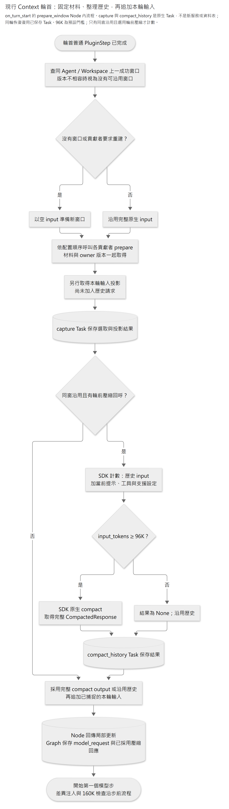
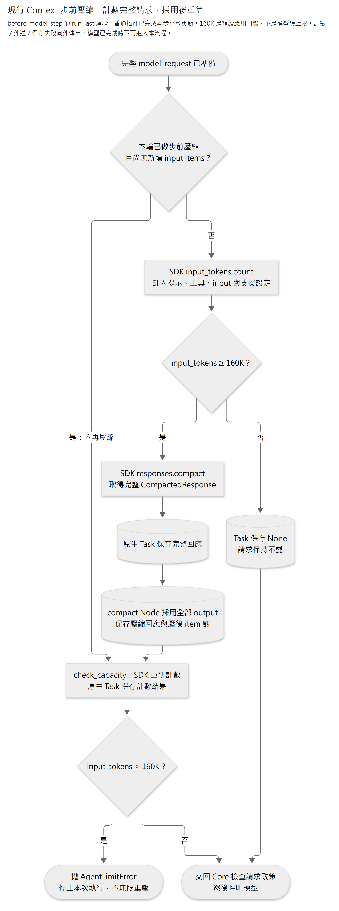

# Context Bundle

一個 Bundle 提供兩個可獨立啟用的插件：`window` 管輪前窗口準備與換窗接點；`native_compaction` 管原生壓縮，並提供可選的輪前歷史壓縮回呼。

這裡的「窗口」是送給模型的工作 `model_request.input`，可以重建或壓縮；正式訪談、JD、Plan 與 Memory 仍由各能力模組保存。先看[配置與責任](#配置與責任)，再沿[換窗接點](#換窗接點)及[原生壓縮](#原生壓縮)查執行順序與恢復邊界。

## 配置與責任

```json
{"module":"caliburn.bundles.context","plugins":["window","native_compaction"],"config":{"history_threshold_tokens":96000,"threshold_tokens":160000}}
```

`create_bundle(config)` 固定宣告兩個插件，啟停只由 `BundleConfig.plugins` 選取：省略時載入兩者，也可指定 `["window"]`、`["native_compaction"]` 或空清單。`config` 只設定輪前與步前門檻，預設分別為 96,000 與 160,000 token。啟用或改變組裝時更新 Agent `resume_version`。

| 提供者 | 責任與公開接點 |
|---|---|
| Host | 管理 SDK client／Agent，提供 `COMPACTION_CLIENT`、`PREVIOUS_WINDOW` 及來源查讀所需服務 |
| `window` | 固定本輪材料與版本，選擇沿用或重建窗口，最後接上本輪輸入 |
| `native_compaction` | 以官方 API 計數／壓縮；提供 `HISTORY_COMPACTION`，在模型步前處理完整請求 |
| 已選能力的窗口 Plugin | 透過 `WINDOW_CONTRIBUTIONS` 提供來源選取、模型投影及換窗條件；自行宣告所需業務服務 |
| Agent Core／LangGraph | 執行一般 PluginStep、保存 Task 與 State；通用查讀層投影已採用壓縮的用量 |

具體內容沿 [Interview](../interview/README.md)、[Memory](../memory/README.md)、[Plan](../plan/README.md)及 [JD](../job_description/README.md) 的窗口契約。能力未選用時不提供其材料；Context 沒有預設必備業務清單，也不負責短碼或來源資格。

## 換窗接點

已啟用的業務插件透過 `WINDOW_CONTRIBUTIONS` 服務集合提供 `WindowContribution`，依配置順序在啟動時固定。Context 使用這份集合，不維護具體業務清單。`prepare` 取得本輪 State、上一成功窗口的 State 及是否重建，回傳局部 State update；可選 `should_renew` 判斷何時重建，`prepare_input` 投影本輪 input。多個輸入投影 owner 會在啟動時拒絕。

首次沒有成功窗口必須重建；最近成功窗口的 `resume_version` 與目前 Agent 不同時也重建，不再往前搜尋更舊的同版窗口。版本相同時，任一貢獻者要求換窗就重建，否則延續完整原生 input。成功輪資格沿 Core 的 `completed_turn_id`，包含其接受的 refusal 及多個 final；取消、未完成及失敗輪不作基底。窗口版本不相容只阻止沿用窗口，不撤銷該輪的完成來源資格。

單一原生 capture task 保存窗口選擇、資料、本輪輸入投影與 owner 的版本更新；同輪恢復不重選新資料。Core 透過 `run_last` 將窗口準備放在輪首 Hook 末端，將原生壓縮及容量檢查放在模型步前 Hook 末端；服務依賴只決定啟動取得順序。



[圖源](../../../../../../docs/diagrams/bundles/context/context-window.mmd) · [放大 SVG](../../../../../../docs/diagrams/bundles/context/context-window.svg)

圖中 capture 會先取得本輪輸入投影，但此時尚未把它加入待計數的歷史請求。輪前壓縮另用一個原生 Task，最後才把其完整 output 與本輪投影合成 State update；capture 已保存與父 State 已採用是兩個不同邊界。

沒有任何貢獻者時仍可獨立運行：首次提供本輪原始 input，其後延續上一成功窗口並追加原始 input。Context 不讀 Memory、Interview、Plan 或 JD。

各業務插件自行管理貢獻內容與依賴；替換實作沿 Bundle 配置及同一公開接點組裝。B1／B2 只選用 `native_compaction`，不採顧問的換窗政策。

## 原生壓縮

啟用輪前壓縮時，先以沿用的合法歷史 input 加上當前 instructions、工具及支援設定計數，達 96,000 token 才壓縮；壓後才追加本輪 input 與來源導覽。JD 新差異在後續模型步前加入，不進輪前壓縮。即將丟棄的舊窗不先壓縮。啟用 `native_compaction` 時，每次發送模型請求前都檢查完整請求，包含新差異與工具結果加入後的續作；達 160,000 token 才壓縮。

| 時點 | 計數的請求 | 預設觸發值 |
|---|---|---:|
| 同窗新輪、追加本輪內容前 | 當前固定提示／工具與沿用歷史 | ≥ 96,000 input tokens |
| 每次模型呼叫前 | 全部 Plugin 已準備好的請求，包含本輪內容與已加入的工具結果 | ≥ 160,000 input tokens |

計數使用 `client.responses.input_tokens.count()` 的 `input_tokens`，不是歷次 usage 累加或字元估計。兩個值都是本案可配置策略；本插件主動呼叫官方 standalone `responses.compact()`，沒有啟用伺服器的 `context_management.compact_threshold`。後者可在生成中依 rendered token count 觸發，不能視為本插件送出前計數的相同時機。[官方計數 API](https://developers.openai.com/api/reference/resources/responses/subresources/input_tokens/methods/count) · [官方壓縮模式](https://developers.openai.com/api/docs/guides/compaction)



[圖源](../../../../../../docs/diagrams/bundles/context/context-compaction.mmd) · [放大 SVG](../../../../../../docs/diagrams/bundles/context/context-compaction.svg)

`window` 固定依賴 `PREVIOUS_WINDOW`、`WINDOW_CONTRIBUTIONS` 與 `HISTORY_COMPACTION`；後兩者是服務集合。`native_compaction.open_services` 取得 Host 管理的 `COMPACTION_CLIENT`，綁定輪前門檻並提供一份普通 request → `CompactedResponse | None` 回呼。`HISTORY_COMPACTION` 可為空，多個提供者會在啟動時拒絕。只選 `window` 時沒有此回呼，不計數、不壓縮，也不要求 client；只選 `native_compaction` 時不要求 `PREVIOUS_WINDOW`。

普通 `compact_request` 使用同一 OpenAI SDK client，計數包含 instructions、工具與官方支援設定；compact 只傳端點允許的欄位。方法返回 SDK `CompactedResponse` 完整原件，包含 id、usage 及額外欄位。採用時才由 `compaction_input` 取全部 output 原樣接續，含 user items、工具及不透明內容，不截取單一 encrypted item，也不重貼業務資料。SDK 隱式重試關閉。

成功 C 由原生 task 保存完整 SDK 原件，父更新採用時寫入 Core 的 `compaction_response`，不覆寫 `model_response`；此欄位由 Core 在新輪清空，輪前及步前壓縮共用，原生歷史保留每次結果。查閱及用量投影歸 Core，Context 不另建帳本。採用後再計數，仍超門檻且尚無新增 items 時明確停止，不重複 compact；新增模型／工具 items 後才可再次壓縮。已保存 C 後的父更新、計數或後續節點失敗可沿原生 checkpoint 恢復。取消中的未完成結果不採用。只有模型步確實繼續才觸發，不在 final 後補送請求。

容量處理沿上述門檻與原生壓縮。門檻須配合所用模型及 `max_output_tokens` 設定，不代表模型硬上限；Context 不另維護模型容量表、自動推算輸出預留或裁切近期訪談。壓縮後仍超門檻沿前述規則停止，計數或壓縮端點的錯誤照常傳出。

官方 standalone compact 的輸入仍須能容納於該模型的 context window；門檻檢查不能讓任意大小的首次輸入或工具結果都可成功壓縮。需要調整容量時由配置者配合模型設定，不改寫業務原件。[官方 standalone 使用條件](https://developers.openai.com/api/docs/guides/compaction#standalone-compact-endpoint)

`PREVIOUS_WINDOW` 查讀同 Agent／Workspace 的成功原生歷史；業務依賴由各貢獻者宣告，Host 提供所選插件需用的服務實例。

目前以自動門檻觸發，沒有模型主動壓縮意圖工具。取消後回上一成功窗口；不另外回收取消輪內的輪前 C，因此該舊歷史若仍達門檻，下輪會重新壓縮。沒有跨取消的 prepared-window 保存平台或跨批 B1／B2 歷史。

## 程式入口

| 檔案 | 責任 |
|---|---|
| [contracts.py](contracts.py)／[services.py](services.py) | 窗口回呼與 typed service 接點 |
| [history.py](history.py) | 沿 Agent 公開完成資格選上一成功窗口；判斷恢復版本相容性 |
| [window.py](window.py) | capture、輪前歷史壓縮與本輪輸入追加 |
| [native_plugin.py](native_plugin.py) | 模型步前壓縮、採用後重算與同窗禁止重複壓縮 |
| [request_compaction.py](request_compaction.py) | SDK 端點欄位投影、計數與完整壓縮回應；不依賴 Graph 或業務模組 |

本 Bundle 沒有自有業務表或 ER。材料與版本沿 owner 公開用例讀取，工作窗口及完整壓縮原件沿 [Agent 保存契約](../../modules/agent/README.md#postgresql-保存與恢復)進入官方 Checkpointer。
