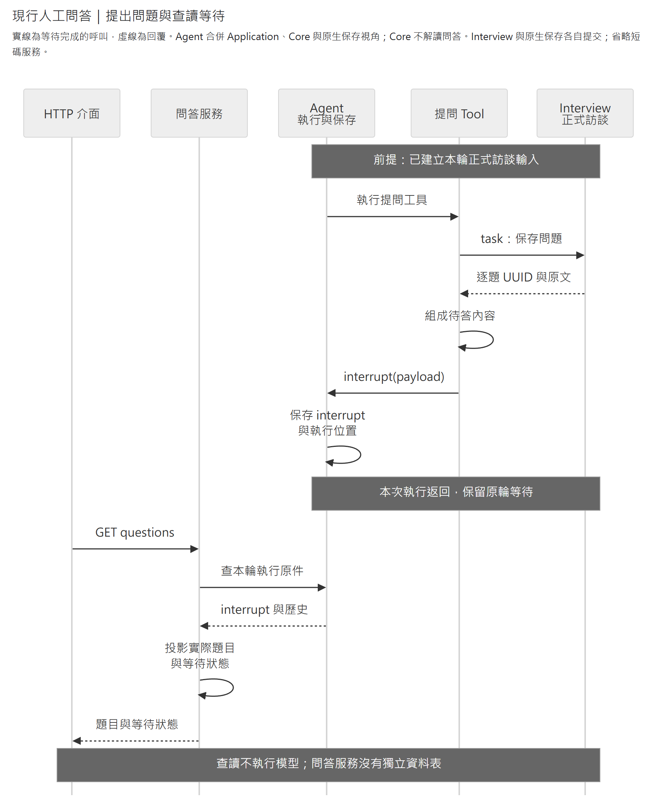
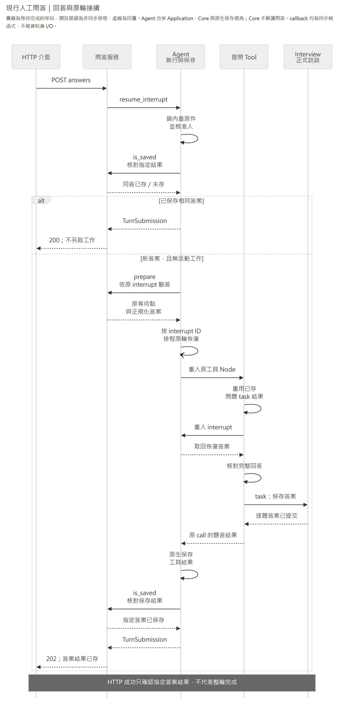

# Human Questions Bundle：提問工具接入

提供 `ask_user_question`：先保存一批問題，等待使用者選擇、自填或略過，再保存逐題答案並回到原工具呼叫。[訪談模組](../../modules/interview/README.md)擁有正式題答與單題規則；[問答互動模組](../../modules/human_questions/README.md)核對整批回答與等待資格；Agent 管通用執行、恢復及 Checkpoint。

接入先看[啟用與依賴](#啟用與依賴)，修改工具時查[模型輸入、結果與錯誤](#模型輸入結果與錯誤)，故障處理沿[保存與恢復](#保存與恢復)。

## 啟用與依賴

下列為 `bundles` 的最小提問組合；完整設定見 [agent.example.json](../../../../agent.example.json)。

```json
[
  {"module": "caliburn.bundles.interview", "plugins": ["interview"], "config": {}},
  {"module": "caliburn.bundles.human_questions", "config": {}}
]
```

[create_bundle](__init__.py)提供名為 `human_questions` 的 Plugin，目前沒有 config 鍵，未知鍵啟動拒絕；不增加 State 欄位。`plugins` 選取空陣列會停用提問插件。Host 必須綁定 `INTERVIEW_UOW_FACTORY` 與共用 `MODEL_REFERENCES`。

插件宣告 `required_plugins=("interview",)`。組裝器在選取完成後檢查依賴，缺少保存插件即拒絕啟動；只提供模組服務不能取代它。依賴檢查不重排插件，也不自動啟用依賴，可由其他 Bundle 提供同名且履行保存責任的插件。

訪談的 `record_input` 先保存本輪原輸入，提問工具才操作同一正式輪次。直接使用底層工具的呼叫端，也須先建立可信 Workspace／Turn 對應的訪談輪次；工具不代建輪次或補錄原輸入。上述最小組合只選訪談保存；Context、來源說明、`read_interview` 及導覽由[訪談 Bundle](../interview/README.md)另外選取。

## 模型輸入、結果與錯誤

工具的模型參數只有 `questions`，至少一題。每題描述題幹、標題、選項與是否複選；模型須依 strict Schema 提供所有鍵，`header` 與選項的 `description` 不使用時填 null，沒有選項時填 `options=[]`，表示自填題。選項 `label` 在同題內唯一；`multi_select=false` 時最多選一項，使用者仍可自填或略過。完整型別與驗答規則沿 Interview 的 [message_content.py](../../modules/interview/domain/models/message_content.py)，此處不另維護欄位 Schema。

模型不提供問題 UUID 或執行識別。`workspace_id`、`turn_id`、`model_step` 與 `tool_call_id` 由可信 `ToolRuntime` 提供。Interview 為每題產生 UUID；工具的 interrupt 帶每題 `message_id`、`question_ref`、完整題目／選項，以及本次 `model_step`／`call_id`。HTTP 用 `question_message_id` 回答，規則與狀態碼沿[問答模組](../../modules/human_questions/README.md#公開能力與-http)。

成功結果為 JSON 字串，`answers` 依原題順序包含實際題幹 `question`、`question_ref`、`answer_ref`、已選 label 的 `selected`，以及有提供時的 `custom`。結果不輸出題答 UUID，也不重複全部選項。兩個 ref 都是 Workspace 範圍的持久 `message_N`；另有啟用 `read_interview` 時，可沿 ref 查正式原件。短碼由[共同定位模組](../../modules/model_references/README.md)配置，不代表訪談順序或來源資格。

`selected=[]` 且 `custom` 省略／為 null 才表示明確略過；略過仍建立答案訊息，不表示同意、拒絕或授權補造內容。空字串與空白自填保留原文。正常答案回原 `function_call_output`，不另複製為 user message；wrapper 改題時，以實際保存並交付的題目為準。

[ask_user_question.py](ask_user_question.py)集中工具 docstring、Pydantic 欄位說明、Schema 接線與修正提示。`StructuredTool` 處理參數驗證及 runtime 注入；參數錯誤回「questions 無效」及最多五個欄位／陣列位置與修正方法，不回顯原始輸入或未知鍵名。未處理的資料保存／執行例外沿 Agent 故障流程，不冒充可修正的模型參數錯誤。

模型 Schema 的四個文字欄位（題幹、標題、選項名稱及說明）透過 `json_schema_extra` 移除儲存專用的 NUL／surrogate 字元 pattern，保留其餘長度與 nullable 等結構限制。原 Domain `AfterValidator` 仍在工具執行前拒絕不可儲存文字；HTTP／Domain 契約不變，此投影也不移除其他工具的格式限制。Bundle 選取入口則在 [__init__.py](__init__.py)。

## 保存與恢復

提問工具不另建 Graph、問題表、批次表或防重鍵，沿原工具 Node 的兩個 `@task` 與一次 `interrupt` 執行：

1. `record_questions` 在短交易保存正式問題，task 結果以 JSON 字串保留原題 UUID 與內容；交易返回後配置 `question_ref`。
2. `interrupt` 交付完整待答內容，原生 Checkpointer 保存等待位置；此時不持有訪談交易。
3. 原輪恢復時重用已保存的問題 task 結果，核對整批答案後，另開短交易呼叫 `record_answers`。答案 task 結果保留答案與原題 UUID，再配置 `answer_ref` 並回工具結果。

提出問題與查讀等待對應前兩步：



[SVG](../../../../../../docs/diagrams/human-questions/human-question-sequence.svg) · [圖源](../../../../../../docs/diagrams/human-questions/human-question-sequence.mmd)

回答與原輪接續對應第三步，工具須先保存答案，HTTP 才能確認指定結果：



[SVG](../../../../../../docs/diagrams/human-questions/human-answer-resume.svg) · [圖源](../../../../../../docs/diagrams/human-questions/human-answer-resume.mmd)

兩圖與問答模組共用同一份圖源；省略短碼服務與 Checkpointer 的獨立呼叫。圖只展開主要交接，完整 HTTP 錯誤與同答／版本／取消界線見[問答模組](../../modules/human_questions/README.md#成功衝突與恢復)。

短碼配置位於保存 task 外。配置失敗後，正常或冷恢復重用已保存 task 結果及 UUID，不重新保存題答。若 Interview 已提交、task 結果卻尚未持久化便崩潰，重跑仍可能新增同文但不同 UUID 的問題；既有未答原件保留，新等待點採本次成功交付的 UUID。本功能不承諾跨業務交易與 Checkpoint 的 exactly-once。原生機制見 [LangGraph Node 內 task](https://docs.langchain.com/oss/python/langgraph/graph-api#using-tasks-in-nodes)。

停用 Bundle 不移除正式訪談或既有問答查讀；新恢復須符合 Agent 的 `resume_version`。離開頁面不等於取消或略過，重開先讀既有等待點。正式取消由 Agent 停妥在途工作，再由訪談保存插件撤回本輪題答；本工具不自行裁決取消或 JD 引用資格。
