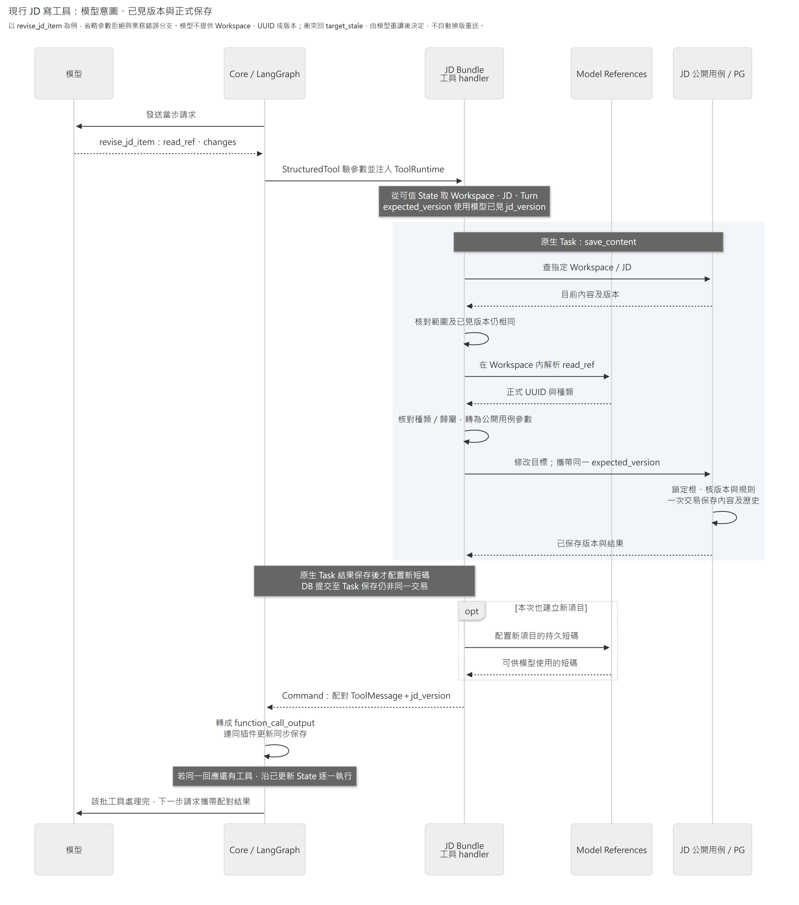

# JD Bundle

把顧問的 JD 查讀與編修意圖接到 [JD 公開用例](../../modules/job_description/README.md)。正式內容、引用資格、交易及快照屬於 JD 模組；Bundle 負責模型參數、可信執行範圍、短碼投影與輪次生命週期。

接入時先看[工具與模型定位](#工具與模型定位)及 [Host 組裝](#host-組裝)；修改提示沿 [instructions.py](instructions.py)，欄位說明沿 [write_inputs.py](write_inputs.py)與工具函式。排查已提交但回覆未保存、人工改稿或取消問題，接著看[保存流程](#寫工具保存流程)及[輪次與 Context](#輪次與-context)。Bundle 不保存第二份 JD 正文，也不讓 Core 判斷 JD 規則。

## 工具與模型定位

| 能力 | 入口 |
|---|---|
| 全量導覽、單項全文、完整 JD | [reading.py](reading.py)：`read_jd(view=map/item/full)` |
| 固定 Memory 引用兩端與來源鏈 | [source_changes.py](source_changes.py)：`read_jd_changes(query)` |
| 建立 Task 與其 O/P、K/S 關聯 | [write_tools.py](write_tools.py)：`create_jd_task` |
| 建立 Duty、K、S、協作或條件 | [write_tools.py](write_tools.py)：`create_jd_item` |
| 修改基本資訊／既有項目 | [write_tools.py](write_tools.py)：`revise_jd_profile`、`revise_jd_item` |
| 調整順序／分類或刪除 | [write_tools.py](write_tools.py)：`move_jd_item`、`delete_jd_item` |
| 讀取投影與來源展開 | [projection.py](projection.py)、[citation_reading.py](citation_reading.py) |
| 意圖轉換 | [writing.py](writing.py) |

工具不接收 Workspace、JD UUID、Turn 或版本。範圍來自可信 `ToolRuntime`，既有項目透過共用 [model_references](../../modules/model_references/README.md) 的持久短碼定位，再核對種類、JD 歸屬及當前存在性。短碼不改寫正文。來源訊息短碼供訪談讀取，不能當成 JD 項目；Memory 新引用使用本輪固定發布版的精確標題，不造另一套 Memory 短碼。

`read_jd` 成功才以同一份內容的版本更新模型已見 `jd_version`。寫工具使用這個版本，不在衝突後偷讀新版本重送。一個呼叫的本體、O/P、K/S、移動與引用操作沿一次 Application 交易；顧問作者由 adapter 注入。業務保存放在官方 LangGraph task，保存結果後才配置新項目短碼；映射失敗不是「未提交」。官方 task 已保存的結果可在恢復時沿用，不宣稱消除 DB commit 至 task 結果保存之間的空窗。

引用的 `jd_changed`、`source_changed` 及 `needs_recheck` 由 JD Application 決定。導覽只帶來源摘要，citation 單項展開原文；Memory 來源比較使用引用固定版與本輪固定版的相同 UUID／同版來源鏈。讀取不核清引用，confirm 只處理指定引用。沒有比較版時未知狀態保持 `null`，不把它當作未變更。

模型參數採 `extra=forbid` 與普通 Literal union。正式 OpenAI request 初始化後的宣告另有測試，避免將 Domain／HTTP 的 discriminated union 直接外送成不支援的 oneOf。

### 查讀、來源與回覆

`map` 列完整定位與關聯，Task 的 O/P 是數量；`item` 展開所選項目，Task 含 O/P，O/P 單項附所屬 Task；`full` 回整份結構化 JD，皆由 [projection.py](projection.py)維護。基本資訊沒有項目短碼，從 map／full 讀取，以專用 profile 工具修改。引用摘要中的 `citation_ref` 可用 item 展開原文；`message_ref` 屬訪談定位，不能直接當 JD 項目讀取。

新增來源與讀回摘要是不同格式：訪談將已提供的 `ref` 填入 `message_ref`；Memory 用本輪固定發布版已讀正文的類別與完整標題，不能把摘要 `kind=memory` 原樣當新來源。來源資格由模組核對，但「模型已讀完整正文、原文確實支持內容」是使用指引與分析品質要求，沒有另一個已讀收據或語意判定器。

| 回覆 | 模型取得什麼 | State／業務效果 |
|---|---|---|
| `read_jd` | 同份資料的 `version` 與所選內容 | 成功時更新 `jd_version`；不新增 JD 版本 |
| `read_jd_changes` | 指定 Memory 引用的 before／after、來源鏈及變動狀態 | 不更新已見 JD 版，不核清引用；比較端已刪除時 after 為 null |
| 六個寫工具 | `status`，有新增時帶 `read_ref`／`created_refs`，有關聯解除時帶計數 | 成功效果已保存；無變更回 `unchanged`。版本透過 `Command` 更新 State，不在成功 JSON 重貼全文或版號 |
| 可修正拒絕 | `status=rejected`、`code`、`message`、`next_action` | 本次未成功修改，不撤銷此前成功呼叫 |

建立的主項目由 `read_ref` 返回，其餘新增 O/P、K/S 或引用由 `created_refs` 返回；修改工具新增的項目也可出現在 `created_refs`。需要確認全文時再讀目標。錯誤代碼區分 `invalid_arguments`、`target_not_found`、`target_stale`、`name_conflict`、`source_not_available` 等可修正拒絕；欄位位置由已知參數提供，不回顯任意輸入正文或 UUID。資料庫／來源資料損毀、短碼配置失敗等技術錯誤向上傳遞，不偽裝成普通拒絕或未提交。

訪談短碼失效時，修正指引沿已讀訪談或本輪原話提供的 `ref` 填入 `message_ref`；沒有可用來源就先釐清。這個指引不要求啟用訪談讀工具，也不放寬來源資格或允許猜碼。

## 寫工具保存流程

以下以現行 `revise_jd_item` 說明模型意圖如何成為正式修改。圖中的查讀核對同一份模型已見版本；真正寫入時，JD Application 仍在交易內鎖定根並重驗版本。兩者之間若發生修改，就回 `target_stale`，由模型重新讀取後決定，不換成最新版自動重送。



[圖源](../../../../../../docs/diagrams/bundles/job-description/tool-execution.mmd) · [放大 SVG](../../../../../../docs/diagrams/bundles/job-description/tool-execution.svg)

[write_tools.py](write_tools.py) 的 `save_content` Task 包住範圍查讀、短碼解析與公開寫入用例，保存結果後才為新項目配置短碼。這些短碼配置若失敗，正常恢復可復用已保存結果；業務提交到 Task 結果保存之間的故障仍可能重做。handler 最後回傳配對的工具訊息及 `jd_version`，由 [Agent 的逐工具流程](../../modules/agent/README.md#工具執行) 一併保存到工作 State，才進入下一個工具或模型步。

## 輪次與 Context

[initialization.py](initialization.py) 固定本輪 JD 與輪前版，以及上一成功顧問完成版（無則初始 v1）。[turn_changes.py](turn_changes.py) 從兩個固定歷史快照提供人工淨差異，含內容、排序、歸屬、K/S 及引用狀態。取消不推進成功基準；完成時記錄模型已見版，無已見版則保留固定輪前版，不在完成當下讀取資料庫最新版本。

| 保存的版本 | 用途與更新時機 |
|---|---|
| `jd_turn_start_version` | 輪首 capture 固定目前版；取消與完成輪比較的輪前端點 |
| `jd_manual_before_version` | 上一成功完成版，無則 v1；人工淨差異的起點 |
| `jd_version` | 模型已見版；由窗口提供／沿用、非空人工差異注入或成功讀寫更新 |
| `jd_completed_version` | 成功收尾固定已見版，無則輪前版；不隨後續人工改稿漂移 |

`jd_turn_id` 與 `jd_id` 固定本輪參與標記及 JD 身分。capture 的原生 Task 結果可供原輪恢復使用，以上 State 只保存座標，不備份正文；正文及任意歷史版沿 JD 模組查讀。

人的完成輪比較沿 [turn_history.py](turn_history.py) 的 `project_completed_turn`：Host 先用 Agent 公開歷史核對指定輪最新保存點的正常完成資格與範圍，再由 Bundle 投影自己的 `jd_turn_id`、`jd_id`、`jd_turn_start_version`、`jd_completed_version` 給 JD 公開查讀。`jd_turn_id` 缺失或不屬指定輪表示本輪沒有 JD 參與紀錄，回未找到；本輪標記存在但端點缺失／無效才明示資料錯誤，不借用其他基底。此投影不提供整輪 Undo，也不把原生 checkpoint 暴露給 HTTP。

有已見版時，完成版可能比輪前版舊：延續窗口且人工改回相同內容時，沒有淨差異訊息，也不推進已見版。沒有已見版時的輪前端點不代表模型讀過全文。人的查讀保留這組真實端點，兩端各自須為正整數，不額外規定版號先後。

[context.py](context.py) 是可選窗口 contributor。重建窗口提供 JD 導覽、來源摘要與一致版本，延續窗口保留原已見版；它不改取消基準。沒有 JD 時明示空缺，Bundle 不負責新建工作區或 JD。

[cancellation.py](cancellation.py) 沿原 capture 呼叫公開 `restore_turn_changes`。Host 先收束本輪在途工作，且即使關閉 JD 工具仍須保留這個取消接縫。無修改及已取消重入不增版；人工交錯或後續修改會拒絕覆蓋。

## Host 組裝

`create_bundle` 提供下列獨立 Plugin。啟停由 Agent 的 Bundle 設定 `plugins` 名單選取；省略選全部、`[]` 全關、未知名稱啟動拒絕。選取保留 factory 順序；必要同伴只驗證，不會自動啟用。

| Plugin | 責任 | 必要 Plugin | 服務依賴 |
|---|---|---|---|
| `job_description` | 輪前範圍、已見／完成版、State、取消 | 無 | `JD_QUERIES`、`JD_UOW_FACTORY`、`JD_PREVIOUS_COMPLETED` |
| `job_description_tools` | 2 讀取及 6 編修工具 | `job_description` | `JD_QUERIES`、`JD_UOW_FACTORY`、`JD_REFERENCES`、`JD_MEMORY_QUERIES`、`JD_CITATION_SOURCES` |
| `job_description_changes` | 人工淨差異注入 | `job_description` | `JD_HISTORY_QUERIES`、`JD_REFERENCES`、`JD_MEMORY_QUERIES`、`JD_CITATION_SOURCES` |
| `job_description_prompt` | [JD 使用指引](instructions.py) | `job_description_tools` | 無 |
| `job_description_context` | 窗口 JD 導覽及同版號 | `job_description` | `JD_QUERIES`、`JD_REFERENCES`、`JD_MEMORY_QUERIES`、`JD_CITATION_SOURCES` |

例如沿用工具但改用另一個 Prompt Bundle，可選：

```json
{
  "module": "caliburn.bundles.job_description",
  "plugins": ["job_description", "job_description_tools", "job_description_changes", "job_description_context"]
}
```

替代 Prompt 自行宣告其必要工具 Plugin。沒有選窗口 Plugin 時，工具仍可透過 `read_jd` 取得內容及已見版；沒有先讀到版號就不能寫入。

重新啟用 `job_description_changes` 不保證補發停用期間已跨過的人工差異。完整 JD 仍可用工具讀取，正式版本歷史也可獨立查閱；完成版沿既有「已見版，無則輪前版」契約，不另外保存跨停用追補基準。

[services.py](services.py) 的 `JD_PREVIOUS_COMPLETED` 包裝 Agent 公開的上一成功完成輪查詢；其餘依賴對應 JD、Memory 與模型定位模組的公開契約。服務資格仍在啟動時檢查。

`job_description_context` 向 Context 的 `WINDOW_CONTRIBUTIONS` 提供一個 `WindowContribution`。它宣告 callback 所需服務，由已選的窗口 Plugin 統一消費，Host 不逐個辨識業務 Bundle。本輪 Memory 發布版沿可信 `memory_published_version` channel；缺少時不以最新發布版替代。換 Memory 分析 Bundle 若仍履行 Memory 模組的公開發布契約，JD 不需改用其私有資料；完全不同來源格式仍須先定義引用契約，不能假裝成既有 Memory 引用。

人工 JD、來源、歷史與 PDF HTTP 路徑獨立於此 Bundle，關閉顧問能力不應移除人工查讀。Host 依實際選取的 Plugin 保留未結輪所需取消及 State，不能只看 Bundle 是否出現在設定中，也不因此帶回停用的工具／Prompt。完整 App 的原子建立由 [Workspace Application](../../modules/workspace/application/lifecycle.py)編排，Host 提供初始化交易與服務生命週期。
