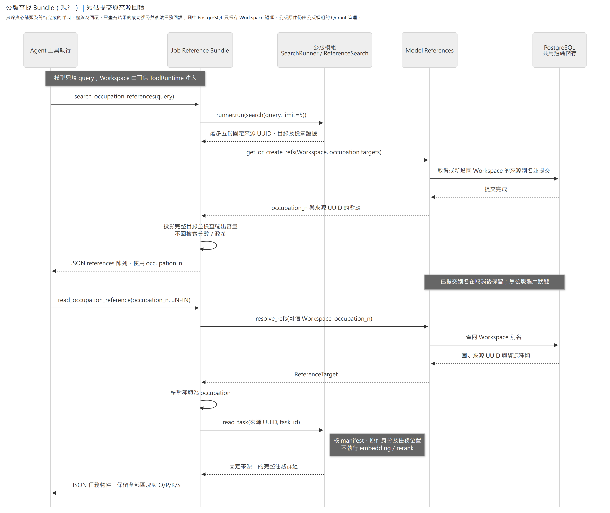

# 公版查找 Bundle

讓模型按需搜尋公版及讀取固定來源。模型提示、參數與結果投影由本 Bundle 管理；來源、索引、檢索及本機模型仍由 [occupation_reference](../../modules/occupation_reference/README.md) 管理。

公版只提供訪談查漏方向，不能直接當作員工事實或 JD 引用來源。先取得員工已確認的主要工作，再利用公版目錄補查工作廣度、按缺口讀任務細節；不把全部公版條目變成必問清單。查無結果或服務暫時不可用時，訪談仍可繼續。這些方法由 [instructions.py](instructions.py) 提供，工具及欄位的正式說明由 [descriptions.py](descriptions.py) 提供。

## 啟用與依賴

在 Agent 配置加入：

```json
{"module":"caliburn.bundles.job_reference","config":{"max_result_characters":1000000}}
```

`max_result_characters` 可省略，預設 1,000,000，必須為正整數。完整 JSON 超量回 `read_limit_exceeded`，不截斷目錄或任務。配置只接受這一欄。

後端啟動必須依[公版模組配置](../../modules/occupation_reference/README.md#明示配置與本機模型)設定 `CALIBURN_REBUILD_REFERENCE_CONFIG`，備妥相容索引與本機權重。公版資源隨後端生命週期管理；工具仍由 Bundle 配置獨立啟停。

Host 綁定 [services.py](services.py) 的 `REFERENCE_SEARCH`（模組公開 `ReferenceSearch`）、`REFERENCE_RUNNER`（公開 `SearchRunner`）及 `REFERENCE_IDS`（共用 `ModelReferences`）。Bundle 不建立模型、Qdrant client、worker 或短碼儲存。搜尋共用 Host 的有界執行席位；取消仍等待真正推論收束，資源關閉由 Host 負責。一般來源讀取及短碼操作在線程執行，不阻塞事件迴圈；讀取不載入 embedding／reranker。

`create_bundle` 提供名為 `job_reference` 的單一 Plugin，攜帶提示與兩個工具；啟停顆粒度是這個 Plugin。它只依賴三個具名服務，不依賴特定 Interview、JD 或 Memory Bundle；服務缺漏由組裝時的 required-services 檢查拒絕。

## 模型可見契約

| 工具 | 模型參數與結果 |
|---|---|
| `search_occupation_references` | 只填 `query`，保留原文，非空且最多 12,000 字元。固定最多五份完整已解析任務目錄；不回相似度或檢索政策。 |
| `read_occupation_reference` | `reference_id` 為已提供的 `occupation_<正整數>` 短碼，與 `task_id` 都必填；`task_id=null` 直接回整份目錄，指定來源內定位則回完整任務群組及 O/P/K/S。 |

工具 Schema 拒絕額外欄位，`ToolRuntime` 與 Workspace 不屬於模型參數。搜尋回 `{"references":[...]}`；讀目錄直接回一個公版物件，讀任務直接回一個任務物件。目錄列出全部已解析任務群組，任務內容保留全部名稱、多個職能區塊、原件級別及 O/P/K/S（工作產出／行為指標／知識／技能）；null 和空陣列不補造為已知值，職能級別不是員工評分。

模型回傳沿模組同一清洗規則整理正文：接合排版斷行、移除結構編號與重複前綴，保留原文、數字、限制及註號。目錄另含職業分類 `category`、整體級別 `ocs_level`、工作態度 `attitudes`；目錄與任務皆帶回同份來源完整 `notes`（先決條件與補充註解），不推測每則註解只適用於哪項任務。缺漏內容不補造，未知級別保留 null。

`reference_id`、`source_sha256`、`source_file`、`ocs_code` 與任務／單元座標維持原定位；正文的 name／text 條目不再附結構 code。這是供模型查漏的清洗投影，不是完整原文件，也不等同索引的整份清洗 JSON。模組仍保存原始 UTF-8；HTTP 維持其原始來源欄位投影。搜尋分數及檢索政策保留於模組／HTTP，Bundle 不將其交給模型。

## 短碼提交與來源回讀

下圖只畫有結果的成功搜尋及後續任務回讀；公版模組內部的 D/T 檢索沿模組流程圖，錯誤與取消沿下方說明。



[放大 SVG](../../../../../../docs/diagrams/occupation-reference/tool-read-sequence.svg) · [圖源](../../../../../../docs/diagrams/occupation-reference/tool-read-sequence.mmd)

搜尋批次取得本 Workspace 的公版短碼，提交完成後才將結果交給模型。Workspace 從可信 `ToolRuntime.state` 取得，模型不能指定。讀取先經共用服務解析短碼，再核對種類並呼叫公版模組；不接受 UUID 捷徑。格式不符（含其他種類前綴或 UUID）先回 `invalid_arguments`；格式合法的 `occupation_<n>` 若未知、跨 Workspace 或解析種類不符，才回 `invalid_reference`，提供核對／搜尋指引。

公版模組與 HTTP 仍使用固定來源 UUID，來源全域共用；只有模型別名依 Workspace 保存。同一 Workspace 的相同來源維持同碼，取消不回收；停用 Bundle 不刪別名，Workspace 整份刪除由共用服務的資料表約束清理。文件內 `uN-tN` 任務座標與官方代碼不另外配號；來源失效不能以同名新版替代。

公版可直接查找及讀取，不提供選用、否認保存或業務取消接點；沒有 Bundle 自有 map、業務 State 或初始化 Hook。工具保留完整目錄與任務群組的查讀方式，模型定位使用共用短碼；模型可見契約由本 Bundle 的 Schema、說明及行為測試維護。

## 取消、恢復與失敗

「唯讀」指不修改公版來源或員工業務資料；搜尋可能新建共用短碼。別名一旦提交，即使稍後取消或工具輸出超量，也不回收或把序號重新分配。Bundle 不保存選用狀態，也不負責撤回來源；搜尋取消的實際運算收束由公版 worker 處理。

已知輸入、來源、索引或依賴錯誤回安全的 `status/code/message/next_action`；未知錯誤沿正式失敗路徑傳遞，不能當空候選。工具結果沿 Agent 既有模型請求及 Checkpoint 保存。停用 Bundle 不影響公版 HTTP、來源或索引維護。

已啟用此 Bundle 的部署在切換工具回傳形狀時，須將其 Agent 配置的 `resume_version` 改為新的恢復契約版本，再重啟載入；未完成輪次不能沿舊版本直接套用新工具。不使用此 Bundle 的配置不因本 Bundle 變更而自動改版。

只有成功搜尋的空 `references` 表示本次沒有候選；`read_limit_exceeded`、索引不相容與服務不可用都不等於空結果或已讀。具體錯誤映射及不截斷規則沿 [errors.py](errors.py)。恢復使用 Agent 已保存的工具輸出及既有短碼；沒有保存完成的工具呼叫是否重做由 Agent 決定，本 Bundle 不提供 exactly-once 保證或公版專用恢復流程。
