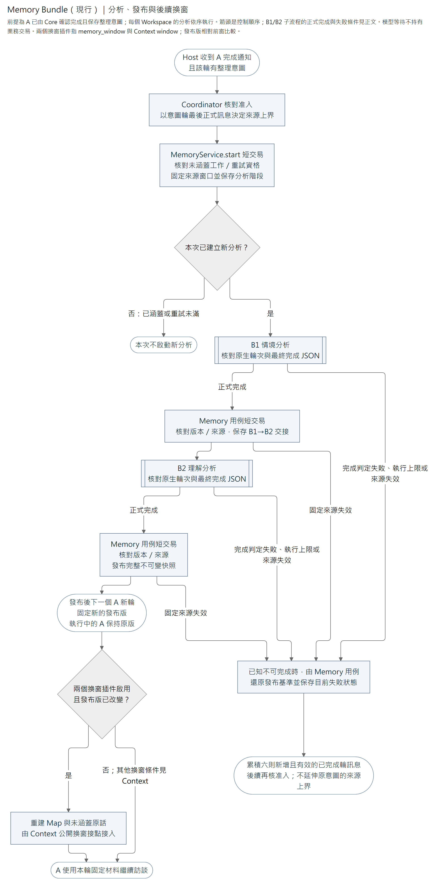

# Memory Bundle

Memory Bundle 將顧問 A 的查讀與整理意圖、B1 情境分析、B2 理解分析接到 [Memory 模組](../../modules/memory/README.md)。Bundle 擁有模型提示、工具與分析協調；Memory 模組擁有資料一致性及發布，Agent Core 擁有模型／工具迴圈與 Checkpoint，Host 擁有背景任務生命週期。

在顧問 Agent 的 `bundles` 設定加入 `{"module":"caliburn.bundles.memory"}`，由 `plugins` 名單明選能力；省略名單選全部，`[]` 全關。收集新訪談時另選 Interview 的保存 Plugin。變更組裝或提示時更新 Agent 的 `resume_version`。可停用 Memory Plugin 並沿公開 Memory API 讀既有資料。

換窗與原生壓縮由獨立的 [Context Bundle](../context/README.md) 提供。`memory_window` 透過公開 `WINDOW_CONTRIBUTIONS` 集合提供發布版判斷、Map、未涵蓋原話及本輪來源投影。發布版改變時要求重建材料；同版不因 Memory 版本要求重建，其他 Context 條件仍可觸發換窗。Context 不辨識 Memory Bundle 的模組名稱。缺少 Interview 保存 Plugin 時仍可查既有 Memory，沒有本輪來源就保留原始 input，不虛構整理資格。未選 Context 時窗口回呼不執行，既有工具照常。

| 要修改的責任 | 程式入口 |
|---|---|
| 角色與 Plugin 組裝、必要依賴 | [Bundle 入口](__init__.py) |
| A 固定發布版、B1／B2 起始材料與提示 | [Initialization](initialization.py)、[B1 提示](situation_instructions.py)、[B2 提示](understanding_instructions.py) |
| 模型參數、查讀、編修及回傳 | [Tool contracts](tool_contracts.py)、[Reads](reads.py)、[Writes](writes.py)、[Tool output](tool_output.py) |
| 完成判定、階段接續與角色組裝 | [Completion](completion.py)、[Coordinator](coordinator.py)、[Factory](factory.py) |
| 選用的換窗材料 | [Window](window.py) |
| 完成後通知、重新發現工作與關閉 | [Host 的 Memory 接線](../../host/memory.py) |

## Plugin 選用

| Plugin | 能力與必要依賴 |
| --- | --- |
| `memory_context` | 輪首固定發布版、合法訪談範圍及整理意圖，提供訪談導覽；需要 Memory／Interview 查讀、已完成輪證據與共用短碼。 |
| `memory_prompt` | 顧問 Memory 提示；沒有 DB 服務、工具或背景工作。 |
| `memory_read` | 兩層 Map／正文與 `read_interview`；需要 `memory_context`、查讀及短碼服務。 |
| `memory_consolidation` | 整理要求工具與背景 coordinator factory；需要 `memory_context`。未選時不啟動背景整理。 |
| `memory_window` | 選用的窗口回呼；需要 `memory_context` 及回呼使用的查讀／短碼服務。 |
| `memory_situation_context`／`memory_understanding_context` | B1／B2 固定分析材料；需要 Memory 查讀與共用短碼。 |
| `memory_situation_prompt`／`memory_understanding_prompt` | B1／B2 靜態角色提示，無業務服務。 |
| `memory_situation_tools`／`memory_understanding_tools` | 對應角色的查讀／寫入工具；需要 Memory 查讀、寫入用例及短碼服務，執行時驗分析資格與階段。 |

顧問角色為預設，B1／B2 由 `config.role` 選 `situation`／`understanding`，再以 `plugins` 名單選該角色能力。Plugin 選取由共用載入器處理，缺必要 Plugin 於啟動拒絕，不自動啟用。替換 Prompt 時只排除原 Prompt Plugin，保留資料資格與工具，再加入候選提示 Bundle。

同時選 Memory 與 Interview 時須明示避免重複 `read_interview`：由 `memory_read` 提供則不選 `interview_read`。選 `memory_window` 作輸入投影時，不再選另一個 Interview 窗口提供者，並排除不需要的 standalone 預載／導覽。Host 不會偷偷關掉另一個 Bundle 的能力。

## 角色與工具

| 角色 | 起始資料 | 工具權限 |
| --- | --- | --- |
| 顧問 A | 固定當輪 Memory 發布版，尚未發布時固定為空 | 讀兩層 Map、正文及同 Workspace 有效正式訪談，包含同輪新增問題／答案。已知資訊足以形成有用情境時，用 `request_memory_consolidation` 傳 `{}` 登記，可繼續訪談。 |
| 情境分析師 B1 | 完整必處理原話與情境 Map | 讀寫情境及按需查固定範圍內訪談。已撤回的既有來源仍可用同一 ref 解除關係，不能讀正文或重新新增。 |
| 理解分析師 B2 | 兩層 Map 與固定基準到 B1 交接的情境差異 | 讀情境及合法訪談，讀寫理解。理解的正式來源只選情境。 |

Map 只提供精確標題與描述，正文和來源按需讀取。工具只接受公開參數。Workspace、版號與分析階段由執行環境提供。A／B1／B2 共用持久 `message_*` 引用；數字不代表訪談順序，正式關聯仍為 Interview message UUID。模型定位服務由 Host 注入同一實例，Memory 使用 Interview 的 `MODEL_REFERENCES` key；B 角色工廠接收 `references`。不在 State 配號或改寫正文中的字串。

導覽中的 `target_title` 是查讀及編修的精確標題，讀回的 `title` 是同一目標。情境來源使用 `message_*`；理解來源使用情境標題，保存時解析為同 Workspace 的情境 UUID。`memory_navigation` 與 B 起始材料中的 Map 均是工具對應的導覽，`description` 不能取代正文。B2 的 `work_situation_changes` 是發布基準到 B1 交接的展示差異；受影響理解是優先複核對象，不要求機械式重寫。

`read_interview` 沿 Interview 唯一工具工廠。A 使用目前有效訪談；B 先驗分析資格及整份固定來源，再選取明列 ref 或依正式訪談順序的區間。任一固定來源失效，要求其他有效子集也整次拒絕。

工作稿正文使用 V4A 局部編修，回傳差異顯示實際套用效果；更新結果為 `applied_changes`，引用差異為 `added`／`removed`，輸入仍用 `changes`、`add`／`remove`。正文上限 2,000,000 字元，diff 上限 64,000 字元、128 個 hunk。顧問工具可設 `max_tool_result_characters`，預設 1,000,000。分析工具回傳及完整起始 context 的預設上限同為 1,000,000 字元，由可信角色工廠配置。超量讀取回拒絕，超量寫入效果在保存前拒絕。

參數格式拒絕指出公開頂層欄位與陣列索引，例如 `changes[0]`；不回顯輸入或 union 內部型別。展示 diff 描述實際結果，不能直接當成下一次 V4A 輸入。

## 完成與恢復

[放大 SVG](../../../../../../docs/diagrams/bundles/memory/consolidation-flow.svg) · [圖源](../../../../../../docs/diagrams/bundles/memory/consolidation-flow.mmd)

本圖呈現新分析的正常路徑與已知無法完成的結算。`MemoryService.start` 先在根鎖所在短交易核對資格，保存 `analysis_id`、`situation` 階段及固定來源窗口，再啟 B1；模型等待不持有業務交易。B1／B2 子流程沿[Coordinator](coordinator.py)與[完成判定](completion.py)，各自保存原生角色輪次；每個角色須有 Core 的本輪完成證據，且單一完整最終文字解析為 `{"status":"complete"}`，才可交接或發布。圖中換窗是啟用對應插件後的後續行為；A 不等待背景發布，進行中的 A 輪也不改版。

`request_memory_consolidation` 只保存本輪的布林整理意圖。A 完成資格沿 Core 的 `completed_turn_id`，其合法 refusal 或多個 final 同樣是已完成輪；不套用 B 的嚴格 JSON 交付規則。Host 在 A 成功完成後才准入，沿該意圖輪最後一則正式訊息固定上界，包含要求之後保存的問題、回答、略過及顧問最終發話。未完成或取消輪不准入；後來的新輪不會擴大已固定的 B 來源窗口。重啟沿同一分析窗口接續，不改用 Workspace 最新訊息。

同一 Workspace 的分析在單一 Host worker 內依序執行。已交接者直接續 B2；較新的整理要求先接續既有分析，再核對新要求。分析達到 Agent 執行上限、最終輸出格式無效或固定訪談窗口確定失效時，系統放棄工作稿並保留原發布版。傳輸、儲存與其他暫時故障不會一律放棄；接續依已保存分析階段及原生 Checkpoint。Host 記錄例外，由後續完成通知或啟動時的 `recover` 重新發現工作，沒有自動定時重試。

失敗後新增六則已完成輪次的正式訪談訊息，才可重開合格的未涵蓋意圖；計入員工輸入、正式問題、回答／略過及顧問最終發話。略過仍為答案訊息，投影為「略過」，不表示同意或已有事實。只有保存但尚未完成的輪次、取消輪及工具／執行紀錄不計入。補足重試資格不會把原整理意圖的來源上界延伸到後來輪次。

編修先核對正文與輸出容量，再直接呼叫 Memory 用例。Agent 的原生 Checkpoint 保存工具進度。B2 到達終點後，以當前根版本與分析 ID 發布。整理重入依目前階段接續，已涵蓋的訪談略過。PostgreSQL 在寫入時核對版本及分析資格。提交確認遺失時，儲存錯誤沿既有路徑回報。

`memory_consolidation` 提供公開 `MEMORY_COORDINATOR_FACTORY`。Host 依選後的服務宣告取得 factory，注入同一 SDK client、Checkpointer 與模組公開依賴；Host 保留完成後通知、恢復、Workspace 暫停及關閉責任，不把背景分析移到 A 尚未完成的 Hook。

替代 Bundle 可透過 `create_coordinator_factory(situation_bundles=..., understanding_bundles=...)` 提供同一契約，明示各角色的完整 Bundle／Plugin 組裝，無須修改 Core、Context 或 Host 模組名稱清單。內建 factory 為 B1／B2 明列對應 Memory 角色與 Context 的 `native_compaction`，保留預設 160,000 token 壓縮，不反查 A 的 Bundle 配置。需要不同提示或壓縮設定時，明示完整角色組裝。`open_memory_role_agent(..., bundles=...)` 是同一路徑的低階工廠；各角色仍有自己的原生 thread。

`completed_memory_request(snapshot)` 回傳已完成且有意圖的 Turn UUID；來源訊息 UUID 由 Coordinator 完成後經注入的 `interview_queries` 查得，兩者不可混用。State 欄位為 `memory_consolidation_requested`，變更後須更新 `resume_version`，不保留舊上界欄位相容層。

[Memory 模組責任與公開查讀](../../modules/memory/README.md)
