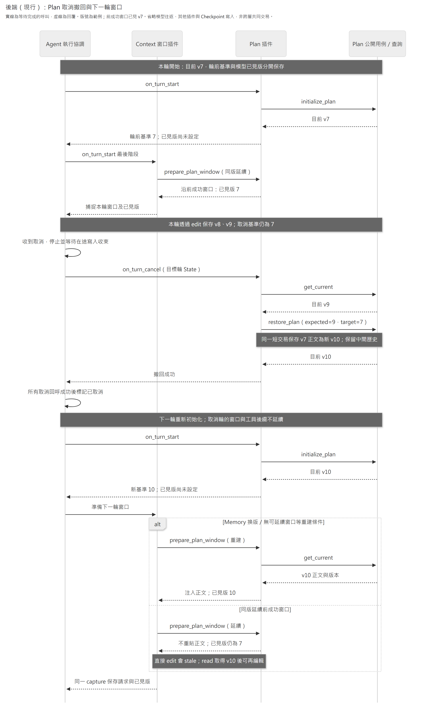

# Plan Bundle

讓 Agent 讀取、編修目前 Workspace 的工作計畫。Bundle 組合可獨立選取的工具、提示、Context 貢獻與輪次流程 Plugin；正文、歷史、原子 patch 與儲存規則仍由 [Plan 模組](../../modules/plan/README.md)負責。

依問題閱讀：[安裝與依賴](#安裝與依賴) · [模型與 State](#模型與-state) · [自動注入與跨輪窗口](#自動注入與跨輪窗口) · [保存與限制](#保存與限制) · [取消後接續](#取消後接續)。

## 安裝與依賴

在 Agent 設定的 `bundles` 加入：

```json
{"module": "caliburn.bundles.plan", "config": {}}
```

[create_bundle](./__init__.py) 回傳下列固定 Plugin。選取由共用 `BundleConfig.plugins`／JSON `plugins` 處理：省略選全部、`[]` 全關、名稱清單只選明列項目；清單不改 factory 宣告順序。Plan 的 `config` 只接受空物件，不能用另一套布林選取規則。Agent 啟動及配置方式見 [Agent README](../../modules/agent/README.md#明示設定)。

| Plugin | 責任 | 必要 Plugin | 必要服務 |
|---|---|---|---|
| `plan_tools` | read／edit 工具及模型錯誤投影 | `plan_lifecycle` | Plan queries、UoW |
| `plan_lifecycle` | 初始化輪前基準／已見版本、State、取消恢復 | 無 | Plan queries、UoW |
| `plan_prompt` | 現行工作安排提示 | `plan_tools` | 無 |
| `plan_context` | 提供窗口正文／已見版回呼 | `plan_lifecycle` | Plan queries |

缺必要 Plugin 時啟動拒絕，不自動啟用。原提示要求更新保存的計畫，故依賴工具；只替換 Prompt 時，明選工具與輪次流程，再安裝另一個 Prompt Plugin。例如保留自動窗口資料、關閉原提示：

```json
{"module": "caliburn.bundles.plan", "plugins": ["plan_tools", "plan_lifecycle", "plan_context"]}
```

`plan_context` 只提供資料回呼，窗口策略由選用的消費 Plugin 決定，不會自動啟用 Context Bundle。關閉工具或整個 Bundle 不清除已存內容；正式 Host 仍保留必要取消回呼及其依賴，已開始的輪次可完成撤回。唯讀 HTTP 不依賴 Agent 的插件選取。

Host 按選用能力提供 [services.py](services.py) 的公開服務識別：

- `PLAN_QUERIES`：Plan 公開 `PlanQueries` 查詢實作。
- `PLAN_UOW_FACTORY`：建立 `PlanUnitOfWork` 的 callable。

正式 Host 供應這兩項依賴；直接使用 `open_agent` 時，透過 `external_services` 傳入各 key 的 `bind(...)` 結果。缺少依賴會在啟動時拒絕。Bundle 不建立連線、不持有目前 Workspace，也沒有轉呼叫用的 Plan Service。

## 模型與 State

[工具宣告](tools.py)提供 `read_interview_plan` 與 `edit_interview_plan`，模型分別傳空物件與正文 V4A `diff`。參數限制與範例由同一工具 schema 產生；Workspace、版本及 call ID 不在模型參數中。[工作安排提示](planning_instructions.py)保留已採用的訪談接續方法。

Plan 記錄工作方向、處理位置、重要未知與返回條件，供顧問安排下一步；它不是職務事實來源，不能取代 Interview 原話或作為 JD／Memory 的來源依據。正文中的短碼是一般 Markdown，Plan 不產生、解析或驗證引用。

工作安排提示要求更新方向前，對照原計畫、本輪資訊與成功操作結果：已答問題、待編修工作、具體未知與返回條件分別更新；已完成或已釐清的內容也隨之調整。這是模型的工作方法，不是 Domain 對 Markdown 內容的語意驗證。

預載 `consultant_interview_plan` 的 `plan`、read 讀回的 `plan` 與 edit 修改的是同一份工作計畫。投影與查讀描述觀察當時的正文；`null` 表示尚無正文，空字串表示空正文，兩者都不表示沒有未完工作。這些能力語意隨 `plan_tools` 的工具說明提供，不依賴可替換的工作安排提示。

輪前 Hook 經 `initialize_plan` 建立或取得目前 Plan，將 `plan_turn_id` 與版本 `plan_turn_start_version` 一起保存，並先把 `plan_version` 設為 `None`。前兩者標定本輪取消恢復基準；後者表示模型窗口已見、或成功 read／edit 後取得的版本。欄位由 [PlanState](state.py) 宣告，沒有另一份可編輯正文。

成功查讀回完整正文並更新已見版本；已有窗口提供的正文及版本時可直接 edit。修改回 `updated` 表示本次內容已保存，回傳實際 unified diff；`unchanged` 表示正文未變，兩者都採用 Plan 用例回傳的版本。模型依成功修改後內容接續與回報；需要完整目前正文時再 read。回傳的 unified diff 是變更結果，不能原樣作下一次 V4A 輸入。工具結果與版本以配對 `ToolMessage` 的 `Command` 同步交給 Graph 保存，下一個工具可接續使用。

未取得可供編輯的版本時回 `source_not_available`，版本或並行衝突回 `target_stale` 並要求重讀，不自動換版重套。patch 格式、定位及容量拒絕提供修正提示；正文、Workspace 與內部版本不出現在錯誤訊息。查詢、資料完整性及保存故障向外傳遞，不偽裝成空計畫或可放心重試的工具拒絕。

## 自動注入與跨輪窗口

[context.py](context.py) 提供兩個普通公開方法：`project_plan_context(PlanView)` 由同一份查詢結果產生模型資料與版本；`prepare_plan_window(...)` 在重建時讀取並附加該投影，延續時帶回前成功窗口的已見版本。模型資料固定為 user-role 的 `{data_kind: "consultant_interview_plan", plan: ...}`；null 與空字串都保留，不把正文加入 instructions。

由 [Context Bundle](../context/README.md)的窗口插件負責調度：首次或 Memory 換版重建時注入 Plan 正文並綁定同版；同版延續合法窗口，native compact 後不重貼。`plan_context` 透過 [Context 公開契約](../context/contracts.py)的 `WindowContribution`，在啟動時提供 [WINDOW_CONTRIBUTIONS](../context/services.py) 固定集合；依賴僅在該 Plugin 宣告。選用的窗口以同一 capture 保存投影、版本及請求，Plan 不另建注入節點，也不提供本輪輸入回呼。Host 不以 Plan Bundle 名稱插入投影；未啟用換窗時仍可透過 read／edit 工作，Core 不知道業務內容。

變更影響窗口內容的 Plugin 組裝或 Prompt 時，沿 Host 契約更新 `resume_version`，讓同一 Workspace 的下一輪重建窗口。

新輪目前 Plan 較新時，也不能把其版本冒充為延續窗口已見版本。

## 保存與限制

同步查詢在 worker 執行；初始化及修改使用原生同步 `@task`，結果僅含可序列化內建值。已完成 Task 的結果可供原輪恢復使用；新輪才重新初始化版本。此接線沿 [LangGraph Node 內 Task](https://docs.langchain.com/oss/python/langgraph/graph-api#using-tasks-in-nodes)，工具更新沿 [ToolRuntime 與 Command](https://docs.langchain.com/oss/python/langchain/tools#short-term-memory-state)。

業務提交與 Checkpoint 並非同一交易。若有實質修改且已增版提交、Task 結果尚未保存就故障，恢復仍帶原 expected version，會拒絕 stale，不能再增一版或猜測原操作成功。no-op 沒有增版，若目前版本仍相同，恢復可再次回 unchanged；不承諾跨兩個交易 exactly-once。

## 取消後接續

下圖以「前成功窗口已見 v7，本輪改到 v9，取消恢復為 v10」說明兩種版本的用途。省略模型往返、其他插件回呼及各次 Checkpoint 寫入；業務提交與 Checkpoint 的限制沿上節。圖中的 Plan 插件涵蓋 lifecycle、tools 與 context 回呼，Core 只執行通用接點。



[放大 SVG](../../../../../../docs/diagrams/plan/plan-agent-lifecycle.svg) · [圖源](../../../../../../docs/diagrams/plan/plan-agent-lifecycle.mmd)

Agent 停止並等待本輪寫入收束後，透過 [取消回呼](cancellation.py) 恢復輪前內容。只有 `plan_turn_id` 對上可信目標輪才使用基準；初始化前沒有本輪基準時不恢復。回呼重新查目前版本作 `restore_plan` 的前置條件，不使用可能落後已提交修改的 `plan_version`。相同內容恢復不增版，因此回呼可重試；查詢、恢復及並行版本衝突向上傳遞，不能假稱取消完成。

下一輪重新讀取恢復後的目前版本作取消基準。換窗若重建，就注入恢復後的正文／版本；若同版延續，則保留前成功窗口已見版，必要時沿 stale→read 取得恢復後的新版本。取消輪的窗口與工具後綴不延續。原輪故障恢復則沿已保存投影及版本，不重新查目前內容。

本 Bundle 不提供模型 restore 工具、Plan HTTP 寫入、Memory 或 JD 工具。驗證命令沿[後端 README](../../../../README.md#安裝與檢查)，跨交易與恢復使用真 PostgreSQL；離線合成模型測試不代表訪談品質提升。
