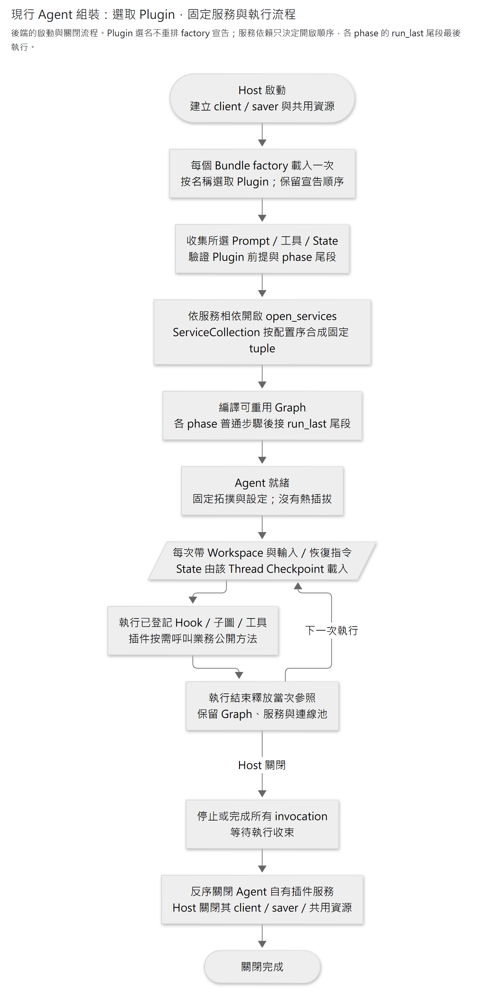
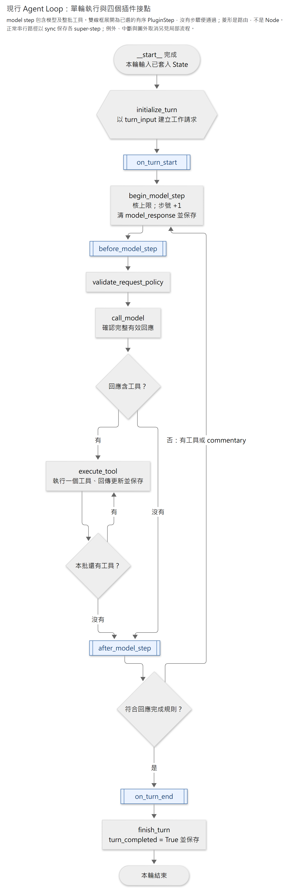
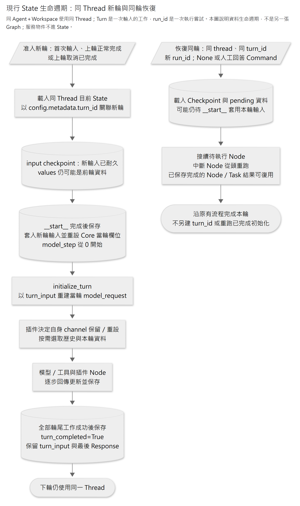
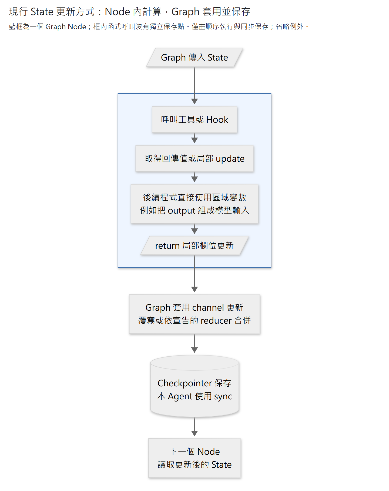
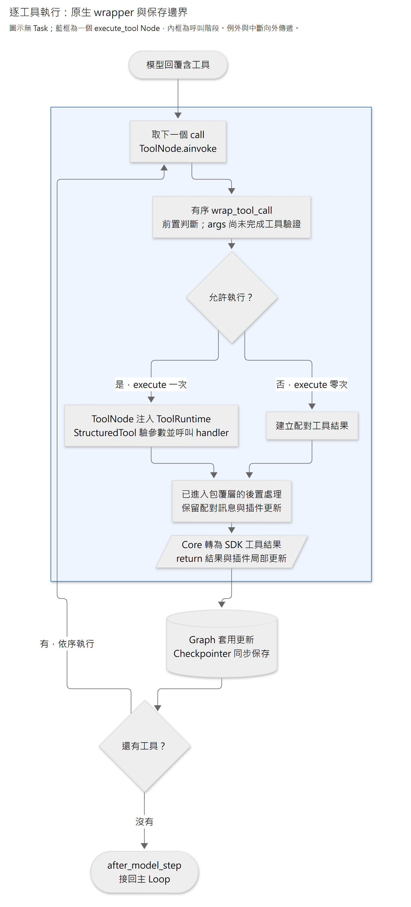
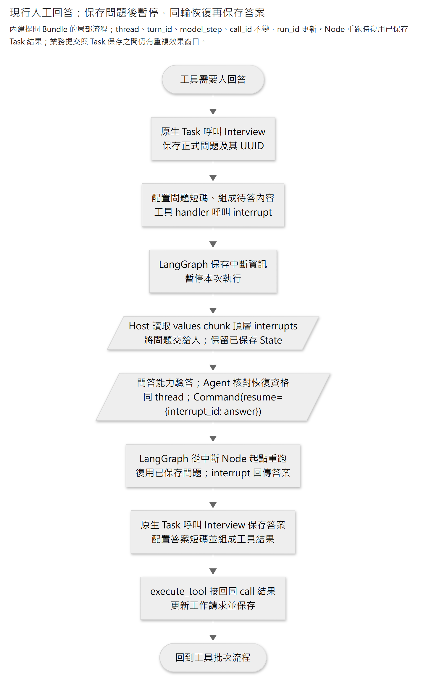
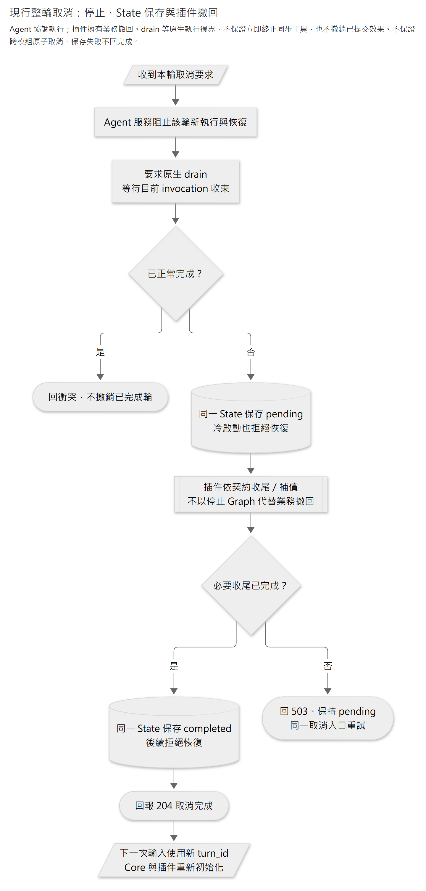

# Agent

系統分責沿[完整架構規格](../../../../architecture.md)；本頁記錄目前 Core／API 的用法。問答語意由能力模組管理，模型能力以 Plugin 為選取單位、由 Bundle 包裝；通用執行與查讀不依賴具體能力。

以原生 LangGraph、OpenAI Responses 串流及 StructuredTool 執行固定插件流程。Core 管模型／工具往返與 Checkpoint；能力模組管理業務資料與版本。Bundle 選取材料、投影／解析短碼，Model References 保存共同映射，業務 owner 核對資格。同一 Agent＋Workspace 使用同一 Thread，新輪重設 Core 當輪資料，插件決定自身資料如何保留及選取。

Core 提供啟動、串流、故障／人工回答恢復、通用取消及 State 查讀。Application 提供持久受理、輪次／步驟查讀、SSE、interrupt 接續與整輪取消，由 FastAPI lifespan 共用。提問工具由 [Human Questions Bundle](../../bundles/human_questions/README.md) 提供；各能力處理自身撤回。Host 保留停用工具後的必要撤回能力，並為 Workspace 刪除用例提供停工及 Checkpoint 清理介面。

初次閱讀先看[系統的插件分責](../../../../architecture.md#4-bundleplugin-與依賴)，再沿[單輪執行](#執行流程) → [State 與跨輪生命週期](#state-與資料生命週期) → [啟動組裝](#啟動與入口)理解主要流程。接入時查 [HTTP 與部署](#http-與部署)；撰寫插件時查[作者接口](#插件作者接口)、[工具執行](#工具執行)及[等待回答與取消](#等待回答與取消)。圖面描述正式後端的現行實作。

| 責任 | 入口與邊界 |
|---|---|
| Host | [應用程式組裝](../../host/app.py)管理共用資源與 HTTP lifespan。[顧問組裝](../../host/consultant.py)接入 Agent、完成輪 JD 查讀及 Memory，並保留既有資料所需的取消 callback |
| Agent Application | [AgentService](application/agent_service.py) 管輪次准入、持久受理、單程序執行、恢復／取消與 SSE |
| Agent Core | [Agent](agent.py) 與 [Graph](infrastructure/langgraph/agent_graph.py) 管通用模型／工具循環及原生保存；不持有業務規則 |
| Bundle／Plugin | 宣告提示、工具、流程及所需服務；從可信 State 補範圍／版本，呼叫能力模組公開用例 |
| Context Bundle | [窗口與壓縮](../../bundles/context/README.md) 決定工作請求如何延續或重建；來源資格與內容投影由提供材料的能力管理 |
| 能力模組 | 持有正式業務資料、交易及版本；[Model References](../model_references/README.md) 只映射短碼，不授予讀寫資格 |

上述層次是程式責任，不是額外部署服務。Agent 使用官方 Checkpointer 的執行資料，沒有自有業務表；不能把 State 裡的 Workspace／Turn 識別畫成連到各業務表的資料庫外鍵。

## HTTP 與部署

API 內部路徑位於 `/workspaces/{workspace_id}/agent`；正式同源 Host 掛在 `/api` 下。同一後端配置綁定一個穩定 `agent_id`；呼叫端不能指定 Thread、run 或 Checkpoint。HTTP 與後端生命週期在 [`caliburn.host.app`](../../host/app.py) 組裝，Application 不直接查 Workspace 私有資料表。後端尚無登入權限，僅供本機、單 worker 使用；不得以多 worker 共用同一 Agent Thread。

Workspace 存在檢查由 Host 注入。Host 把明確不存在轉為 Agent 自有的 `TurnNotFound`，HTTP 維持 `404 / agent_turn_not_found`；其他儲存錯誤不轉成不存在。Agent 的 HTTP mapper 不匯入 Workspace 業務錯誤。

| HTTP | 用途 |
|---|---|
| `POST /turns` | 傳 `turn_id`（標準 UUID）、`input`（原始 UTF-8 文字）；新受理 202，同要求重送 200，異輸入或有其他未完成輪 409 |
| `GET /turns` | 按建立順序回未取消輪次，不提供分頁 |
| `GET /turns/{turn_id}` | 查保存狀態；不存在的 Workspace／Turn 一致 404 |
| `GET /turns/{turn_id}/steps` | 查各模型步、公開訊息／推理摘要、工具輸入與已保存結果及 usage |
| `GET /turns/{turn_id}/events` | 原生 SSE：當前狀態與其後文字／摘要增量、工具通知，終局後關閉 |
| `POST /turns/{turn_id}/resume` | 明確恢復目前未完成輪，202；不追加文字或替未答問題作答 |
| `POST /turns/{turn_id}/cancel` | 無 body；停止並完成插件撤回後回 204，取消重送同樣回 204；正常完成輪 409，收尾失敗 503 |
| `POST /turns/{turn_id}/answers` | 傳 `model_step`、`call_id`、完整 `answers`；答案保存後 202，同答重送 200，異答／非待答呼叫 409，無效答案 422 |

完整格式及錯誤沿 `/docs`、`/openapi.json`，回傳 DTO 直接由 Application 的公開觀察值提供。取消 pending／completed 的輪次不回正文、steps 或問題查讀；一般 submit／resume／回答重送回 409，只有 cancel 可接續收尾。不可用斷線或空 resume 代替取消。新輪輸入不 trim，去重比較為原文字 UTF-8 SHA-256。去重證據保存在原生 metadata，僅在 Checkpoint 保留期間有效；不可刪除／遷移保存點或變更不相容配置後仍宣稱舊 ID 不會重跑。

202 必須先從官方公開接口讀到本輪已套用 State 的非 input 保存點。首次保存失敗回 503 `agent_unavailable`，結果可能未知，應沿同一 turn_id 查回／重送；保存查詢故障不當成輪次不存在。HTTP 回覆遺失、HTTP／SSE 斷線不取消後端工作。SSE 重連以保存狀態與 steps 補足結果，不保證逐 token 或 Last-Event-ID 重播；每個活動輪至多 64 訂閱，每個訂閱最多緩衝 64 個公開事件，慢端收到 `resync_required` 後應重讀。

SSE 的具名事件與 payload 由同一 `TurnEvent` 型別產生正式 OpenAPI `components.schemas.TurnEvent` 及串流 `itemSchema`。傳輸仍是 SSE `event` 加 JSON `data`；前端可從正式 Schema 生成驗證器，驗證解碼後的 `{event, data}`，不另定事件或狀態常數。狀態 payload 復用 `TurnView`，取消狀態沿 Core `CancelStatus`。

每個 AgentService 同時至多執行 `max_active_turns` 輪，跨 Workspace 合計，預設 8。新建與恢復共用此容量；滿載回 503 `agent_unavailable`，不排隊，也不建立新工作。同 ID 原要求的重送仍先去重並回原狀態；工作收尾後釋放名額。這是本機單 worker 的技術容量選擇，不是費用預算或負載保證。

查讀只投影保存值，不執行模型。初始 input-only 保存窗口可能尚無本輪正文，因此 input/output/usage 為 null，不回填上輪資料。`recorded` 只表示工具結果已保存；`not_recorded` 不表示工具未執行。`TurnView.usage` 逐模型步加總已保存 Response，重複快照不重算，任一步缺用量則總量未知；`StepView.usage` 是該步模型回覆用量，兩者皆不含壓縮。工具副作用發生而保存失敗時，明確恢復仍可能重複該效果。

原生壓縮用量另由 `compactions` 列出，重用 `UsageView`，缺值保持 null。每輪按 `CompactedResponse.id` 去重，歸屬取父 State 首次採用時的 `model_step`：0 為本輪開始時的歷史壓縮，1 起為對應模型步前的壓縮。輪前壓縮歸本輪，不回算前輪，也不列入第一步的 `compactions`。Turn 列出整輪已採用結果；Step 只列該步的結果，且維持已有模型回覆才產生 Step 的規則。若壓縮已採用但後續計數或模型失敗，Turn 仍可先查到 C；保存模型回覆後，該 Step 才會一併列出。

這些是**已保存並採用的用量，不是帳單或全部外送紀錄**。原生 task 已保存 C，但父 State 更新前失敗／取消的結果不在此投影；同一子圖內多次 C、父 State 只採用最後一個時，也只列可見的採用結果。因此空列不能證明未呼叫壓縮，亦不推估未保存用量或成本。公開結果僅含回覆識別、步號及用量，不含壓縮窗口、原話或不透明內容。

無 runner 且待續為 `interrupted`，正常結束才是 `completed`。原生框架有一個不可辨識窗口：已回答後同 Node 故障與下一題待答可能有完全相同的 StateSnapshot（含 interrupt 與舊 error）。此時保守回 `interrupted` 並保留可觀察問題資訊，不宣稱所有問題仍未答；None resume 交 Core 復用已存答案，遇到下一個未答問題仍停止。

### 明示設定

[`caliburn.host.entrypoint.create_app`](../../host/entrypoint.py) 只有設定 `CALIBURN_REBUILD_AGENT_CONFIG` 才啟用 Agent；未配置時 Agent 路由回 503，不讀模型金鑰或開始模型工作。該變數指向非秘密 JSON 設定檔，格式沿 [agent.example.json](../../../../agent.example.json)，沒有熱更新。

每個 Bundle 設定包含 `module`、可選 `config` 與 `plugins`。例如只選顧問提示：

```json
{"module": "caliburn.bundles.consultant", "plugins": ["consultant"]}
```

| `plugins` 設定 | 選取結果 |
|---|---|
| 省略或 JSON `null`；Python `None` | 選取 factory 回傳的全部 Plugin |
| JSON `[]`；Python `()` | 不選取該 Bundle 的任何 Plugin |
| Plugin 名稱清單 | 選取指定名稱，仍保持 factory 宣告順序；清單不重排流程 |

同一 Bundle 可提供多個 Plugin。`config` 交由 Bundle 驗證，`plugins` 由共用 loader 選取；未知名稱或重複選名在啟動拒絕，不自動啟用依賴。空選仍會載入 Bundle 並驗證設定，但不開啟其 Plugin 服務、加入 Prompt／Tool／State 或執行 Hook。全部 Bundle 空選時仍可使用裸 Core；完整 App 的常設取消與資料清理沿 Host 責任保留。

模組路徑是可信部署設定，不接受 HTTP 輸入。另設 `CALIBURN_REBUILD_AGENT_CHECKPOINT_CONNINFO` 指向專用 PostgreSQL／schema，以及 SDK 的 `OPENAI_API_KEY`（如需則 `OPENAI_BASE_URL`）；憑證只放程序環境，勿寫入 JSON 或版本控制。Workspace DB 仍沿後端 `CALIBURN_REBUILD_DATABASE_URL`。`max_active_turns` 須為正整數；SDK 明確停用自動重試；`sdk_timeout_seconds` 預設 120 秒，是 SDK 網路操作限制，不是整輪執行期限。推理等級直接沿鎖定 SDK 的原生型別，不另維護列舉。

`resume_version` 是必填的恢復契約版本，由發布者設定，例如 `"v1"`；不可空白或含 NUL，JSON 與程式組裝使用同一初始化規則。新輪與首個 input Checkpoint 同存，續跑沿原輪版本；Application 在啟動回答／恢復前比較，不相容回 409 `agent_turn_conflict`，保留進度。GET 歷史及已保存答案的同答重送仍可查回；尚未完成的輪次不能用新輸入跳過。換回相容配置後可續作；取消不以恢復版本相同為前提，但必須保留原輪必要撤回能力。

破壞性的工具、Node、Hook 或 State 契約變更須更新 `resume_version`；普通金鑰／日誌設定不需更新。這是明示相容承諾，不是自動掃描程式或固定舊 Graph。未記錄版本的資料不在支援範圍；不提供遷移或版本猜測。

官方 Checkpointer 的首次建表／升級須另行明示執行，HTTP 啟動不自動 setup：

```powershell
uv run --env-file .env --locked python -m caliburn.migrate upgrade head --with-checkpoints
```

此命令先升級業務 schema，再呼叫官方 Saver setup；兩者各自提交，Checkpoint 失敗不回滾已完成的業務遷移。可明確重跑命令完成升級。設好後沿[後端啟動入口](../../../../README.md#啟動)執行 `uv run --env-file .env --locked python -m caliburn.server`，使用單 worker；Host 已處理 Windows Selector loop。程式內組裝可向 `build_app` 傳 [`AgentConfiguration`](../../host/agent_settings.py)及必填公版配置，沿同一 lifespan 提供模型設定、Bundle 及 client factory；測試只替換外部 SDK 傳輸，仍使用正式 Core 與真 PostgreSQL。

關閉時先停止新受理，再等待現有 invocation 自然收束，最後反序關閉插件、Saver pool 與模型 client。等待受模型／插件自身 timeout 約束，沒有固定秒數強停保證。強制終止程序後不自動恢復；只可讀取最後保存狀態後明確 resume，未保存外部效果仍屬未知。此策略避免鎖定版框架在強制取消時晚到的 Checkpoint 寫入越過資源關閉。

## 啟動與入口

```python
from contextlib import aclosing

from caliburn.modules.agent.bootstrap import BundleConfig, open_agent

async with open_agent(
    agent_id="consultant",
    resume_version="v1",
    client=client,
    model_settings={
        "model": model_name,
        "reasoning": {"effort": "low"},
        "max_output_tokens": 16384,
    },
    bundles=(BundleConfig(module=bundle_module, config=bundle_options),),
    checkpointer=saver,
) as agent:
    async with aclosing(
        agent.astream(
            workspace_id=workspace_id,
            turn_id=turn_id,
            input="說明日常工作",
        )
    ) as stream:
        async for part in stream:
            consume(part)
```

`load_plugins` 在啟動時對每個明列 Bundle 呼叫一次 `create_bundle(config)`，依 Plugin 選名展平，保留 Bundle 與 factory 內的宣告順序。Host 可先載入，再把結果包成 `AgentBundle` 傳給 `open_agent`；已組裝 Bundle 不會再次呼叫 factory。選後的 Prompt、工具、插件步驟及子圖固定，沒有熱插拔。

import 與 Bundle factory 只建宣告；compile 不執行 Hook、模型或工具。`open_plugin_services` 先驗 Plugin 前提與階段收尾契約，再依服務相依開啟可選 `open_services`。Host 持有 client／saver 的關閉權，`open_agent` 反序釋放自有插件服務；關閉前須停止或完成所有 invocation 並等待收束。



[圖源](../../../../../../docs/diagrams/agent/assembly-lifecycle.mmd) · [放大 SVG](../../../../../../docs/diagrams/agent/assembly-lifecycle.svg)

FastAPI lifespan 在啟動建立一份 AgentService，共用 Agent、模型 client 與 Checkpointer；Core 不依賴 FastAPI 型別。服務依必要依賴建立；流程沿宣告順序及各階段的明示尾段執行，兩種順序互不取代。

| 現行公開方法 | 責任 |
|---|---|
| `astream(workspace_id, turn_id, input)` | 可信上層提供輪次 UUID，文字或原生 SDK input items 開始新輪；回原生 v2 custom／values stream，可明示 include_checkpoints |
| `aresume(workspace_id, turn_id, resume_command=None)` | 故障用 None；人工回答用 Command(resume={interrupt_id: answer})；不追加原始輸入 |
| `aget_state(workspace_id, ...)` | 查原生 StateSnapshot，可指定 checkpoint_id／subgraphs |
| `aget_state_history(workspace_id, ...)` | 查同 Thread 原生歷史快照，可指定 turn_id／limit／before |
| `aget_previous_completed_turn(workspace_id, before_turn_id)` | 以指定輪原生 input 保存點為錨，取得之前最近成功輪的完整 StateSnapshot；無錨點或完成輪回 None，不解讀業務 channel |
| `services`（唯讀屬性） | 可信 Host 沿公開 `ServiceKey` 取得已組裝服務；僅在 `open_agent` 生命週期內使用，不移轉資源關閉權 |

`agent_id:workspace_id` 決定 thread，每次執行／恢復另產生 run_id；turn_id 在同輪恢復時不變。同一 Agent 實例拒絕同 Workspace 並行執行及以新輸入覆蓋未完成工作；這不是 HTTP 授權或跨程序業務鎖。custom 帶 SDK 事件、turn_id／model_step 及 execution metadata，遮蔽 encrypted_content；values 投影 turn_id 與最近完整 model_response，後者可能為 None。完整 Response 仍屬可信後端資料，不能直接外送 Web。

## 執行流程

現行 Graph 有六個正常流程 Core Node，加上配置選中的插件 Node／子圖，以及圖外取消使用的 `cancel_turn` writer：



[圖源](../../../../../../docs/diagrams/agent/core-loop-current.mmd) · [放大 SVG](../../../../../../docs/diagrams/agent/core-loop-current.svg)

**model step 是一次模型回覆及其整批工具執行**，無工具時仍是一個 step；它不等於單一工具或 HTTP 嘗試。

| 接點 | 執行位置與可更新範圍 |
|---|---|
| `on_turn_start` | 新輪初始化後；準備插件當輪資料及初始工作請求 |
| `before_model_step` | 當步編號保存後、模型外送前；更新工作請求及插件資料 |
| `after_model_step` | 模型及整批工具正常完成後，包含已轉為結果的業務錯誤；只更新插件資料 |
| `on_turn_end` | 最終回答所在步的後置接點成功後；只更新插件資料 |

`begin_model_step` 先核上限，再把 `model_step` 加一、清除 `model_response` 並保存。步號從 1 開始；恢復同一步不加一。call_model 先確認成功、完整且符合支援協定的回應，再進路由。含工具先執行全批，經 after_model_step 再續步；無工具則依最後完整 assistant message 判斷：commentary 續步，final_answer 完成，未帶 phase 的非空文字／refusal 作相容出口。refusal 是內容型別，不凌駕 phase。

四個接點各可展開多個 `PluginStep`，零步驟直接通過。普通 Hook 依登記成為 Node，compiled subgraph 直接掛入圖；條件 Edge 不另建工作 Node。後置接點屬正常流程，例外或取消不保證執行；資源清理仍用 finally／context manager。DeepSeek 的 step 也包模型與工具，但其 step/end 是 finally 紀錄，不能套成本案成功後置接點。[上游 Loop](https://github.com/deepseek-ai/deepseek-harness/blob/8bd073392eef6f54e921a093b95076248eb08cbb/packages/core/agent-loop/src/agent.ts#L326-L425)

`PluginStep.run_last=True` 將該步放在同 phase 全部普通步驟之後；兩組內部都保持宣告順序。每個 phase 最多一個 Plugin 擁有尾段，該 Plugin 的尾段必須連續，不能在尾段後再宣告普通步驟；無效組裝在開服務前拒絕。每個尾段步驟仍是原生 Node／子圖，沿原生 Checkpoint 恢復，不合併成額外 wrapper 或排程器。此排序不改 Prompt、Tool、其他 phase 或服務順序。

例如 [Context Bundle](../../bundles/context/README.md) 的 `window` 在 `on_turn_start` 尾段準備窗口，`native_compaction` 在 `before_model_step` 尾段完成原生壓縮與容量檢查。業務 Plugin 透過 `WINDOW_CONTRIBUTIONS` 服務集合提供材料；Core 仍只執行上述通用接點，Context 也不直接查 Memory／Interview／JD。

`finish_turn` 在所有輪尾接點成功後保存 `turn_completed=True`。重開時移除插件 Node，原生新圖可能不再投影舊待續位置；本輪完成證據仍為 False，因此不會誤判完成或允許新輪。若 drain 時只剩此無業務效果的完成 Node，Core 以官方 update_state 完成保存，保留自然完成優先；不重跑插件或工具。

`validate_request_policy` 確認 input 為 items list、工具呼叫與結果完整配對、工具已登記且無重複、固定模型設定未變，以及未啟用不相容的服務端歷史模式。配對完成後可在後續步重用 call_id；不重驗工具業務參數。

## State 與資料生命週期

Thread 是同 Agent＋Workspace 的保存範圍；Turn 是一次新輸入到完成／取消的工作；run_id 識別一次執行嘗試。新輪沿同 Thread 載入 State，重設 Core 當輪欄位，**Core 不自動把前輪 input 加回模型請求**。插件自行選歷史、重設或保留自己的 channel；同輪恢復沿已保存值，不重新開始新輪。



[圖源](../../../../../../docs/diagrams/agent/turn-state-lifecycle.mmd) · [放大 SVG](../../../../../../docs/diagrams/agent/turn-state-lifecycle.svg)

| State channel | 生命週期與 owner |
|---|---|
| `workspace_id` | Thread 固定歸屬；可信入口設定，插件只讀 |
| `turn_id` | 新輪建立，同輪故障／人工回答恢復不變 |
| `turn_input` | 原始本輪輸入；先隨新輸入耐久保存，`__start__` 後套入 State；整輪不清除、不隨壓縮改寫 |
| `model_request` | 唯一當輪 SDK 工作請求；插件選材料，Core 追加完整模型 output 與工具結果 |
| `model_response` | 最近完整 SDK Response；新輸入帶 None，`__start__` 後套入 State，每步開始再清除 |
| `compaction_response` | 最近被父 State 採用的完整 SDK CompactedResponse；新輪清空，由 Context 壓縮更新，不覆寫模型回應 |
| `model_step` | 新輸入帶 0，`__start__` 後套入 State；begin_model_step 配置 1 起的邏輯步號 |
| `turn_completed` | 新輸入 False；全部正常輪尾工作成功後才 True；不替代原生排程或取消狀態 |
| `cancel_status` | None／pending／completed；取消完成仍不算正常完成輪 |
| 插件 channel | 插件明示 TypedDict／reducer；決定跨輪保留、重設及恢復規則 |

新輪的 input checkpoint 先耐久保存新輸入，`values` 此時仍可能是前輪資料；原生 `__start__` 完成後，本輪 turn_id／turn_input、空 response 與步號 0 才出現在 State，initialize_turn 再建立本輪 model_request。入口以原生 `config.metadata.turn_id` 關聯本輪，不另存輸入正文副本，也不能把初始化前快照的舊 response／request 當成本輪結果。

metadata 同存可信 `workspace_id`，供 Host 透過官方 Saver 篩選全部所屬 Thread（含停用 Agent／分析角色）並清理；不把業務表或短碼種類放入 Core。Workspace 刪除先停止准入並等待 writer，再提交業務刪除與清理保存點；兩者不是同一交易，失敗不回完整成功，可用同一 Workspace ID 重試。

內部 values 使用 `output_keys=["turn_id", "model_response"]`，入口只轉送 `data.turn_id` 符合本輪的資料，同輪恢復的初始值仍可保留。頂層 `interrupts` 獨立保留，不隨前輪 data 一起丟棄；不另造串流 DTO。恢復准入不能只看 `StateSnapshot.next` 是否為空，還須核對輪次、待套用輸入與原生 tasks。

保留 turn_input 不代表已完成跨輪對話查詢入口。對話、Memory 等正式業務資料仍由各 owner 保存。

State 不存 handler、client、連線或服務物件。`AgentContext.services` 是原生 Runtime.context 的啟動依賴，預設空表，不保存 Workspace 業務資料；`Agent.services` 向可信 Host 提供同一份唯讀服務綁定。綁定唯讀不表示服務物件本身被凍結，物件操作仍沿各自公開契約。共用 Agent／服務不持有 current_workspace、當輪 map 或完整歷史 cache；invocation 結束後釋放本次參照，PG 保留 State。

### Node 內用回傳值，Node 之間用 State update

同一 Node 內直接使用普通 Python 回傳值／區域變數；Node 最後回傳局部更新，Graph 才套用 channel reducer 並保存。工具回 Command 也須由執行它的 Node 向外傳遞，不會自行提交父圖 State。



[圖源](../../../../../../docs/diagrams/agent/node-state-update.mmd) · [放大 SVG](../../../../../../docs/diagrams/agent/node-state-update.svg)

把傳入 State 與巢狀容器視為唯讀，回傳新容器及改動欄位；框架不因此自動 freeze 或深複製。不要把完整舊 State 混回 update，累加 reducer 可能重複累加。順序 Node 各佔一個 super-step；同一步平行 Node 不會即時互讀更新。[官方 State／reducer](https://docs.langchain.com/oss/python/langgraph/graph-api#reducers)

## 插件作者接口

可參考 [Plan Bundle](../../bundles/plan/README.md)：工具、固定提示、輪前準備與版本 State 依下列契約組裝，透過 Host 提供的模組公開依賴存取資料，Core 不加入 Plan 分支。

| 宣告 | 用途 |
|---|---|
| `prompt_sections`／`tools` | 固定提示及 StructuredTool；啟動決定 schema 與 handler |
| `state_schema` | 插件新增的持久 channel；不重宣告 Core 欄位 |
| `on_turn_cancel` | 可選的圖外 async callback；取得 State、可信 Workspace／Turn 及 AgentContext，確認撤回後回 None |
| 生命週期接點中的 `PluginStep` | 有序普通 async Hook 或原生 compiled subgraph；回局部 State 更新 |
| `PluginStep.wrappers` | 明示包同一個插件 callable；目前不包 Core 模型／工具 Node |
| `PluginStep.run_last` | 同 phase 的連續尾段；完整接收普通步驟更新後執行，保留原生保存邊界 |
| `wrap_tool_call` | 有序原生工具 wrapper，組裝為 ToolNode 的 awrap_tool_call |
| `open_services`（可選） | 啟動時開關共享資源；required／provided_services 明示依賴 |
| `required_plugins` | 要求指定 Plugin 同時被選取；只查存在，不重排流程／服務，也不自動補開 |

固定提示／工具不需空 Hook。動態提示更新 `model_request.instructions`，歷史／壓縮更新 `input`，工具選用更新 `tools`；只能選啟動已登記、宣告未變的工具。多步或分支用原生 Node／Edge／subgraph，私有 scratch 留子圖；跨步需用的值才明示共享 channel。TypedDict 只宣告型別，插件須在讀取前初始化值；子圖累積全值不可再次當增量送進父圖 reducer。

Bundle → Plugin → Step 的宣告順序決定普通流程；`run_last` 明示同 phase 的最後處理，例如完成所有材料更新後再計數。服務依賴排序只保證服務已就緒，不重排 Prompt 或流程。插件合作沿公開 callable、回值及 State 契約；Core 不增加 Memory／compaction 特例。

`ServiceKey[T]` 宣告一次並以物件身分辨識；普通 key 只能有一個 provider，缺必要服務、重複 provider、同名不同 key 或循環相依都在啟動拒絕。`ServiceCollection[T]` 是值為 `tuple[T, ...]` 的 key，允許多個 provider 各自以 `bind(tuple)` 提供一份貢獻；聚合先放 Host 外部 binding，再按選後 Plugin 原宣告順序接上各 tuple，不受服務取得順序影響。已宣告的 collection 沒有 provider 時取得 `()`；未宣告的依賴仍不能在 `open_services` 內查用。

collection consumer 等全部 provider 就緒後取得固定 tuple。每個 provider 仍須恰好提供自己宣告的 binding，缺漏、重複或未宣告值都拒絕；初始化失敗與關閉沿同一 `AsyncExitStack` 反序清理。這是一次啟動的固定集合，沒有執行中註冊或重新搜尋。窗口業務回呼由各能力 Plugin 供給 Context 的公開 collection，詳細責任與 96K／160K 門檻沿 [Context Bundle](../../bundles/context/README.md)。

普通 around 在組裝時取得 next callable，形成 A 前 → B 前 → Hook → B 後 → A 後。傳給 next 的新值只在該次呼叫可見；後置段保留內層 update，最後一併回傳，不能自己模擬任意 reducer。正常執行一次 next，清理放 finally；不暗中 invoke 子圖，也不新增保存點。要跨階段獨立恢復，使用 Node／子圖。

插件可普通 import 業務模組公開方法；模組自己管理 DB／UoW，消費者只傳業務參數。import 不啟用另一插件的 Hook，也不自動改指向 Bundle 選中的另一實作。只有確需共享已配置實例／資源時才用服務 binding；不為每次跨插件呼叫加 Service 轉發類別。服務取得後，內部函式明收必要依賴，不把整份 Runtime 傳入 Domain。

## 工具執行

現行 `execute_tool` 是 Graph Node，每次只將一個 call 交給官方 ToolNode，再呼叫插件的 StructuredTool handler；不是把工具程式複製進 Core。ToolNode 內的 AIMessage／ToolMessage 僅作窄協定轉換，持久工作歷史仍是 `model_request.input` 的原生 SDK items。

`parallel_tool_calls=True` 允許模型在同一回應提出多個 call；本案仍逐一執行並保存結果，下一個工具才看見前一個的 State 更新。參數 JSON 由 SDK 解析；Core 在執行首個工具前核整批完成狀態、call_id、工具名稱與數量，各工具的欄位驗證與業務拒絕則在 StructuredTool／handler 執行。

工具可回文字，或 `Command(update=...)` 搭配對應 call_id 的文字 ToolMessage 與插件 channel 更新。Core 將訊息轉為 function_call_output，與插件更新同一步保存，下一個工具才看見新 State。Command 不得改 Core 欄位或以 goto／graph／resume 改路由；目前不接受多 Command 或多模態工具結果，JSON 內容由插件序列化。

### 工具包覆



[圖源](../../../../../../docs/diagrams/agent/tool-pipeline.mmd) · [放大 SVG](../../../../../../docs/diagrams/agent/tool-pipeline.svg)

`wrap_tool_call` 沿官方 `AsyncToolCallWrapper`：接 `ToolCallRequest` 與 async execute，回 `ToolMessage | Command`。前置判斷、around、後置轉換是同一包覆鏈的內部階段，不是三套 Hook 系統。前置看到的 args 尚未經 StructuredTool 驗證；JD 查版、短 ID 解析等仍由 handler 負責。後置轉換須保留原 Command 的插件更新與配對 call_id；State 更新沿 Command，不靠修改 request.state。[原生工具 wrapper](https://github.com/langchain-ai/langgraph/blob/5bd231cbfd913e05ebc662f519eb9a655bc766df/libs/prebuilt/langgraph/prebuilt/tool_node.py#L1191-L1256)

有序 wrapper 以第一個最外層組合；前段依宣告順序、返回依反序。官方 execute 允許多次呼叫；本案正常允許路徑只呼叫一次，拒絕可零次並回配對結果，不暗中重試副作用。短路會跳過尚未進入的內層，未處理例外與 interrupt 向外傳遞。只讀觀察沿原生 stream／標準 logging，不加 on_tool_result registry，也不把觀察通知當作 Checkpoint 已提交。

Core 不強制每工具再包 `@task`。若必要後置失敗時不得重跑已完成工具，插件可用原生 Task 保存實際執行結果，後置放在 Task 之外；也可拆獨立 Node。Task 保存可復用的回傳值，不自動更新父圖 State；把整條管線包成一個 Task 無法隔開失敗。仍不提供業務提交與 Checkpoint 跨系統的 exactly-once。[官方 Node 內 Task](https://docs.langchain.com/oss/python/langgraph/graph-api#using-tasks-in-nodes)

### 可信參數與能力範例

ToolNode 注入原生 `ToolRuntime`，模型 schema 不含 runtime。工具可用 `ToolRuntime[AgentContext, ToolState]`，其中 ToolState 是只列所需 Workspace／插件欄位的窄 TypedDict，**不繼承含 SDK request／response 的完整 AgentState**。工具公開 schema 只含模型應填的業務參數。[官方 State 型別範例](https://docs.langchain.com/oss/python/langchain/tools#short-term-memory-state)

具體例子見 [JD Bundle 的寫工具保存流程](../../bundles/job_description/README.md#寫工具保存流程)：模型提供修改意圖，Bundle 補入可信範圍及模型已見版本，業務模組負責規則與交易。短碼、版本資格與撤回仍由各能力的責任文件維護，Core 不加入能力特例。

預期業務錯誤由插件 ToolException／StructuredTool(handle_tool_error=...) 轉成模型可讀結果；ToolNode 使用 handle_tool_errors=False，未處理例外停止當次執行。strict 工具參數與 HTTP PATCH 的省略／清空語意不同，不能直接複用 DTO。同步工具沿原生 executor，取消 await 不能強停 worker 或撤銷已提交效果。

## 等待回答與取消

`aresume` 區分故障續作與人工回答。pending／interrupt 不當成正常完成；工具發出的人工 interrupt 也不記為一般工具失敗。

等待人工回答時拒絕開新輪，不能用新輸入覆蓋或跳過問題；同輪以 `aresume(..., resume_command=Command(resume={interrupt_id: answer}))` 回答。這是可信 Core 接口：mapping 不可空，只能包含當前 interrupt ID，原生答案可為 None。interrupt_id 不是每題唯一的重送識別，同 Node 先後兩題可能共用 ID；正式 HTTP 因此使用下述工具批次定位，不讓前端直接操作 Command。Command 不能帶 update／goto／graph 改寫流程。

### 人工提問 Bundle

設定 `bundles` 加入 `{"module":"caliburn.bundles.human_questions","config":{}}` 即啟用。工具 Prompt、參數說明及修正提示在 [Bundle](../../bundles/human_questions/README.md)；問答規則、驗答與語意查讀在 [Human Questions 模組](../human_questions/README.md)。Core 不辨識工具名或問答 payload。

通用 `/steps` 回所有工具的原參數／結果與當步原生 `interrupts` JSON，停用任何插件仍可查既有紀錄。問答模組的 `/questions` 則整理實際問題、答案與待答狀態；其他插件需要問答時呼叫該模組介面，不各自解析執行資料。

Application 提供 `resume_interrupt` 通用准入。能力提供同步純 `prepare`／`is_saved`：前者在鎖內從最新保存點驗證並準備輸入，後者依完整本輪保存紀錄確認指定結果已保存，包含原生 interrupt 證據；執行中確認與冷恢復使用相同範圍。Agent 保留鎖、容量、同請求合併、恢復版本及 `Command(resume={interrupt_id: value})`。答案結果前故障不算受理；已保存結果可查回，即使後續模型失敗。

LangGraph 重跑後可能保留 task.error；Agent 僅接受本次正常 invocation 重新發出、且 checkpoint／interrupt ID／payload 仍相符的通用等待證據。這不是問答特例或持久答案副本；重啟後若有殘留 error，須先原生 None 恢復。



[圖源](../../../../../../docs/diagrams/agent/human-resume.mmd) · [放大 SVG](../../../../../../docs/diagrams/agent/human-resume.svg)

內建提問工具先以原生 Task 呼叫 Interview 保存正式問題，再配置短碼並 `interrupt(payload)`；恢復後另以 Task 保存答案，交易不跨人工等待。問題、答案與短碼的完整分工見 [Human Questions Bundle](../../bundles/human_questions/README.md)。原生 v2 stream 在 values chunk 頂層的 `interrupts` 帶出問題，不在 `data.__interrupt__`。`include_checkpoints=True` 另提供原生保存點通知，不能把通知本身當成持久保存證據。Host 收答案後用相同 thread 呼叫上述 ID mapping Command。turn_id／model_step／call_id 不變，run_id 更新。

框架重跑中斷 Node，該次 interrupt 回傳答案；已完成 Task 結果可復用，但未回傳的區域變數不會自動保存。必須跨等待保留的值放前一 Node 或已完成 Task。故障以 None 接續，人工回答用 Command；都需服務主動呼叫。[官方 Interrupts](https://docs.langchain.com/oss/python/langgraph/interrupts)



[圖源](../../../../../../docs/diagrams/agent/turn-cancellation.mmd) · [放大 SVG](../../../../../../docs/diagrams/agent/turn-cancellation.svg)

Application 阻止新執行／恢復，透過原生 RunControl 停止並等待活動 invocation 收束，再於同一份 Agent State 保存 `cancel_status=pending`。各插件透過可選 `on_turn_cancel` 撤回自己的業務效果，全部確認完成才保存 `completed`；Core 不知道業務如何撤回，Memory 不回退。停止前已自然完成則回衝突；沒有立即終止同步 thread 的保證。

公開入口為 `AgentService.cancel_turn(workspace_id=..., turn_id=...)`；成功返回表示撤回與完成狀態已保存，失敗沿同入口接續。正在取消的工作由 Service 持有，HTTP 斷線不停止收尾；既有訂閱用 `cancellation` 事件回目標 turn_id 與 pending／completed，不回正文。取消完成後允許新 turn_id，Core 重建當輪請求，插件沿 `on_turn_start` 重新取得自己的版本及輪內資料。插件辨認基準所屬輪次，Core 不維護業務欄位清除清單。

取消 callback 按靜態插件順序執行，失敗即停；重送可能重做先前成功的 callback，結果核對由插件擁有。callback 使用既有 `AgentContext.services`，不回 `Command`／State 更新，也不呼叫正常完成 `on_turn_end`。只有輸入已保存、尚無本輪 State 時，state 可為 None。Host 須保留未結清義務所需的相容 callback 及資料讀取能力；`resume_version` 不同本身不阻擋取消，本片不遷移缺少本輪基準識別的舊插件 State。

可信程式在 writer 已停止後可呼叫 `Agent.acancel_turn(workspace_id=..., turn_id=...)`。Core 透過官方 bulk update 合併公開 task result 與 pending 標記，再保存 completed；保存用的 `cancel_turn` Node 不接入正常模型路徑。關閉串流、CancelledError、可恢復的 drain 或 END 更新本身均不撤回業務。新 dict input 只在正常完成或取消完成後准入，沿 START 取代舊待續排程。[官方故障與停機界線](https://docs.langchain.com/oss/python/langgraph/fault-tolerance)

## PostgreSQL 保存與恢復

[open_postgres_checkpointer](infrastructure/persistence/postgres_checkpointer.py) 使用官方 AsyncPostgresSaver／pool。首次建置或升級明示 initialize=True；日常不重跑 setup，schema 由 conninfo search_path 指定。Windows psycopg async 由 Host 選 Selector event loop，library 不改全域 policy。

Agent 固定 `durability="sync"`，完整 Checkpoint 保存後才續下一步。工具已提交業務資料、結果未保存時仍可能重跑，沒有跨業務 exactly-once；LangGraph 1.2.19 的輔助 aput_writes 失敗可能到收尾才回報，沿用官方限制，未自建同步屏障。冷恢復須用相同 Agent／Workspace、相容 Bundle／State schema 及 serializer；查快照不執行工具，公開入口不提供任意舊 checkpoint 的副作用重播。

官方 JsonPlusSerializer 使用明示 SDK 類別 allowlist、不開 pickle；[OpenAIFieldSetSerializer](infrastructure/persistence/openai_field_sets.py) 僅補存 model_fields_set，保留省略與顯式 null。插件 channel 優先用普通 dict／list／純值，自訂型別須由 Host 明示加入 allowlist。非法插件更新可能已留在 pending writes，恢復仍會拒絕；可指定既有完整快照唯讀診斷，不自動丟棄更新。

模型前快照代表當次出站邏輯請求，最新 request 可能已追加 output；同一 Response 的 usage 不因出現在多份快照而重複計量。Checkpoint 不是失敗 Response 日誌、Web DTO 或永久稽核紀錄；診斷沿標準 logging，沒有第二套成功 request／response／tool Store。Workspace 刪除用例透過 Host 提供的介面停工及清理 Checkpoint。Host 使用 `saver.adelete_thread` 刪除所屬 Thread。

SDK 請求錯誤、串流錯誤與模型回應協定錯誤在 adapter 邊界使用固定訊息，原 provider 錯誤正文不進公開錯誤或原生 `task.error`。受控診斷沿既有 logger 保留錯誤型別及執行識別；Context 的 count／compact 使用相同窄邊界。這不涵蓋第三方 SDK 自行發出的任意 warning。正常完成需有非空白的 assistant 文字或 refusal；只含空白的 final 不形成完成輪，合法工具呼叫仍優先繼續工具流程。

## 程式入口

| 檔案 | 責任 |
|---|---|
| [bootstrap.py](bootstrap.py)／[agent.py](agent.py) | 固定組裝、執行、恢復及快照查讀 |
| [state.py](state.py) | Core channel 與 SDK 工作資料型別 |
| [plugins/contracts.py](plugins/contracts.py) | Bundle／Plugin／Step 作者契約 |
| [plugins/services.py](plugins/services.py)／[plugins/composition.py](plugins/composition.py) | typed key／collection、Plugin 前提及尾段驗證、服務依賴與生命週期 |
| [agent_graph.py](infrastructure/langgraph/agent_graph.py)／[plugin_steps.py](infrastructure/langgraph/plugin_steps.py) | 主循環與插件 Node 接線 |
| [openai/](infrastructure/openai/)／[persistence/](infrastructure/persistence/) | SDK／工具橋接、官方 saver 與窄序列化適配 |

維護時沿正式入口、離線 SDK 串流及真 PostgreSQL 核對保存／恢復接縫，測試入口見[後端說明](../../../../README.md)。模型內容品質、負載及業務交易由各自驗收範圍確認；不能從 Loop 或圖面正確推定這些效果成立。
