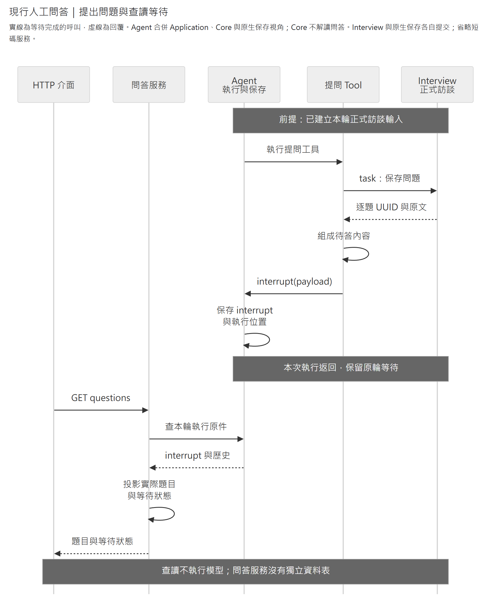
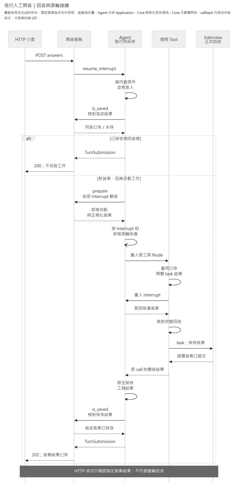

# Human Questions：等待、查讀與回答

本模組讓使用者查讀 Agent 實際提出的問題，提交整批答案並接續原輪。它沒有獨立資料表：問題與答案的正式原件由[訪談模組](../interview/README.md)保存，等待位置、工具結果與執行歷史來自 Agent 的原生 interrupt／Checkpoint。提問工具可停用，常設查讀能力仍保留。

先看[一次問答的生命週期](#一次問答的生命週期)，接入時查[公開能力與 HTTP](#公開能力與-http)；修改模型提示或工具參數則前往[提問 Bundle](../../bundles/human_questions/README.md)。

## 入口與依賴

Host 建立 `QuestionService(agent_service)`，共用 Agent 的准入、執行與查讀能力。問答服務依賴 Interview 的單題規則及 Agent 公開原件，不直接查 Checkpointer 私有表，也不保存另一份訪談正文。查正式原話或來源資格時，直接使用 Interview 公開方法。

| 入口 | 責任 |
|---|---|
| [question_service.py](question_service.py) | 查本輪問答、準備答案並要求 Agent 接續 |
| [questions.py](questions.py) | 已展示問題、完整回答集合與同答比較；單題驗答沿 Interview Domain |
| [agent_history.py](agent_history.py) | 從原生 interrupt 與工具結果投影問答狀態 |
| [api.py](api.py) | HTTP 輸入、回應及答案錯誤轉譯 |
| [提問 Bundle](../../bundles/human_questions/README.md) | 模型 Schema、提示、可信 runtime、正式題答保存與 interrupt 接線 |

## 一次問答的生命週期

1. 訪談保存插件先建立本輪正式輸入。提問工具呼叫 Interview 保存每題，取得問題訊息 UUID，再發出一次原生 interrupt 等待整批回答。
2. 本模組從該 interrupt 查回已交付的題目與選項。工具 wrapper 改過問題時，採這份實際內容，不從模型原始 arguments 猜題；保存與交付不代表瀏覽器已顯示。
3. 使用者提交指定 Workspace／Turn／`model_step`／`call_id` 的完整答案。能力核對每題 UUID 與答案，Agent 核對等待資格並以 `Command(resume={interrupt_id: answers})` 接續原輪。
4. 恢復後，工具呼叫 Interview 保存答案，再回傳同一 call 的工具結果。Agent 確認該結果已保存，HTTP 才回成功；後續工具或模型步仍可繼續執行。

前半段將問題原件保存，再透過原生等待點供介面查讀：

[SVG](../../../../../../docs/diagrams/human-questions/human-question-sequence.svg) · [圖源](../../../../../../docs/diagrams/human-questions/human-question-sequence.mmd)

後半段核對完整回答，接續原輪並確認指定工具結果已保存：

[SVG](../../../../../../docs/diagrams/human-questions/human-answer-resume.svg) · [圖源](../../../../../../docs/diagrams/human-questions/human-answer-resume.mmd)

圖中省略短碼服務及 Checkpointer 的獨立呼叫。Interview 原件與 Agent 原生執行資料可共用 PostgreSQL，但各自提交，不構成同一交易。恢復版本與取消流程沿 [Agent](../agent/README.md#等待回答與取消)。

`prepare` 與 `is_saved` 是交給 Agent 的同步純 callback。前者在准入鎖內選取最新 interrupt 並驗答；後者用同次 interrupt 的 `question_ref`／UUID 對照解讀指定工具結果。兩者不做資料庫 I/O、不改快照、不重入服務，也不依題幹或結果位置猜配。正式答案由恢復後的工具保存。

## 公開能力與 HTTP

Python 入口如下；HTTP 的完整 DTO 以 [api.py](api.py)與應用 `/openapi.json` 為準。

- `list_questions(workspace_id, turn_id)` 回 `list[QuestionExchange]`，包含每次提問的 `model_step`、`call_id`、`questions`、`answers` 與 `status`。
- `pending_questions(workspace_id, turn_id)` 篩出目前 `waiting` 的提問；實際受理仍須通過 Agent 准入。
- `submit_answers(workspace_id, turn_id, model_step, call_id, answers)` 接受 `AnswerBatch`，回 Agent 的 `TurnSubmission`；HTTP 只回其中的 `TurnView`。

HTTP 路徑前綴為 `/workspaces/{workspace_id}/agent/turns/{turn_id}`：`GET /questions` 查問答投影，`POST /answers` 提交整批。通用 `/steps` 另保留任意工具的原參數、輸出與原生 interrupt JSON，供查執行經過。

查讀的 `answered` 表示指定工具已保存可解讀的答案結果；`waiting` 表示目前原生 interrupt 可接續，版本與容量仍須通過 Agent 准入；`unanswered` 表示未讀到這種結果且目前未確認待答。最後一種不等於正式略過，也不能單憑 Interview 有未答問題就啟動恢復。

### 回答與略過

每題由 interrupt 提供 `message_id` 與持久 `question_ref`。HTTP 以 `question_message_id` 回傳問題 UUID，且每題必須明示 `selected`；`custom` 可省略或為 null。整批每題恰有一筆答案，不能缺題、重複答題或混入其他問題。`selected` 必須是原題選項 label，不可重複；單選題最多一項，也可同時附自填文字。

明確略過是 `selected=[]` 且 `custom` 省略／為 null，仍會保存一則正式答案；不表示同意、拒絕或授權補造內容。`custom=""` 或只有空白仍逐字保存，不自動改成略過。答案依原題及選項順序正規化，同答比較不受這兩種順序影響，自填文字則逐字比較。

HTTP UUID 使用含連字號的標準字串。`model_step` 是從 1 起的 JSON 數值整數，`call_id` 是非空字串，兩者共同定位本輪工具呼叫；`interrupt_id` 定位整次等待，不是逐題身分。模型結果改用 Workspace 範圍的 `message_N` 短碼，格式與結果內容沿 Bundle 說明。

### 成功、衝突與恢復

| HTTP 結果 | 含義 |
|---|---|
| 202 | 此請求啟動回答工作，且指定工具結果已確認保存 |
| 200 | 已存同答，或併入活動中的同答請求並確認結果保存；不另啟工作 |
| 404 `agent_turn_not_found` | 找不到可查輪次；取消中的／已取消輪次也不提供問答查讀 |
| 409 `agent_turn_conflict` | 已存異答、目標非目前待答、其他工作衝突、取消或恢復版本不相容 |
| 422 `invalid_request`／`agent_invalid_answers` | 請求格式錯誤／答案不符合實際題目；回安全欄位位置，不回原始輸入 |
| 503 `agent_unavailable` | Agent 無法受理、活動容量已滿，或未能確認指定結果保存 |

202／200 不保證整輪完成；指定答案可能已保存，後續執行仍在進行或故障。503 也不能當成答案未曾消費，應先讀原輪狀態。框架解碼與未預期例外另沿[共用 HTTP 錯誤](../../shared/presentation/api/app.py)處理。

新回答恢復須符合已保存的 `resume_version`；版本不相容不阻擋 GET 或非取消輪次的已存同答查回。停用工具不刪紀錄，也不讓未完成輪自動取消。取消中／已取消輪次拒絕回答重送，完整收尾由 Agent 與各業務 owner 負責。

故障快照殘留的 interrupt 不一定仍可回答。快照帶有執行錯誤且目標等待點未重新確認時，須先沿 Agent 的同輪 `None` 恢復，不能覆寫可能已消費的答案；正常等待點直接提交答案。離開頁面或連線中斷不構成取消、回答或略過。
