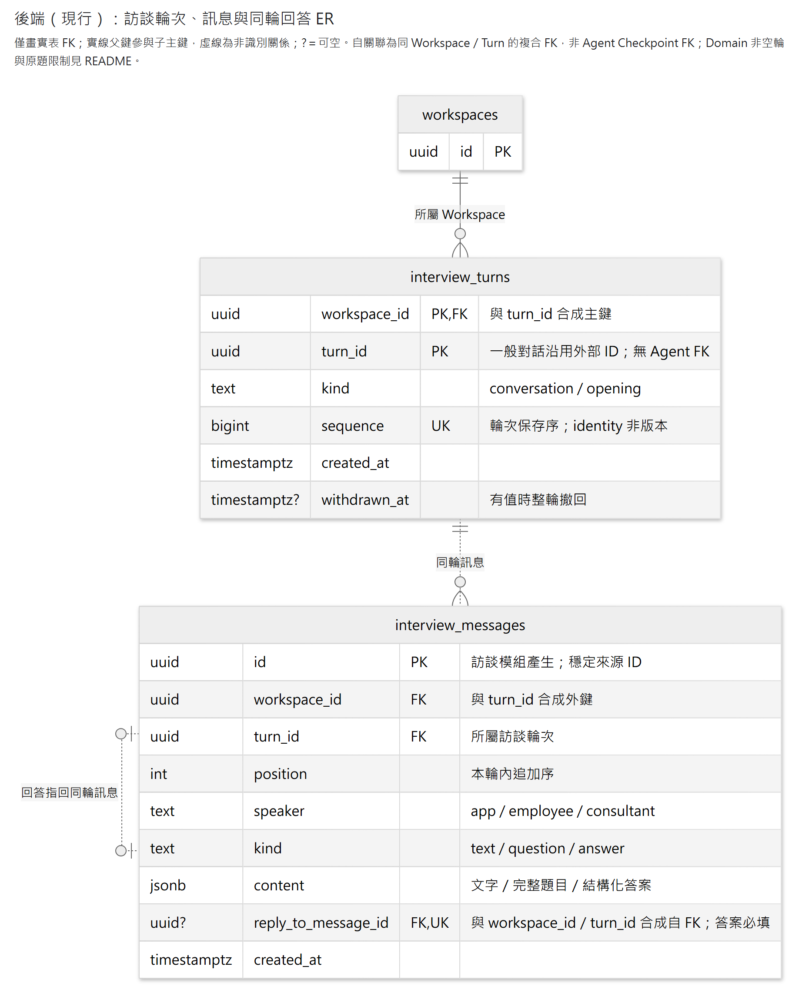

# 訪談

保存可供人與其他模組查讀的正式原話：開場、員工輸入、顧問題目、逐題答案／略過，以及本輪最終顧問發話。中途說明、模型推理與工具執行過程留在 Agent 紀錄。

`InterviewTurn` 是聚合根，以 `workspace_id + turn_id` 定位；一般輪次沿用呼叫端 ID。它管理不可改寫的訊息、逐題回答與整輪撤回。新訊息 UUID 由模組產生，不由模型填寫。問題與回答規則集中於 [message_content.py](domain/models/message_content.py)。

**已保存與已完成分開判斷。** 本模組不保存 Agent 的 running／waiting／completed 狀態；本輪顧問可以查讀已保存原話並支持自己的 JD 候選，其他分析的完成資格由呼叫方確認。開場不屬於顧問執行輪；一般輪次的 `turn_id` 雖沿用執行 ID，資料庫沒有連到 Agent Checkpoint 的外鍵。

理解資料與來源範圍先讀下方公開方法及同交易查詢；模型接入見 [Interview Bundle](../../bundles/interview/README.md)，人工待答查回及送答案見 [HumanQuestions 模組](../human_questions/README.md)。

## 公開方法

| 方法 | 輸入（除組裝依賴外） | 回傳 |
|---|---|---|
| `record_opening` | Workspace、開場文字 | 完整訊息 |
| `record_turn_input` | Workspace、輪次、員工原文 | 完整訊息 |
| `record_consultant_message` | Workspace、輪次、最終顧問原文 | 完整訊息 |
| `record_questions` | Workspace、輪次、多個問題 | 每題一則完整訊息 |
| `record_answers` | Workspace、輪次、各題 UUID 與答案 | 每題一則完整訊息 |
| `list_messages` | Workspace，可指定輪次 | 有序的純文字訪談 |
| `get_message` | Workspace、訊息 UUID | 完整原始內容 |
| `withdraw_turn` | Workspace、輪次 | 無；整輪不再出現在一般查讀 |

寫入入口在 [recording.py](application/recording.py)／[withdrawal.py](application/withdrawal.py)，只協調短交易與聚合行為。單則回 [MessageView](application/results.py)，保留 UUID 與結構化原件；批次回對應訊息 tuple。`list_messages` 回 `TranscriptMessage` tuple，將題答轉成可閱讀文字；`get_message` 回原始 `MessageView`。查讀在 [queries.py](application/queries.py)，不載入 Agent 或執行模型。Host 提供 UoW factory／查詢實作，不把連線或聚合放進全域變數。

Workspace Application 在建立用例中要求保存固定開場。Host 將共同交易的 SQLAlchemy Session 傳給 [stage_opening](infrastructure/persistence/opening.py)。該入口重用開場規則並 flush，建立用例由外層 UoW 統一提交。單獨保存仍用 `record_opening`。

同 Workspace／Turn 重送相同原輸入回原訊息；不同原文拒絕。同題重送相同答案也回原訊息，不同答案拒絕；新題目與顧問發話則各自追加，不按內容去重。單次保存的多題或多答案全成全敗。沒有答案列代表未答；`selected=[]` 且 `custom=null` 的答案代表明確略過。空字串或空白自填仍保留原文，不自動轉成略過。一般自由文字不強制配對成問答。

## 同交易來源查詢

[public_queries.py](infrastructure/persistence/public_queries.py) 提供需要與其他模組共用交易的來源入口。來源一律沿輪次 `sequence`／訊息 `position` 排序，UUID 或模型短碼不表示順序。

| 入口 | 範圍與用途 |
|---|---|
| `read_interview_sources` | 讀同 Workspace 指定且未撤回的訊息；不要求完成輪。JD 可用它核對本輪候選引用，呼叫方須比對所需 ID 是否全數存在。 |
| `read_completed_interview_sources` | 呼叫方提供已完成輪次集合及涵蓋上界 `through`，只讀集合內至該座標的有效來源；用於固定分析範圍。 |
| `read_completed_interview_message_ids` | 讀已確認完成、未撤回的 conversation 全部訊息 UUID，含原文、問題、答案／略過及 final；不含 App 開場。 |
| `interview_source_position` | 查同 Workspace 的保存座標，包含已撤回訊息；只供定位既有上界，不授予正文讀取資格。 |

完成集合由呼叫方證明，不以員工輸入／顧問收尾配對推定完成，也不限制每輪只有兩則來源。一般 [InterviewQueries](application/persistence.py) 另提供 `after_message_id` 嚴格下界；撤回錨點仍保留座標，未知或跨 Workspace 錨點拒絕。這是服務查詢能力，HTTP 清單沒有該參數。

這些入口借用呼叫方 Session，不提交或關閉交易。提供 `lock_turns` 的入口在 True 時使用 `FOR SHARE` 保護來源輪，直到呼叫方交易結束；False 只讀取，不阻止另一交易撤回。`read_completed_interview_sources` 固定持有此鎖。完成資格及後續分析門檻由呼叫方管理，訪談查詢不依賴 Agent 或 Memory。

## 資料關係

[放大 SVG](../../../../../../docs/diagrams/interview/interview-storage.svg) · [圖源](../../../../../../docs/diagrams/interview/interview-storage.mmd)

圖中使用實表名稱，只展開輪次、訊息與回答關係；省略 `content` 內部欄位與 Agent 保存。`interview_turns` 以 `(workspace_id, turn_id)` 為主鍵，訊息以同兩欄組成輪次 FK。`reply_to_message_id` 與同兩欄組成自 FK，因此回答只能指回同 Workspace、同輪的訊息；答案必填該欄，其他種類必須為 NULL，同一訊息至多被回答一次。目標必須為問題的內容規則另由 Domain 驗證。

`UNIQUE(workspace_id, turn_id, position)` 保護輪內順序；`sequence` 全表唯一，`kind=opening` 的部分唯一索引限制每個 Workspace 至多一個開場輪。正式型別與完整約束見 [ORM](infrastructure/persistence/orm_models.py)及 [migration 0006](../../migrations/versions/0006_interviews.py)。

ER 表示儲存約束，輪次到訊息的零至多基數不代表 Domain 允許空輪：聚合要求 conversation 以員工文字開始，opening 只含一則 App 文字且不能撤回。回答還必須指向同輪較早、尚未被不同答案回答的題目；複合 FK 本身不判斷目標內容是否為問題。

Repository 只鎖定及載入目標輪，追加新訊息或更新撤回時間；刪除 Workspace 級聯清除訪談。`sequence` 與 `position` 是顯示順序，不是版本；同一 Workspace 的輪次由呼叫端依序執行。

## HTTP 與插件

- `GET /workspaces/{workspace_id}/interview/messages`：完整有序訪談，可加 `turn_id`；不分頁。題目只回題幹，答案保留所選標籤與說明、自填原文或「略過」。
- `GET /workspaces/{workspace_id}/interview/messages/{message_id}`：完整題目／選項或答案。撤回訊息不返回正文。
- [Interview Bundle](../../bundles/interview/README.md) 可分別啟用首尾原話保存、來源說明及既有訪談 Context；[提問 Bundle](../../bundles/human_questions/README.md) 保存問題／答案並接原生等待。插件讀本模組的公開查詢，不解析工具 Log；停用插件不會停用本模組的查讀。

兩個 HTTP 入口都回 `Cache-Control: no-store`。未知 Workspace 或不存在／撤回的單則訊息回404；查詢失敗或資料不完整回503 `interview_unavailable` 並附 request ID，不偽裝成空訪談。實際轉換見 [router.py](presentation/api/router.py)。

模型查讀由 Interview Bundle 的唯一 `read_interview` 工廠提供，模型使用共用持久 `message_N`；本模組的公開方法與正式關聯仍使用 UUID。短碼數字不是排序，Bundle 沿本模組回傳的有序訪談選取。A 可讀本輪已保存內容；Memory B 的固定範圍仍由其 owner 先驗完整資格。取消輪的訊息不交業務消費端，既有短碼亦不改指。

離開頁面不是取消；待答表單沿 Agent 已保存的等待點查回。`withdraw_turn` 只撤回訪談；呼叫端必須先停止本輪在途寫入，再協調 JD／Plan 等其他能力，不能把本方法成功當成整個 Agent 已取消。JD 引用及跨模組取消另有自己的契約。
