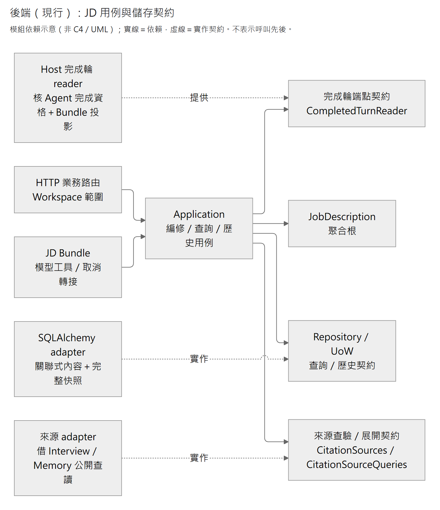
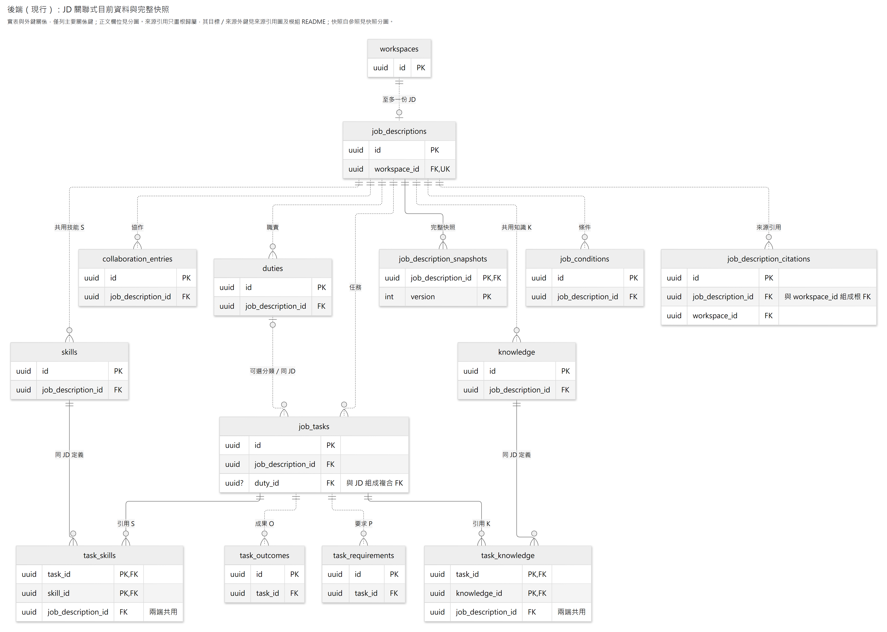
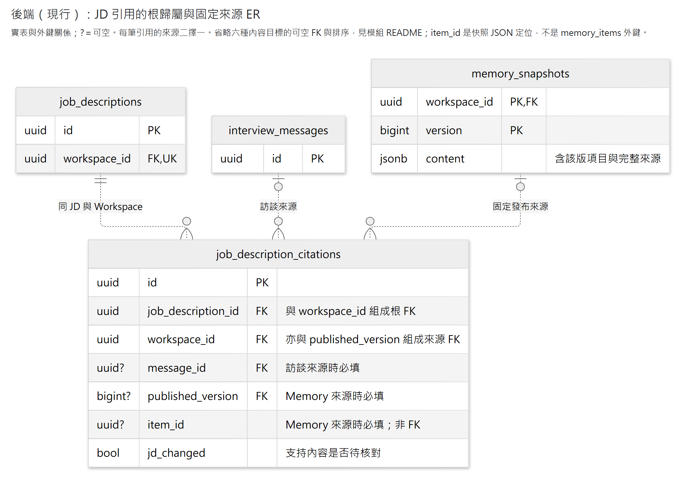
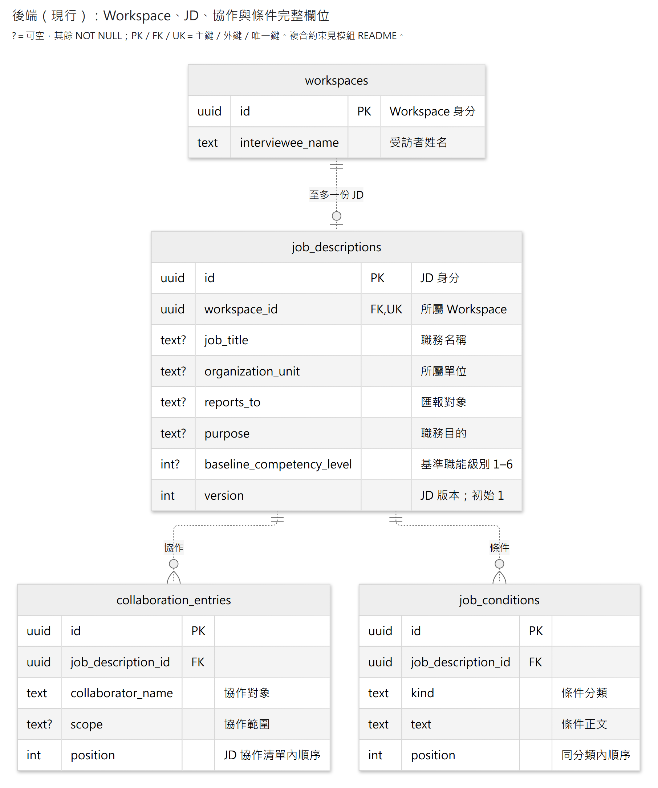
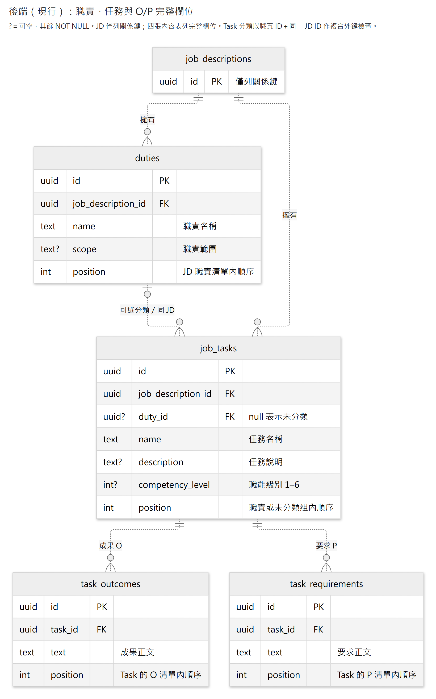
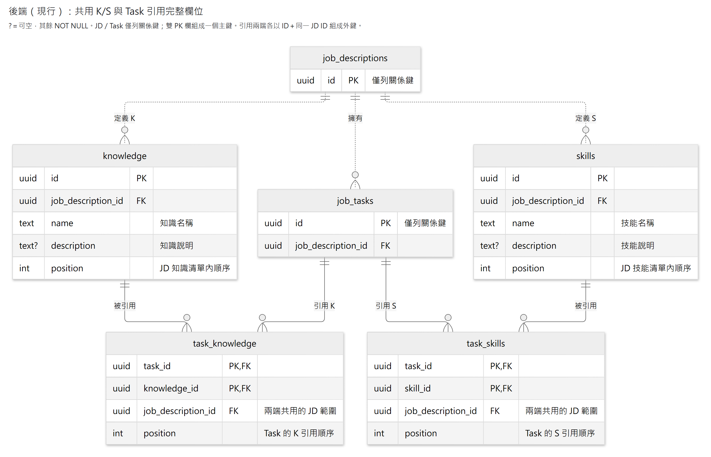
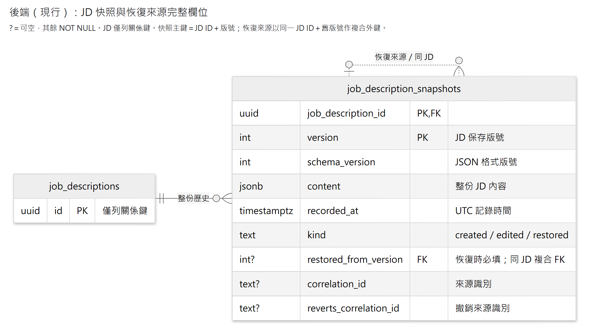

# JD 模組

管理一份 JD 的內容、完整快照歷史、版本差異與安全恢復。JobDescription 是唯一聚合根；人與 AI 共用 Application 入口，所有操作限定 Workspace。人工恢復只變更 JD 內容與引用；執行中的 Agent 取消由 Host 協調，完成輪的唯讀比較不提供整輪 Undo。

| 找什麼 | 入口 |
|---|---|
| 聚合根、Entity、VO／DP | [JobDescription 聚合根](domain/models/job_description.py)及同目錄 [領域模型](domain/models/) |
| 名稱值與同名比較 | [EntryName](domain/models/entry_name.py) |
| 排序共用規則與具名拒絕 | [rules](domain/rules/)及 [errors](domain/errors.py) |
| 基本資料、職責與共用 K/S | [job_descriptions](application/job_descriptions.py)、[duties](application/duties.py)、[knowledge](application/knowledge.py)、[skills](application/skills.py) |
| 任務、O/P 與 K/S 引用 | [tasks](application/tasks/) |
| 協作與條件 | [collaborations](application/collaborations.py)、[conditions](application/conditions.py) |
| 目前查詢、歷史、Diff 與恢復 | [queries](application/queries.py)、[history](application/history/) |
| 已完成輪的固定 JD 兩端與差異 | [turn_history](application/turn_history.py)、[HTTP 投影](presentation/api/routes/turn_history.py) |
| 來源引用、核對與 Memory 差異 | [citations](application/citations.py)、[citation_changes](application/citation_changes.py)及[支持內容](domain/models/citation_review.py) |
| 模型工具、可信 State 與輪次接入 | [JD Bundle](../../bundles/job_description/README.md) |
| 完整 PDF 匯出 | [匯出用例](application/exporting.py)、[HTML 投影](application/export_projection.py)、[Chromium renderer](infrastructure/pdf_renderer.py)、[下載路由](presentation/api/routes/export.py) |
| 保存契約與實作 | [persistence 契約](application/persistence.py)、[PostgreSQL adapter](infrastructure/persistence/) |
| HTTP 及啟動／測試 | [Router](presentation/api/router.py)、[Request／Response](presentation/api/schemas/)、[後端操作](../../../../README.md) |

## 編修與歷史

呼叫端只送局部操作；成功的內容寫入、恢復與整份查詢都直接回傳完整 JD 欄位與 `version`。建立從 v1 開始，一般內容寫入與指定版本恢復帶原 `expected_version`；一般無變更回原版，明確指定版本恢復一律建立下一版。例如目前 v10 恢復 v3 後成為 v11，內容與原 UUID 取自 v3，舊歷史保留。Diff 按種類＋UUID、欄位及各組順序比較兩版內容。指定完成輪的條件恢復採下述可信固定端點前置。

既有 JD 寫入先以 Workspace＋JD 鎖根、完整載入並核版，再由根修改。Repository 只同步有變動的目前資料；JD 新版本與完整快照同交易保存，確認提交後回本次結果。子項沒有獨立版本或可寫 Repository。查詢使用一致的唯讀快照；歷史、Diff 與恢復也先核對 Workspace＋JD。

完成輪查讀由[顧問組裝](../../host/consultant.py)提供 `CompletedTurnReader`，先確認指定 Workspace／turn 正常完成，再回該輪保存的 JD 輪前與完成版本。`get_turn_changes` 回固定兩端完整內容及結構差異；後續人工改稿不混入，無寫入輪可有相同兩版。不以目前 JD 或 correlation 的首末寫入推測端點。不存在、非正常完成、錯範圍或本輪沒有 JD 參與紀錄回 `jd_turn_not_found`；已保存本輪 JD 標記但固定版本／歷史不完整回 `jd_turn_data_error`，不回假空差異。JD 模組不解析 Agent checkpoint，完整 HTTP 欄位由 OpenAPI 維護。

`after_version` 是該輪完成時保存的模型已見版，沒有已見版則使用固定輪前版；後者不表示模型讀過全文。版號未必大於 `before_version`：例如上一輪已見 v7，人工改成 v8 再改回相同內容的 v9，延續窗口且本輪未再讀寫 JD 時，可保存輪前 v9／完成已見 v7。查讀仍沿這兩個原版得到空淨差異，不能改填當前版或因版號逆序拒絕。此入口需 Host 的 Agent 歷史服務可用；一般 JD 歷史與指定歷史版來源查讀不依賴 Agent。

`POST /workspaces/{workspace_id}/job-descriptions/{job_description_id}/turns/{turn_id}:restore` 僅恢復該完成輪的 JD 改動，無業務 body。`restore_completed_turn_changes` 取得可信完成兩端後，復用 [restore_turn_changes](application/history/turn_changes.py)。同根鎖內核對固定輪前基準、完成版上界及完整持久寫入區段；caller 不能選端點，不另收會破壞成功重送語意的 `expected_version`。後續人工、其他來源交錯或超過完成版的同輪來源寫入回 409。已恢復且基準一致時重送回目前 JD，保留其後人工修改；沒有該輪寫入時不增版，不能只用空 diff 推定是否有寫入。正常恢復保存新 JD 版本，保留子項／引用 UUID；原完成輪差異與 Agent、Interview、Plan、Memory 不變。執行中取消沿同用例但不傳完成版上界，保留收束已提交寫入的原行為。

[放大 SVG](../../../../../../docs/diagrams/job-description/application.svg) · [圖源](../../../../../../docs/diagrams/job-description/application.mmd)

此圖說明依賴與契約實作，不表示呼叫先後。HTTP 只轉換格式與映射錯誤；Domain 維護完整內容規則，Application 決定保存與提交，Infrastructure 實作 SQLAlchemy 儲存與快照編解碼。

PATCH 省略欄位表示保留，可空欄位的 `null` 表示清空。內容資源以 `placement` 表達移動，內部省略 `before_id` 表示組末；Task 另須指定目的職責或未分類。Task PATCH 的有序 `changes` 可操作 O/P、K/S 引用、新建並連結 K/S，與本體修改共用一次核版、保存及提交。共用 K/S 定義的修改仍走自己的資源入口。

Application 將具型別的修改意圖轉交聚合根；根定位 Entity、維護跨項目規則，Entity 負責自身修改與集合規則。UoW 只管理交易與 Repository，不執行業務方法。完整路由、欄位與錯誤由[OpenAPI](../../../../README.md#api-文件與實作範圍)提供。只有確定未提交的原生 PostgreSQL 40001 可有限重試；版本拒絕、提交未知及已提交後失敗不重送。

新增由 Application 整理原始值，再呼叫 `JobDescription.create` 或根的 `add_*` 方法。Domain 配發 UUIDv7、建立 Entity／VO、填入歸屬，驗證完整候選後才納入；`add_*` 回傳新 ID，供後續連結或定位。Task 的 K/S 可按序引用既有 ID 或新建名稱／說明，根負責建立及連結。Application 不配號或建立 Entity／VO。Entity 業務欄位唯讀，VO 不可變；修改經根與 Entity 內部方法完成，文字與級別規則由各模型負責。

Entity 繼承 `BaseEntity` 的 `validate_assignment=True`，不啟用 `revalidate_instances="always"`。Repository 與快照解碼以保存值建立獨立的 Domain 物件，保留原 UUID，不重播新增操作；建構子不自動複製另一個根的既有 Entity。新增不接外部可變 Entity，對外讀取沿不可變 DTO，無須普遍 deep copy；既有內容編修仍原地修改。

編修直接使用 Repository 的 `get_for_update`，缺少 scoped JD 時拋出未找到錯誤；`LoadedJobDescription.require_version` 核對該次載入的版本，`UpdateTaskInput.validate_changes` 核對修改組合。這些屬於保存前置與輸入契約，Domain 模型只處理業務狀態及不變條件。

## 來源引用與核對

基本資訊整區、Duty、Task、K、S、協作及條件都可選填多筆來源。O/P 與 Task 的 K/S 用途共用 Task 引用；共用 K/S 定義的依據另屬各自目標。每筆引用有獨立 UUID，保存目標種類／UUID 與同 Workspace 的固定來源；訪談以訊息 UUID 定位，Memory 以 `(workspace_id, published_version, item_id)` 定位。JD 不保存來源正文或另建 Memory 修訂。

引用屬於 JD 根。內容用例的 `citations` 動作可新增、移除或逐筆確認，與正文共用一次核版、來源查驗及提交。改字、排序與移動保留引用；刪除目標清目前引用，歷史仍保留；恢復指定 JD 版本時，正文、引用 UUID、固定來源及核對狀態一起恢復。引用單獨有變也會新增 JD 版本。

恢復會逐筆查讀目標快照的固定來源原件。訪談已撤回仍可恢復原引用，展開時維持不可用；固定原件遺失或損毀則拒絕恢復。這與新增來源的有效資格檢查不同，入口見 [save_and_commit](application/writing.py)。

新增訪談引用使用來源 owner 的同交易公開查詢，要求訊息已保存、同 Workspace 且所屬輪未撤回，持有訪談輪次共享鎖到 JD 提交，避免資格查驗與撤回交錯。這個入口不要求來源輪已完成，因此本輪已保存原話或問答可支持本輪 JD 編修；它不改變 Memory 只整理完成輪的資格。程式查驗來源定位與可用性，原文是否支持 JD 主張仍由編修者核對。

已撤回訪談拒絕新引用；既有引用保留定位，展開只回 `unavailable` 且不回正文，無關內容修改仍可完成。原件遺失、損毀或查詢故障是明確錯誤，不能偽裝成撤回或空內容。Memory 只核固定發布版與該版項目存在，不遞迴重驗訪談現況；理解所引情境從同版快照解析。公開接縫見 [CitationSources](application/citation_sources.py)及其[來源 adapter](infrastructure/persistence/citation_sources.py)。

人工修改支持內容會把受影響既有引用的 `jd_changed` 設為待核對，改回也保留；顧問實際修改該支持內容或逐筆確認才核清。Task 支持內容含文字、級別、O/P 及所連 K/S 定義，基本資訊含基準級別；排序及 Task 歸屬不觸發語意待核對。Application 以可信 `actor` 區分人與顧問，HTTP 預設人工，不以 correlation ID 推定作者。

Memory 來源變動比較原引用固定版與指定比較版的同 UUID、正文、來源鏈及 `changed_version`。比較版刪除項目會顯示刪除，不改指同名新項目；讀取不清除待核對。`needs_recheck` 是 `jd_changed` 或來源變動；未提供 Memory 比較基準且 JD 尚未標記時回未知 `null`。Memory 逐筆確認必須提供已選定的發布版，將同一 citation UUID 改指該版同一 item UUID 並核清；直接訪談確認不接受 Memory 版號。

完整／歷史 HTTP 內容回覆保存引用座標與 `jd_changed`，不逐次展開來源。人工來源查讀由 `GET /workspaces/{workspace_id}/job-descriptions/{job_description_id}/citations/{citation_id}` 提供，可帶 `published_version` 比較；同目標逐筆增修使用 `PATCH` 該 `citations` 集合，帶 `expected_version`。既有內容建立／PATCH 亦可同次帶引用動作。組裝 `build_job_description_router` 時提供 `citation_sources` 與 `memory_queries` 即包含獨立來源路由；也可單獨組裝 [build_citations_router](presentation/api/routes/citations.py)。兩者不要求 Agent 或插件啟用。

指定歷史版的來源沿 `GET /workspaces/{workspace_id}/job-descriptions/{job_description_id}/history/{version}/citations/{citation_id}` 查讀。此入口從所選 JD 快照取得 citation，後續改字、核對或移除目前引用都不改變所選原件；`published_version` 仍只控制 Memory 比較端，不會把引用改指最新版。同樣遵守訪談撤回後只回不可用定位的政策，讀取不變更核對旗標。

`initialize_job_description` 接受呼叫者既有交易的 `JobDescriptionRepository`，新增空 JD 及首版快照而不提交、關閉或更改隔離。完整 App 的跨 owner 原子建立可借用此窄入口；一般 `create_job_description` 仍自行開 UoW、呼叫初始化並提交。

## PDF 匯出

`export_job_description` 取得 Workspace＋JD 的完整唯讀快照，結束資料庫讀取後才列印。投影包含基本資訊、基準及 Task 職能級別、Duty／Task／O／P／K／S、協作與條件；業務文字一律 HTML escape，不帶員工姓名、引用來源或控制定位。匯出不修改 JD 或新增歷史。

獨立 `build_export_router` 提供 `GET /workspaces/{workspace_id}/job-descriptions/{job_description_id}/export.pdf`，不依賴 Agent 啟用。Host 注入查詢與共用的 `PdfRenderer`，並在 lifespan 關閉 renderer。[`PdfConfiguration`](infrastructure/pdf_renderer.py)指定中文字型與 Chromium，環境設定見[後端操作](../../../../README.md)。沒有 renderer 時明確回 503，列印錯誤只回安全代碼。

Renderer 一次接一份工作，沒有等待佇列；呼叫者逾時或取消後，名額仍保留至實際工作結束。60 秒上限只限制呼叫者等待，不保證 Chromium 初始化、關閉及 worker 回收在期限內完成；瀏覽器或驅動關閉若卡住，應用關閉亦可能等待。這項限制不影響已完成查詢的資料庫連線釋放。

## 資料關係

目前正文使用 11 張關聯表，來源使用 `job_description_citations`，歷史使用一張 `job_description_snapshots`；Workspace 是模組外部的歸屬表。總覽只列主要關係鍵，來源引用另以局部圖展開。這些 ER 對應實際資料表與外鍵，不是領域物件圖；表數不代表聚合數，所有目前 JD 內容都屬於同一根。

初讀先看[編修與歷史](#編修與歷史)的用例接線，再按問題查閱[來源引用](#來源引用的資料關係)或[正文與快照欄位](#正文與快照欄位)的局部分圖。完整 ER 供跨表核對，可展開下圖或開啟 SVG 放大。

展開完整 ER：目前內容、來源引用與快照

[放大 SVG](../../../../../../docs/diagrams/job-description/storage.svg) · [圖源](../../../../../../docs/diagrams/job-description/storage.mmd)

Workspace 至多一份 JD；Task 可不分類。Duty 分類與 K/S 引用的兩端必須同 JD，由複合 FK 保護；操作範圍另由 Application／Repository 核對。這些資料約束不代替使用者授權。

刪 Duty 會把原 Task 按原順序接到未分類組末；刪 Task 會清除自有 O/P 與引用，保留共用 K/S；刪 K/S 先解除全部引用。快照內的子項 UUID 不參照目前子表，刪除子項後仍可查回及恢復原版。

刪除整份 Workspace 則沿所有權 FK 清除 JD、所有內容與歷史，不逐項重播編修或產生刪除快照。Task→K/S 定義的複合 FK 保留引用限制，在交易提交時檢查，避免跨分支級聯依賴 trigger 順序；懸空或跨 JD 引用仍不能提交。單項刪除的領域規則不變。

### 來源引用的資料關係

[放大 SVG](../../../../../../docs/diagrams/job-description/source-citations.svg) · [圖源](../../../../../../docs/diagrams/job-description/source-citations.mmd)

每筆引用必屬同一 JD 與 Workspace，來源只能是訪談訊息，或固定 Memory 發布版中的項目。兩條來源線各自為可選，`CHECK` 再要求恰選一種：訪談填 `message_id`；Memory 同時填 `published_version` 與 `item_id`。`item_id` 從該版快照 JSON 解析，不指向目前的 `memory_items`。訪談 FK 只保護訊息 UUID 存在，同 Workspace、有效性與撤回資格由來源公開查詢核對。

為聚焦來源，圖中省略 `duty_id`、`task_id`、`knowledge_id`、`skill_id`、`collaboration_id`、`condition_id` 與排序欄。六個可空目標欄位各與 `job_description_id` 組成同 JD 內容外鍵；最多選一個，皆空代表基本資訊整區。完整儲存定義見 [citation_rows](infrastructure/persistence/citation_rows.py)與 [migration 0009](../../migrations/versions/0009_jd_citations.py)。

## 正文與快照欄位

以下四張參考圖只展開正文及快照，不重複來源引用圖。重複出現的 JD／Task 參照方塊只列關係鍵。`?` 表示允許 NULL，其餘為 NOT NULL；多個 `PK` 標記共同組成一個主鍵。型別為閱讀用簡寫，複合約束見[下表](#跨欄位約束)，正式定義見 [ORM](infrastructure/persistence/orm_models.py)。

### 基本資料、協作與條件

[放大 SVG](../../../../../../docs/diagrams/job-description/basic-fields.svg) · [圖源](../../../../../../docs/diagrams/job-description/basic-fields.mmd)

`organization_unit`、`reports_to` 與 `collaborator_name` 都是文字記載。條件的五類為 `work_environment`、`schedule_travel`、`shared_authority`、`shared_collaboration`、`qualification`，各類可有多筆。

### 職責、任務與 O/P

[放大 SVG](../../../../../../docs/diagrams/job-description/task-fields.svg) · [圖源](../../../../../../docs/diagrams/job-description/task-fields.mmd)

Task 按 Duty／未分類組排序；O/P 各按 Task 排序。`EntryName` 先移除前後空白，再限制名稱最多255個 Unicode code points；清洗後字串完全相同才算同名，大小寫不同可共存。比較與雜湊沿 Pydantic 不可變值的預設行為。只改大小寫仍保存，僅前後空白不同則為 no-op。描述及 O/P 正文保留原文。正式寫入先鎖根再驗證同類名稱；DB 的 `(job_description_id, name)` 唯一約束保護已保存字串，不負責清洗輸入。

### 共用 K/S 與引用

[放大 SVG](../../../../../../docs/diagrams/job-description/knowledge-skill-fields.svg) · [圖源](../../../../../../docs/diagrams/job-description/knowledge-skill-fields.mmd)

K/S 正文各存一份，引用表只存關係及順序。回覆中的 `knowledge_ids`、`skill_ids` 對應有序引用列；總覽順序與各 Task 引用順序互相獨立。

### 完整快照

[放大 SVG](../../../../../../docs/diagrams/job-description/snapshot-fields.svg) · [圖源](../../../../../../docs/diagrams/job-description/snapshot-fields.mmd)

快照以 `(job_description_id, version)` 定位。`content` 是完整業務內容、原 UUID、分類、引用及邏輯順序；`schema_version` 是 JSON 格式版號。`recorded_at` 供顯示，歷史依 `version` 排序。來源識別可重用，不是冪等鍵或權限憑證；`restored_from_version` 指向同 JD 的舊快照。

新快照使用格式 v2，必須包含完整 `citations`；既有無來源引用的 v1 可明確解碼為空集合。不能把缺少 v2 引用欄位當成空引用，亦不接受 v1 偷帶新引用。來源表由 migration `0009_jd_citations` 建立，接於 `0008_model_references`，啟動不自動升級。

成功建立 JD 時，根與 created v1 快照一起提交；一般有效編修保存 edited，明確恢復保存 restored。圖中零到多描述 FK 基數，不表示成功建立可缺少首版快照。

### 跨欄位約束

| 範圍 | 唯一／外鍵／檢查 |
|---|---|
| JD | `UNIQUE(workspace_id)`；`version > 0`；基準級別 NULL 或 1–6 |
| Duty／Task／K／S | 各表 `UNIQUE(id, job_description_id)` 供複合 FK 參照；`UNIQUE(job_description_id, name)`；名稱採 TEXT，CHECK 限制長度 1–255 |
| Task 分類 | `(duty_id, job_description_id)` → Duty 的 `(id, job_description_id)`；另有 JD FK，未分類仍須屬於有效 JD |
| Duty／K／S／協作排序 | 各表 `UNIQUE(job_description_id, position)` |
| Task 排序 | `UNIQUE(job_description_id, duty_id, position) NULLS NOT DISTINCT`，未分類仍禁止同位置 |
| O／P 排序 | 各表 `UNIQUE(task_id, position)`；Task FK 可級聯清除自有列 |
| K／S 引用 | PK 為 `(task_id, knowledge_id)` 或 `(task_id, skill_id)`；兩端 ID 各與同一 JD ID 組成 FK；各表 `UNIQUE(task_id, position)` |
| 條件 | `UNIQUE(job_description_id, kind, position)`；kind 限五類 |
| 內容共通 | `position >= 0`；Task 級別 NULL 或 1–6；必填名稱／正文／協作對象不可全空白；名稱與排序 UNIQUE 可延後檢查，支援同交易交換 |
| 來源引用 | 獨立 UUID PK；根＋Workspace 與內容目標複合 FK；最多一個子目標，皆空表示基本資訊；訪談訊息 FK 或同 Workspace 固定 Memory 快照 FK 二選一；同目標同來源唯一；Memory item 存於快照 JSON，存在資格由來源公開查詢核對 |
| 快照 | 複合 PK；版本／格式版號 > 0；content 為 JSON object；created 只在 v1，edited 在 v1 之後；restored 必填較舊來源版並以同 JD 自 FK 參照，其他種類來源版為 NULL；來源若提供須非全空白且最多 200 字；撤銷來源僅 restored 可填 |

Domain 驗證內容規則，DB 保護上列可宣告約束；選填文字仍可空白。快照讀取與恢復另外驗證格式、身分、歸屬、引用及內容結構，損毀歷史不回空或部分 JD。
