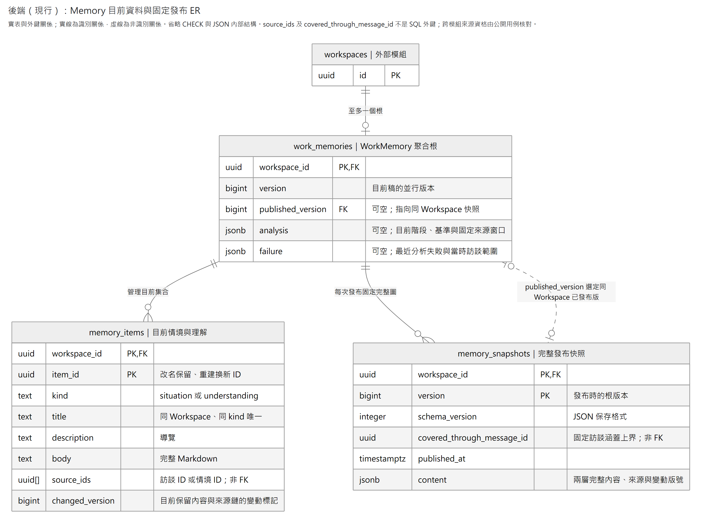

# Memory

Memory 保存工作情境與工作理解，原始訪談由 Interview 擁有。每個 Workspace 至多一個 `WorkMemory` 聚合根，所有編修、來源連動及發布都經根完成；不為每張表建立獨立 CRUD 服務。

| 責任 | 程式入口 |
|---|---|
| 根內一致性：兩層內容、來源連動、分析階段與發布 | [WorkMemory](domain/work_memory.py) |
| 用例與短交易：開始、編修、交接、發布、放棄 | [MemoryService](application/service.py) |
| 聚合保存、訪談來源資格及獨立查讀介面 | [Application ports](application/persistence.py) |
| PostgreSQL 保存、查讀與 Interview 來源轉接 | [Infrastructure](infrastructure/persistence/) |
| 已發布內容的 HTTP 查讀 | [Router](presentation/api/router.py) |
| A／B1／B2 的提示、工具與背景整理協調 | [Memory Bundle](../../bundles/memory/README.md)；不屬於本模組的領域規則 |

## 資料與引用

[放大 SVG](../../../../../../docs/diagrams/memory/memory-storage.svg) · [Mermaid](../../../../../../docs/diagrams/memory/memory-storage.mmd)

此圖呈現實表與 SQL 外鍵，省略 JSON 內部結構及一般檢查約束。根與快照之間有兩種關係：根擁有全部發布快照，且可用 `(workspace_id, published_version)` 選定其中一版。正式定義見 [ORM](infrastructure/persistence/orm_models.py)及 [migration 0007](../../migrations/versions/0007_memory.py)。

| 表 | 責任 |
|---|---|
| `work_memories` | 根版本、目前發布版、目前分析的階段與固定窗口、最近分析失敗狀態 |
| `memory_items` | 目前情境與理解；各有穩定 UUID、標題、描述、正文、來源、變動版本 |
| `memory_snapshots` | 不可變的完整發布圖；固定內容及全部來源關係 |

情境與理解是不同領域 Entity，共用項目表，以 `kind` 區別。情境的 `source_ids` 引用 **`interview_messages.id`**；理解的 `source_ids` 引用 **同根、kind=situation 的 `memory_items.item_id`**。全部限同 Workspace。標題可改，UUID 不變；刪除後重建取得新 UUID。

對外固定引用是 `(workspace_id, published_version, item_id)`。理解在某發布版引用的情境，也從同版快照解析。`source_ids` 陣列及快照的 `covered_through_message_id` 都不是 SQL 外鍵：Domain 核對情境關係，Application 透過 Interview 公開保存介面核對原話歸屬、完成資格、有效性及固定上界；來源查驗與寫入共用交易及訪談輪鎖。

同層標題精確唯一。情境變更會更新引用它的理解之 `changed_version`；刪除情境會同次移除理解中的該引用。成功分析內改回原文仍留下變動標記；放棄失敗稿則恢復發布基準及其標記，根版本繼續前進。完整快照只追加，資料庫禁止改寫，僅允許 Workspace 整體刪除時級聯清除。

## 分析與查讀

[Memory Bundle](../../bundles/memory/README.md) 負責模型提示、工具及 B1→B2。A 輪前固定發布版，包括尚無發布的空基準；同輪恢復不換版，新輪重新選版。A 只能讀取及提出整理意圖。

Host 在 A 完成保存後核對意圖與完成狀態，以該輪最後正式訊息固定來源上界，包含同輪問題、答案／略過及最終發話；未完成／取消輪及上界後的新輪不納入。`MemoryService.start` 在同一短交易鎖根、綁定來源窗口並保存分析階段，才開始 B1。B1 只讀寫情境，B2 可讀兩層與合法原話、只寫理解；Bundle 核對明確完成結果後直接呼叫交接或發布用例，零修改不等於完成。模型執行、故障結算及接續流程見 [Bundle 完成與恢復](../../bundles/memory/README.md#完成與恢復)。

`MemoryService` 是程式內部介面，使用 `MemoryWriteContext(workspace_id, expected_version, analysis_id)`，沒有命令收據或回放協定。根保存目前分析階段供接續；已發布涵蓋的整理意圖直接略過。已知無法完成的分析同交易還原基準並保存一筆目前失敗狀態，新增六則已完成有效輪次的正式訊息才再試，包含問題、回答及略過；工具紀錄與尚可取消的輪次不算。成功發布後清除失敗狀態。這筆狀態不保存操作歷史、請求或回傳結果。

HTTP 只讀已發布內容：

- `GET /workspaces/{workspace_id}/memory`：目前發布版 Map，尚未發布時回空 Map。
- `GET /workspaces/{workspace_id}/memory/versions/{version}`：指定發布版 Map。
- `GET /workspaces/{workspace_id}/memory/versions/{version}/items/{item_id}`：該版單項全文及來源。

停用 Agent 仍可查讀。指定不存在的 Workspace、發布版或項目回 404；保存內容損毀或查詢失敗回 503，不能偽裝成空成功。無 HTTP 寫入端點。

## 組裝與限制

Alembic `0007_memory` 建立三張表；服務啟動不自動遷移。Domain 不依賴 SQL、Agent 或模型；Application 只依賴自有 ports；Infrastructure 透過 Workspace／Interview 公開保存查詢實作。跨模組依賴由 `.importlinter` 檢查。

目前隨 Host 使用單 worker；同 Workspace 的整理依序執行。資料庫根鎖、版本與分析階段拒絕失效寫入。Agent Checkpoint 與業務資料各自保存，不保證提交中斷後回傳原用例結果。完整發布內容會重複保存，尚未作正式容量／延遲基準；沒有額外 revision、正文重用或來源邊表。此模組不提供未支援資料格式的自動遷移；操作界線見[更新與備份](../../../../../../docs/operations/README.md#更新與備份)。
