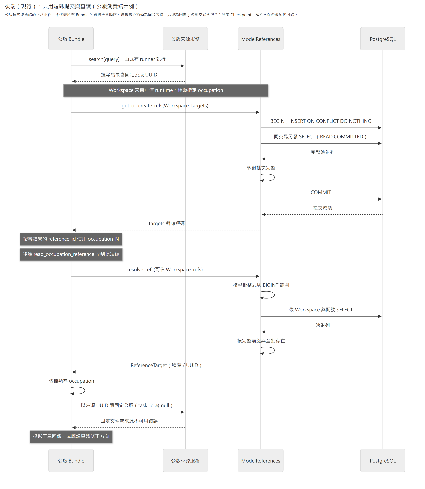
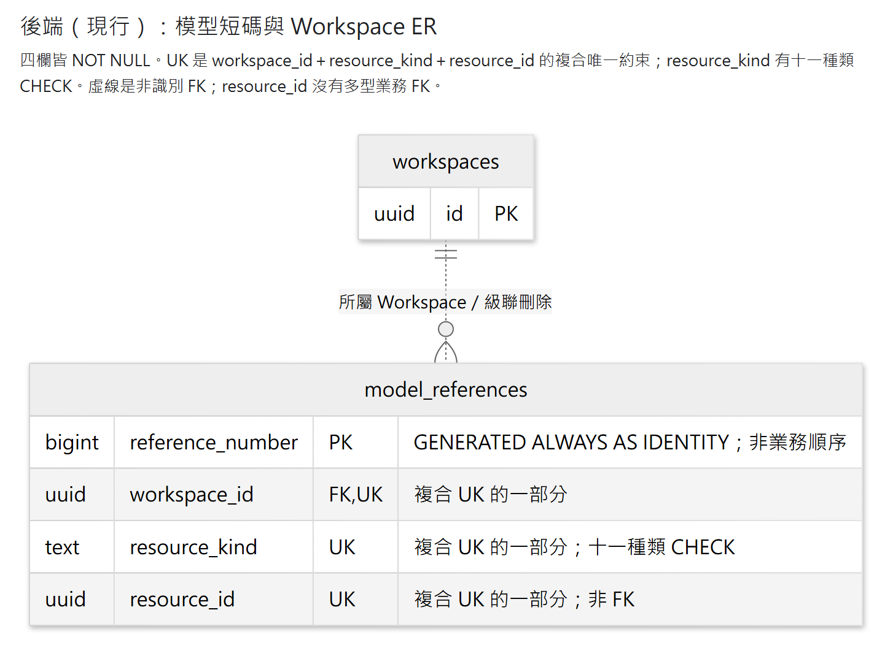

# 模型短碼

`model_references` 是後端的共用定位服務：讓模型使用 `message_101`、`task_102` 等短碼，正式業務關聯仍使用 UUID。同一 Workspace／種類／UUID 持久對應同一短碼；配置號可缺號，不代表順序、版本或權限。本模組沒有模型工具、Prompt、HTTP 路由或業務來源資格。

依問題閱讀：[入口與組裝](#入口與組裝) · [批次接口與錯誤](#批次接口與錯誤) · [配置與使用流程](#配置與使用流程) · [資料表](#持久化與組裝) · [生命週期與恢復](#生命週期與恢復)。整體責任見[系統架構](../../../../architecture.md)。

## 入口與組裝

| 入口 | 責任 |
|---|---|
| [公開匯出](__init__.py)與[契約](contracts.py) | `ModelReferences` Protocol、不可變的 `ReferenceTarget`、固定 `ResourceKind` 與例外 |
| [PostgreSQL 實作](persistence.py) | 批次配置／解析；每次呼叫取得並關閉自己的 Session |
| [ORM](orm_models.py)與[migration 0008](../../migrations/versions/0008_model_references.py) | 唯一映射表、Workspace FK、identity、複合唯一及種類約束 |
| [Host 應用程式](../../host/app.py) | 建立 `SqlAlchemyModelReferences(session_factory)`，將同一實例注入消費者；Engine 的生命週期歸 Host |

Host 將同一服務綁定到 Interview 的 `MODEL_REFERENCES`、JD 的 `JD_REFERENCES`、公版的 `REFERENCE_IDS`，Memory B 工廠亦沿用此實例。這些是消費者具名依賴，不是三套配號系統。服務本身不另包成可啟停 Plugin；Bundle 的 Plugin 決定是否提供模型能力，Core 不依賴短碼或具體業務。

| 消費者與模型定位欄位 | 消費者自有責任 |
|---|---|
| [Interview／題答](../../bundles/interview/README.md)：`ref`、`reply_to`、問題／答案 ref 使用 `message_*` | Interview 核正式訊息與順序。range 先解析兩端 UUID，再按正式順序選取，不能比較短碼數字 |
| [JD](../../bundles/job_description/README.md)：項目 `read_ref`、來源 `message_ref`、引用 `citation_ref` | JD 核目前內容、預期種類、歸屬、版本及引用資格；`citation_*` 只定位引用 UUID |
| [Memory](../../bundles/memory/README.md)：訪談來源使用 `message_*` | A 與 B 的可讀範圍不同；B 先核整份固定分析來源。情境／理解仍用精確 `target_title`，沒有 Memory 項目短碼 |
| [公版](../../bundles/job_reference/README.md)：`reference_id` 使用 `occupation_*` | 公版 owner 查固定文件；文件內 `uN-tN` 任務座標須連同文件使用 |

只轉換這些契約明定的定位欄位，保留正文原字串；Plan 不配置短碼。模型不提供 Workspace、Turn、版本或 UUID 控制值，Bundle 從可信 runtime 取值。各能力的完整參數、回傳與 Prompt 由連結的 Bundle 維護，不在 mapper 複製第二套工具契約。

## 批次接口與錯誤

Bundle 從 `caliburn.modules.model_references` 匯入 `ModelReferences`、`ReferenceTarget`、`ResourceKind` 與錯誤型別。Host 從 `persistence` 匯入 `SqlAlchemyModelReferences`，注入共用 `session_factory`。

```python
target = ReferenceTarget("message", message_id)
refs = references.get_or_create_refs(workspace_id, [target])
resolved = references.resolve_refs(workspace_id, [refs[target]])
assert resolved[refs[target]] == target
```

- `get_or_create_refs(workspace_id, targets) -> dict[ReferenceTarget, str]`：同 Workspace／種類／UUID 只配置一次；獨立短交易提交完成才回傳。
- `resolve_refs(workspace_id, refs) -> dict[str, ReferenceTarget]`：整批解析，任一無效就拒絕，不回部分結果；成功只表示本 Workspace 有此完整短碼的映射。
- 空批次回 `{}`，重複折疊，回傳順序無業務意義。兩者是同步 I/O；async 接入沿框架 worker／`asyncio.to_thread`，不在 event loop 直接呼叫。建構不連線，每次呼叫各自取得／關閉 Session，不關閉借入 engine。
- `ReferenceTarget` 是 frozen dataclass；`resource_kind` 為 Literal，`resource_id` 為 UUID。固定種類為 message、duty、task、outcome、requirement、knowledge、skill、collaboration、condition、occupation、citation。citation 僅定位引用 UUID，引用業務規則歸 JD。

模型短碼必須符合 `<resource_kind>_<positive integer>`，數字為 ASCII、無前導零、最大 `9223372036854775807`。不接受完整 UUID、舊格式或自動修正。

| 失敗 | 服務行為與呼叫方責任 |
|---|---|
| 格式錯誤、未知種類、非合法正整數或超過 BIGINT | `InvalidModelReferenceError`；例如 `message_01`、未知前綴或完整 UUID |
| 格式合法但本 Workspace 無完整短碼 | `UnknownModelReferenceError`；包含跨 Workspace，以及把已知碼改成另一個允許種類的前綴 |
| 配置遇並行 Workspace 刪除，SELECT 結果不完整 | `ModelReferenceAllocationError(RuntimeError)`，不回空集合／部分結果、不自行重試；刪除發生在其他時點也可能先得到原生 DB 錯誤 |
| 連線、提交或其他儲存故障 | 原生錯誤向外傳遞，不偽裝成找不到；呼叫方先核 Workspace 與原業務結果 |

前兩者共用 `ModelReferenceError(ValueError)`，都有 `.reference`；Bundle 用它指出失效參數的位置並選擇可修正的下一步，mapper 不知道 `supporting_sources[0].message_ref` 等工具欄位。例外訊息不洩漏其他 Workspace 或目標 UUID。若模型提供的是另一種類的真實短碼，解析可以成功，但 Bundle 仍須拒絕不符合該參數預期的種類。

## 配置與使用流程



[放大 SVG](../../../../../../docs/diagrams/model-references/reference-boundary.svg) · [圖源](../../../../../../docs/diagrams/model-references/reference-boundary.mmd)

圖示為公版搜尋後使用 `occupation_*` 查讀固定文件的正常成功路徑。配置必須提交完成才將短碼交給模型；目標的種類、歸屬、存在性與可讀資格由消費者及業務 owner 負責，映射本身不授予讀寫權，也不驗證目標是否仍存在。

這不是各 Bundle 共用的呼叫順序。Interview 先取得可讀來源；Memory B 在此先驗整份固定來源，之後才解析指定 ref；JD 也先讀目前快照，再比對解析結果。業務寫入後配碼則沿已保存的原結果。完整先後與來源規則留在各 Bundle，不搬入 mapper。

配置時批次去重並按固定順序 INSERT，使用 `ON CONFLICT DO NOTHING`；在**同一短交易**中另發 SELECT，以 PostgreSQL 預設 READ COMMITTED 取得剛才等待的並行提交結果。確認完整批次後才 COMMIT；提交失敗不回碼。不自製鎖或重試。解析則使用獨立唯讀 Session，按 Workspace／配號查詢後核完整前綴與全批結果，不寫入或提交映射。

## 持久化與組裝

### 資料表



[放大 SVG](../../../../../../docs/diagrams/model-references/reference-storage.svg) · [圖源](../../../../../../docs/diagrams/model-references/reference-storage.mmd)

此圖列出短碼表四欄與唯一的 SQL 外鍵，Workspace 只列關係鍵。四欄皆不可空；三個 UK 標記共同表示一個複合約束，不表示各欄單獨唯一。Workspace 鍵不參與短碼表主鍵，因此使用非識別關係；`resource_id` 沒有多型業務外鍵。正式型別及約束以 ORM 與 migration 為準。

`model_references` 四欄：`reference_number`（BIGINT GENERATED ALWAYS AS IDENTITY 主鍵）、`workspace_id`（FK workspaces ON DELETE CASCADE）、`resource_kind`（固定種類文字）、`resource_id`（UUID）。`UNIQUE(workspace_id, resource_kind, resource_id)` 保證同目標唯一。

`resource_kind` 另有 CHECK 限定前述十一種類。表中不保存完整 ref 字串、正文、順序、版本、Turn、窗口或 active 標記。公版內容雖然共用，模型別名仍依 Workspace 配置。Host 將 ORM 納入 Alembic metadata，明示執行 migration 後再使用服務。

## 生命週期與恢復

在同一 Workspace、同一種類下，同 UUID 改名、排序、移動、恢復或換窗仍用原碼；同名新 UUID 使用新碼。同一 UUID 若用於不同種類或不同 Workspace，也各自配碼。服務沒有刪除或回收接口。業務刪除、取消及停用 Plugin 不刪除映射；舊碼仍解析回原 UUID，再由 owner 拒絕失效讀寫。正常業務生命週期中，只有整份 Workspace 刪除經 FK 級聯移除其映射。

映射提交與業務寫入／Checkpoint 不構成單一交易。已保存業務若後續配置失敗，呼叫方須沿原 UUID／原結果查回再配置，不能以新 UUID 重建。這張表是持久資料，備份與恢復必須和業務資料、可恢復 Checkpoint 一致，不能當作可任意重建的 cache。

`0008` 的 downgrade 會刪除整張映射表，不能用作仍要續用既有短碼歷史的操作性回退。重建表即使保留業務 UUID，也無法保證原配置號；資料搬移／整體恢復須同時保留映射。不提供舊 JD 私有短碼或舊資料的自動相容轉換。

維護時沿[單元測試](../../../../tests/unit/modules/model_references/)核格式與失敗邊界，沿[PostgreSQL 整合測試](../../../../tests/integration/model_references/)核持久、並行及 FK 約束；Bundle 的來源資格、取消與恢復由各能力的測試負責。
