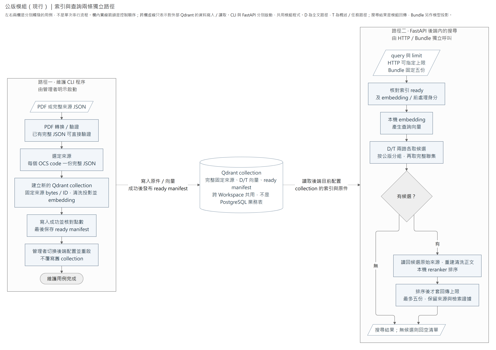

# 職業公版參考模組

`occupation_reference` 管理職業公版（OCS）的 PDF 轉換、固定來源、向量索引、搜尋與回讀。維護 CLI 與 FastAPI 後端使用同一模組：CLI 程序執行轉換及建索引，後端程序處理 HTTP 查讀及已啟用的 [Job Reference Bundle](../../bundles/job_reference/README.md)。它們不經另一個公版 HTTP 或模型推論服務轉接。

公版來源及 Qdrant 索引跨 Workspace 共用，不保存員工事實。Bundle 負責模型提示、工具參數與結果格式；模型使用的 Workspace 短碼由 [Model References](../model_references/README.md) 保存。停用 Agent 或公版 Bundle 不影響本模組的 HTTP 與維護入口。

閱讀順序：[來源流程](#來源索引與搜尋) → [資料身分](#資料身分與儲存) → [HTTP](#http-與查讀) → [配置](#明示配置與本機模型) → [維護與選版](#pdf-轉換與選版) → [建索引與切換](#建立新索引與切換)。

下列命令均在 `apps/backend` 執行。HTTP 使用同一個 FastAPI App，預設網址為 `http://127.0.0.1:8101`；後端基本安裝、PostgreSQL 與啟動沿[後端 README](../../../../README.md)。

全量本機語料集中在本模組的 [`data/`](data/README.md)：原始 PDF、完整／清洗 JSON、文字保全版、隔離候選與診斷各有明確位置。資料不隨 Git 或 Python 套件交付，CLI 仍明示指定來源子目錄；放入資料夾不會自動匯入或切換向量索引。

## 來源、索引與搜尋

本圖分開維護 CLI 與後端搜尋的控制順序。兩者存取 Qdrant 中的固定來源與索引；PDF 解析在維護 CLI 內執行，建索引的 embedding 也在該 CLI 程序執行。HTTP／Bundle 搜尋使用後端程序內的 embedding 與 reranker，沒有獨立 GPU 服務。



[放大 SVG](../../../../../../docs/diagrams/occupation-reference/source-search-flow.svg) · [圖源](../../../../../../docs/diagrams/occupation-reference/source-search-flow.mmd)

圖中省略逐檔拒絕、診斷與各種依賴錯誤，詳見下方維護規則。建索引失敗不發布 ready manifest；即使建立成功，也須明示改配置並重啟才切換。`clean-json` 另存的清洗副本不作索引來源，索引從完整來源產生清洗搜尋投影。兩個 GET 回讀入口只驗索引並讀固定來源，不經 embedding／rerank；目前配置之外的舊 collection 不在回讀契約內。

## 資料身分與儲存

Qdrant 的一個 collection 同時保存固定來源、搜尋向量與 ready manifest。本模組沒有 PostgreSQL 業務表；下列是 point 與 payload 的邏輯關係，不是 SQL 外鍵或另一份 OCS Schema。

| 資料 | 定位及內容 | 使用方式 |
|---|---|---|
| 全文 point | ID 為 `reference_id`；保存原始 UTF-8、來源檔名、SHA-256 及清洗全文 D 的向量 | 回讀時從原始 bytes 重建來源並重驗身分；rerank 使用完整清洗正文 |
| 概述／任務 point | ID 由來源 ID 與段落位置產生；payload 保存 `reference_id`、種類及適用的 `task_id`，向量來自清洗概述／完整任務群組 | 按父來源分組召回；任務正文由固定來源讀取，沒有另一份任務內容副本 |
| ready manifest | collection 內固定 ID 的無向量 point；包含 embedding／前處理身分與文件、資料點數 | 建置全部成功後才保存；查讀前核對就緒與相容性 |

`reference_id` 是 OCS code 與原始 UTF-8 bytes 所決定的 UUID；`task_id` 如 `u1-t1` 是該來源內的任務群組位置。來源 bytes 改變會得到新 ID。模型短碼 `occupation_<n>` 由 Model References 在 Workspace 內對應此 UUID，不是 Qdrant point ID，也不保證舊 collection 切換後仍能讀到來源。

## HTTP 與查讀

| 入口 | 輸入及結果 |
|---|---|
| `POST /occupation-references:search` | JSON `query` 為 1–12,000 字元且不可全空白；`limit` 為 1–5、預設 5。回公版目錄、檢索證據及採用的檢索設定 |
| `GET /occupation-references/{reference_id}` | 回固定來源的職稱、概述與完整單元／任務目錄，含來源 hash；不以搜尋命中任務裁切目錄 |
| `GET /occupation-references/{reference_id}/tasks/{task_id}` | 回同一固定來源中的任務群組，保留全部 T code／名稱、職能級別及 O/P/K/S |

一個 `task_id` 群組可能包含多個 T code，不是全域任務代碼。API 不會將不同來源的同名任務合併。目錄與任務回傳是已解析來源的查讀投影，並非完整 OCS JSON；工作產出、行為指標、知識與技能（O/P/K/S）由任務入口回讀，來源的 notes 補充說明由模型工具提供，目前不在 HTTP 投影中。

錯誤語意：輸入無效 422、來源／任務不存在 404、索引未 ready 或身分不相容 409、模型／儲存回覆無效 502、依賴不可用 503。HTTP 錯誤不輸出本機完整路徑與查詢全文；完整欄位沿啟動後的 `/docs` 及 `/openapi.json`。

兩個 GET 只讀取 Qdrant 中已固定的來源，不執行 embedding／rerank，也不載入模型權重；仍會核對索引 manifest 與目前配置的 embedding／前處理身分。搜尋才按需載入本機 embedding 及 reranker。後端啟動必須提供公版配置；關閉 Agent 不會停用公版能力。啟動只建立延遲資源，不驗全索引或載入權重，服務是否可查仍須經實際查讀確認。

HTTP 保留正式契約的原始來源欄位投影；模型工具另沿同一清洗規則整理正文，並提供分類、整體級別、態度及註解，詳見 [Bundle 契約](../../bundles/job_reference/README.md#模型可見契約)。完整原始 UTF-8 由固定來源保存；目前 HTTP 目錄與任務回應並非整份原始 JSON 的下載介面。

## 明示配置與本機模型

先複製[配置範例](../../../../reference.example.json)至 `.local/reference.json`，設定獨立 Qdrant collection 與本機資源，再讓後端讀取此檔：

```powershell
$env:CALIBURN_REBUILD_REFERENCE_CONFIG = ".local/reference.json"
uv run --locked --extra local-models --env-file .env python -m caliburn.server
```

使用搜尋或建索引前，安裝鎖定的本機推論套件：

```powershell
uv sync --locked --extra local-models
```

`local-models` 包含 Torch／Transformers；版本及平台 wheel 來源由 [pyproject.toml](../../../../pyproject.toml)與 [uv.lock](../../../../uv.lock)維護。PDF 轉換及兩個 GET 不需要載入這組套件。後端仍須設定 `CALIBURN_REBUILD_DATABASE_URL`；公版配置不代替整個 App 的資料庫設定。

| 配置 | 用途與預設 |
|---|---|
| `collection` | 必填；明示要建立或讀取的 Qdrant collection |
| `qdrant_url` | Qdrant 位址，預設 `http://127.0.0.1:6333` |
| `qdrant_timeout_seconds` | Qdrant 請求逾時，預設 30 秒 |
| `embedding_path`、`reranker_path` | 可選的既有本機 snapshot 目錄；目錄名須是程式固定的 revision |
| `cache_dir` | 可選 Hugging Face cache 根目錄；未指定路徑時從既有 cache 找固定 revision |
| `device` | `cpu` 或 `cuda`；程式預設 `cpu`，範例設定為 `cuda` |
| `use_fp16` | 預設 true；只在 CUDA 生效，CPU 使用 fp32 |
| `batch_size` | 模型 embedding 批次大小，預設 8，至少 1 |
| `candidate_limit` | 每路父公版候選數，預設 20，範圍 1–80 |
| `admission_timeout_seconds` | 等待搜尋執行席位的時限，預設 5 秒 |

配置檔內的相對路徑以程序工作目錄為準。權重必須事先備妥；本模組使用 `local_files_only=True`、停用 remote code，啟動、搜尋及建索引均不自動下載模型。缺少權重或推論套件會明確回 unavailable。

模型固定為 `BAAI/bge-m3` 及 `BAAI/bge-reranker-v2-m3`。索引 manifest 核對的是 embedding provider、模型、維度、權重 revision／方法／精度及前處理；reranker 的固定 revision 由[本機模型實作](infrastructure/models/local.py)維護，不在索引 manifest 中。CPU／CUDA 或精度變更可能需要新索引；不能只因 embedding 模型同名就沿用舊 manifest。CPU 適合可用性檢查；CUDA 須有相容 driver、wheel 與足夠顯存，配置存在不代表硬體容量已驗收。

### 資源生命週期與取消

Host 依配置進入本模組的 `open_reference`，建立 Qdrant client、延遲載入的模型物件及單席搜尋 worker；首次搜尋才載入模型權重。HTTP 與 Bundle 共用這個 worker，等待席位有獨立逾時，普通 GET 回讀使用背景執行緒而不占模型席位。

等待中的搜尋可以取消；工作交給執行緒後，取消仍要等待實際運算結束，才傳遞取消並釋放席位，不能硬停推論執行緒。Host 關閉時先停止准入、取消等待者並等在途運算收束，再關閉 worker、模型與 Qdrant client。這是資源生命週期，不是公版選用或業務撤銷；工具取消／恢復的模型接線見 Bundle 文件。

Qdrant 與 PostgreSQL 都是外部資料庫程序，本模組不啟停它們、不初始化資料庫、不清資料，也不在 App 啟動時建索引。維護 CLI 另開自己的模型與 client，結束時自行釋放；同時執行 CLI 與後端搜尋會各自占用資源，Host 的單席 worker 不替另一個程序限流。

## PDF 轉換與選版

單檔或目錄皆可輸入；目錄遞迴找 PDF，產出保留相對子目錄：

```powershell
uv run --locked python -m caliburn.modules.occupation_reference convert-pdf .local/source-pdfs .local/reference-json --diagnostics .local/reference-diagnostics
```

輸出與診斷目錄必須分開，不能相同或互為子目錄，以免報告覆蓋正式 JSON。可加 `--exclude-historical` 排除檔名含「歷史資料」的 PDF；排除結果仍寫入報告，此選項不判定其餘來源是官方最新版。

每份 PDF 從固定 bytes 快照抽取一次，經生成的 OCS 型別、必要內容與來源覆蓋檢查後寫 JSON。多 T 共用任務群組、無碼段落及支援版型的跨頁內容保留。未知表頭、不可讀或沒有可抽取文字的 PDF 明確拒絕；不自動使用 OCR。

轉換前先固定來源清單與 SHA-256；無法取得初始 hash 或轉換時內容已變更的文件會拒絕。逐檔隔離失敗，任何拒絕都不覆寫該檔既有目標。每份結果為 `converted`、`rejected` 或 `excluded`；沒有拒絕時 exit 0，有拒絕時 exit 1。

`--diagnostics` 下保存：

- `input-manifest.json`：開始時固定的相對檔名、hash 及排除設定。
- `files/<來源相對路徑>.json`：逐檔完成即寫入的結果；批次中斷後仍可查已完成部分。
- `candidates/<來源相對目錄>/rejected/<檔名>.json`：已形成但被拒絕的候選，與報告分開保存。
- `report.json`：整批正常結束時的計數與所有結果。

來源覆蓋忽略空白、標點與 Unicode 寬度，不能證明 PDF 抽取器未取得的字元完整。

已有 JSON 可獨立檢查生成型別與必要內容規則，不必重新解析 PDF，也不會改寫輸入：

```powershell
uv run --locked python -m caliburn.modules.occupation_reference validate-json .local/reference-json/example.json
```

驗證回傳 JSON 格式的 `valid`／`errors`，通過 exit 0、失敗 exit 1。此命令沒有 PDF 原件，不提供來源覆蓋或官方版本確認。

### 清洗來源副本

清洗使用現有來源模型讀取，保留原階層、陣列順序、共用任務群組、多職能區塊及註解指涉，不另建細粒度 Schema：

```powershell
uv run --locked python -m caliburn.modules.occupation_reference clean-json .local/reference-json .local/reference-cleaned --diagnostics .local/cleaning-diagnostics
```

單檔與目錄皆可輸入，輸出沿相對檔名另存。來源、輸出、診斷路徑須分開；逐檔失敗會記錄並繼續，摘要回傳 `cleaned`／`rejected`，有拒絕時 exit 1。診斷的 `files/` 與 `report.json` 保存來源與輸出 hash、結果及失敗階段。

清洗移除版本沿革、結構代碼與空欄位；接合排版斷行，保留英文單字間隔、清單／段落邊界、數字、單位、型號及原文條件。已有代碼欄可用於移除正文重複的代碼前綴；不把 `A320`、`S45C` 等型號當編號刪除，不用名詞清單刪內容。未知級別仍為 null；`【註1】` 等指涉與補充說明一起保留，不跨任務去重。

同一任務名稱若含更細的 `T1.1.1` 等任務碼，清洗將其轉成段落邊界，保留整段內容；不為此新增子任務 Schema 或重分配 K/S 區塊。這類合併文字應在批次問題清單標示，避免誤認為逐子任務關係已解析。

PDF 的職位名稱與職業別分開抽取，分類按同列標籤及可核對的碼／名稱邊界讀取。單一分類名稱中的頓號保留；代碼不能可靠配對時保留名稱及 Unknown，不以職位名稱猜填分類。

若完整表格轉換失敗但 PDF 仍可讀，`infrastructure/pdf/text_fallback.py` 提供文字保全入口：保留抽取的頁／行序與註號，清除可確定的版本資料列、頁尾及行首任務碼。這類結果須標記 `text_fallback` 並保留原失敗原因；抽取行可能已混合多個儲存格，不能宣稱保有精確區塊關係或全部代碼已移除。完全沒有正文的來源拒絕，不猜補字或使用 OCR。批次呼叫者須核對固定來源 hash，再由同一解析快照產生文字結果。

清洗 JSON 是獨立的檢索內容副本，已移除來源識別碼，不能當作原始 OCS 文件回灌。此命令不載入模型、不建索引；正式索引仍輸入完整來源，在產生 D/T 搜尋正文時呼叫同一個清洗函式。向量索引切換須另行明示執行。

建索引前，把本輪採用的 JSON 放入獨立目錄，例如 `.local/selected-ocs/`，每個 OCS code 只選一份。此目錄只放來源 JSON，不混入轉換診斷報告；程式不替使用者選新版或合併重複 code。

## 建立新索引與切換

先在 `.local/reference.json` 指定尚不存在的 collection，再明示執行：

```powershell
uv run --locked --extra local-models python -m caliburn.modules.occupation_reference index .local/selected-ocs --config .local/reference.json --batch-size 32
```

`--batch-size` 是索引寫入批次，與配置中的模型 embedding `batch_size` 分開。命令以原始 UTF-8 bytes 建立來源 hash／ID，保存完整來源、D/T 向量及段落定位。禁止覆寫已存在 collection；重複 OCS code、無效向量、embedding／upsert 失敗或點數不符不發布 ready manifest。失敗 collection 留待診斷；重試須另選新 collection，這個命令不自動刪除失敗結果。

新 manifest 使用含固定 revision／方法的字串身分；舊整數 revision 或 `ocs_top_body_v1`／`ocs_top_body_v2` 前處理 manifest 不相容，須選定來源並重建新索引。建好後讓後端配置指向新 collection，再重啟以載入配置。讀取只針對目前配置的 collection；跨 collection 永久回讀舊來源並非目前保存契約。

搜尋使用 `ocs_clean_document_v1`：全文 D 是完整清洗 JSON，包含職稱、職業別、K/S、級別、態度及註解。概述段保存任務正文以外的頂層內容；每個任務 T 段保留清洗後的 profile、職責名稱、同群所有職能區塊與註解，不跨群去重。索引使用的清洗函式與另存 JSON 相同；原始 JSON bytes、來源 ID 與任務座標保持不變。舊前處理版本的索引不相容，須建立新 collection。

BGE-M3 使用 1024 維向量，每個 embedding 輸入最多 8192 tokens，超出時由模型 tokenizer 截斷；建索引前須核對概述／任務分段是否完整涵蓋長全文的尾段，不能只看全文檔案有保存。D/T 兩路各以 exact cosine 按父公版分組取候選。兩路完整聯集的每份完整清洗正文均 rerank，再截取最多 5 份，同分依 OCS code／reference ID 排序。

Rerank 以 8192-token pair、64-token 重疊及完整尾段分窗，取最大 logit；query 占滿容量會拒絕。`document_cosine`、`task_cosine` 與 `rerank_logit` 是檢索及排序證據，不是符合率或適用門檻。

## 程式責任與驗證範圍

| 位置 | 責任 |
|---|---|
| [domain/source.py](domain/source.py) | 唯一 OCS contract 的固定來源、完整任務群組與 D/T 純投影 |
| [domain/cleaning.py](domain/cleaning.py)、[infrastructure/cleaning.py](infrastructure/cleaning.py) | 保留關係的通用文字清洗，以及另存副本／逐檔診斷 |
| [application/search.py](application/search.py) | 兩路候選聯集、完整 rerank、固定來源／任務回讀 |
| [infrastructure/pdf/](infrastructure/pdf/) | PDF 抽取、組裝、來源覆蓋、原子寫入與逐檔拒絕 |
| [infrastructure/qdrant/](infrastructure/qdrant/) | 新 collection、ready manifest、exact grouped query 與來源身分重驗 |
| [infrastructure/models/](infrastructure/models/) | 同程序本機模型與完整長文 rerank |
| [infrastructure/execution.py](infrastructure/execution.py) | 搜尋准入、取消後的實際 worker 容量與關閉 |
| [bootstrap.py](bootstrap.py)、[configuration.py](configuration.py) | 明示組裝、配置與資源生命週期 |
| [presentation/api/](presentation/api/)、[cli.py](cli.py) | 三個 HTTP 與四個維護命令；批次／解析規則由各自的 infrastructure 擁有 |

受影響離線測試位於[公版單元測試](../../../../tests/unit/modules/occupation_reference/)，整體檢查命令沿[後端 README](../../../../README.md#安裝與檢查)。[真 Qdrant 測試](../../../../tests/integration/test_occupation_reference.py)以 `CALIBURN_REBUILD_TEST_QDRANT_URL` 指向專用 loopback server，每例建立及清理自己的 collection；未設定時跳過。

離線測試核對來源身分、清洗投影、完整任務回讀、候選聯集及 worker 取消／關閉；目標環境還須以相容權重與持久 Qdrant 驗證建置、搜尋及回讀。資料批次的採用範圍與限制沿[資料 README](data/README.md)，不由成功解析或少數搜尋結果推定全語料正確。模組 router、完整 Host 接線與 Agent 工具使用是不同驗證範圍；離線替身及記憶體 Qdrant 測試不能取代目標環境驗證。
