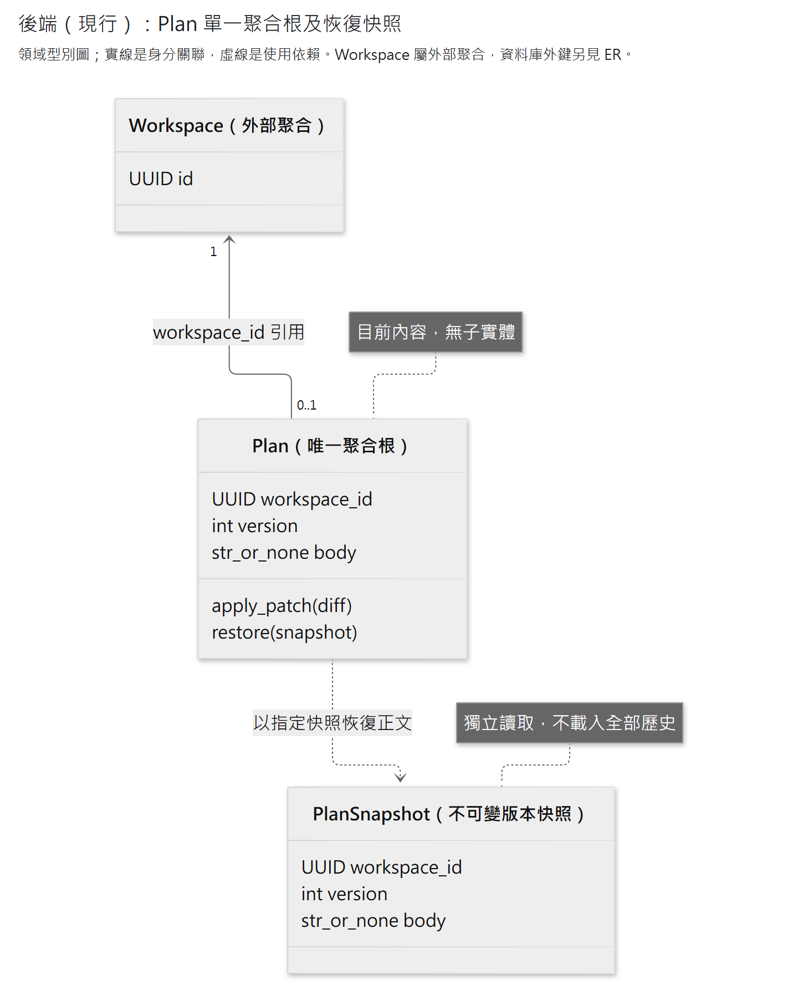
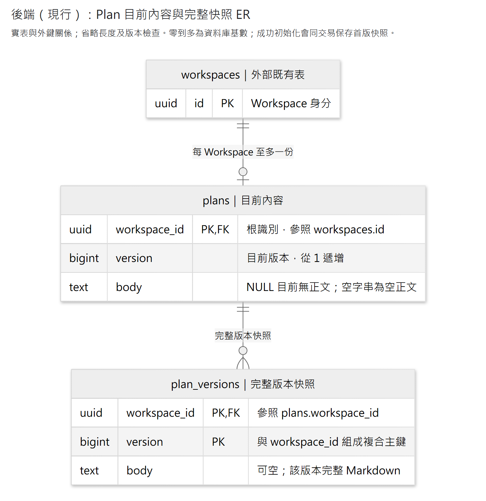

# Plan 模組

每個 Workspace 至多一份 Markdown 計畫，所有查詢讀取最新保存內容。`Plan` 是唯一聚合根，以 Workspace ID 識別，沒有子 Entity。初始化、patch 與版本恢復可由 Python 公開用例呼叫；HTTP 只提供目前內容查詢。

[Plan Bundle](../../bundles/plan/README.md) 透過公開用例提供 Agent 讀改工具及取消撤回；工具提示、可信版本與輪前基準歸插件，正文規則仍由本模組負責。取消恢復輪前內容後，下一輪從最新保存版本繼續。Context 全文投影與換窗接點由 Bundle 提供。

依問題閱讀：[公開介面](#公開介面) · [聚合與保存](#聚合與保存) · [文字修改與失敗](#文字修改與失敗)。

## 公開介面

| 能力 | 入口與效果 |
|---|---|
| 查目前內容 | [PlanQueries.get_current](application/queries.py)：回 `PlanView(workspace_id, version, body)`；不建立資料 |
| 明示初始化 | [initialize_plan](application/plans.py)：沒有 Plan 時保存 v1／body=None；已有則回目前版 |
| 局部修改 | [patch_plan](application/plans.py)：要求 `expected_version`，回目前內容、`changed` 與實際前後差異 |
| 取消所需的恢復 | [restore_plan](application/plans.py)：要求 `expected_version`、`target_version`，採用同 Workspace 舊版正文，回目前內容 |
| HTTP 查詢 | [Router](presentation/api/router.py)：`GET /workspaces/{workspace_id}/plan`；欄位及錯誤沿 [OpenAPI](../../../../README.md#api-文件與實作範圍) |

三個寫用例都接受 `workspace_id` 與 `uow_factory`，各自管理一次短交易。組裝端以 [SqlAlchemyPlanUnitOfWork](infrastructure/persistence/unit_of_work.py) 接上 Session factory；查詢以 [SqlAlchemyPlanQueries](infrastructure/persistence/queries.py) 接上 Engine。Engine 生命週期由建立它的組裝端管理。Application 只依賴自有 [persistence 契約](application/persistence.py)，不接觸 SQL 或 HTTP。

Workspace 存在但未初始化時，查詢回 `version=None, body=None`。初始化後 `body=None` 表示目前無正文，空字串表示空正文；恢復也可以帶回這兩種內容，不能單憑值推斷操作歷史。每次內容實質改變才增版，無效果的 patch 保留原 `None`；恢復相同內容也不增版。所有 patch／restore 都先核對目前版本，過期的 no-op 一樣拒絕。

例如輪前為 v7，本輪改成 v8、v9，取消時恢復 v7 的正文會保存為 v10；下一輪可從 v10 繼續。版本號不倒退，中間快照保留。Agent 負責先停止並收束在途寫入，再呼叫恢復；Plan 不判定整輪是否取消完成。

## 聚合與保存

[放大 SVG](../../../../../../docs/diagrams/plan/plan-domain.svg) · [圖源](../../../../../../docs/diagrams/plan/plan-domain.mmd)

[Plan](domain/plan.py)維護正文、版本與同根恢復規則。[PlanSnapshot](domain/snapshot.py)是不可變版本值，供根以指定快照正文恢復；不隨根載入全歷史。圖中的 Workspace 關聯表示身分參照，資料庫約束另見下圖。

[放大 SVG](../../../../../../docs/diagrams/plan/plan-storage.svg) · [圖源](../../../../../../docs/diagrams/plan/plan-storage.mmd)

模組擁有 `plans` 與 `plan_versions` 兩表。ER 呈現實表與外鍵基數，省略長度及版本檢查；零到多不代表成功初始化可缺少首版快照。建立及每次實質修改，均在同一交易保存目前列與完整快照。`plans.version` 沒有指向快照的外鍵，目前列與同版快照一致由用例交易及查讀完整性核對維持。Workspace 刪除沿外鍵級聯清理。版本上限為 9007199254740991，沿 HTTP 的精確整數界線。正式型別及約束見 [ORM](infrastructure/persistence/orm_models.py) 與 [migration](../../migrations/versions/0005_plans.py)。

初始化鎖定 Workspace 以處理首次建立競爭；修改鎖定 Plan 並核對 `expected_version`。鎖等待預設 5,000ms，衝突不自動重套 patch。查詢用同一次資料庫視圖分辨不存在的 Workspace、尚無 Plan 與不完整內容。

Workspace 身分沿其[公開 selectable](../workspace/infrastructure/persistence/public_queries.py)取得；初始化在同一交易對它加鎖，目前內容查詢則將它與 Plan、目前快照組成同一 SQL statement。Plan 不直接匯入 Workspace 私有 ORM，也不依賴 Agent 或 Bundle；依賴規則由 Import Linter 與正反例測試維持。

## 文字修改與失敗

純文字 [editing](domain/editing/) 接受單正文 V4A patch。多 hunk 全部對同一原文定位後才套用；空白、Unicode、未修改的換行與末尾換行保留。近似匹配的保留行使用實際原文，不用輸入 context 改寫。若有多個合格位置，即使其中一處完全相同，也拒絕歧義。

正文中的 `message_101`、`task_102` 等引用視為一般 Markdown，查讀、保存、恢復與 Context 投影均保留原字串。Plan 不配置短碼，也不解析或重寫正文引用；短碼解析與目標可讀性由各資源的公開查讀能力處理。

第一版工程限制為正文／結果／patch 各 16,000 字元、32 hunk、完整掃描估算 20,000,000；超過即拒絕，不截斷。禁止檔案 wrapper、數字行號 unified header、NUL 及孤立 surrogate。來源授權見 [THIRD_PARTY_NOTICES](../../../../THIRD_PARTY_NOTICES.md)。

[領域錯誤](domain/errors.py)區分格式、找不到 context、歧義與容量；[用例錯誤](application/errors.py)區分未初始化、版本不存在、版本衝突、資料損壞及存取失敗。保存錯誤的 `commit_status` 只表達可證實的 `not_committed`／`committed`／`unknown`，不自動重送。讀取目前內容可協助核對，但不是原操作收據。

HTTP 200 設定 `Cache-Control: no-store`；Workspace 不存在回 404，查詢失敗或資料不完整回安全的 `503 / plan_unavailable`，不偽裝成空內容。503 的 `X-Request-ID` 可對照 stderr 安全診斷，包含 HTTP 狀態、錯誤型別與程式位置，不記正文、SQL 或例外訊息。初始化、patch、restore 及歷史查讀均沒有 HTTP 端點。啟動與驗證命令沿[後端說明](../../../../README.md)。
