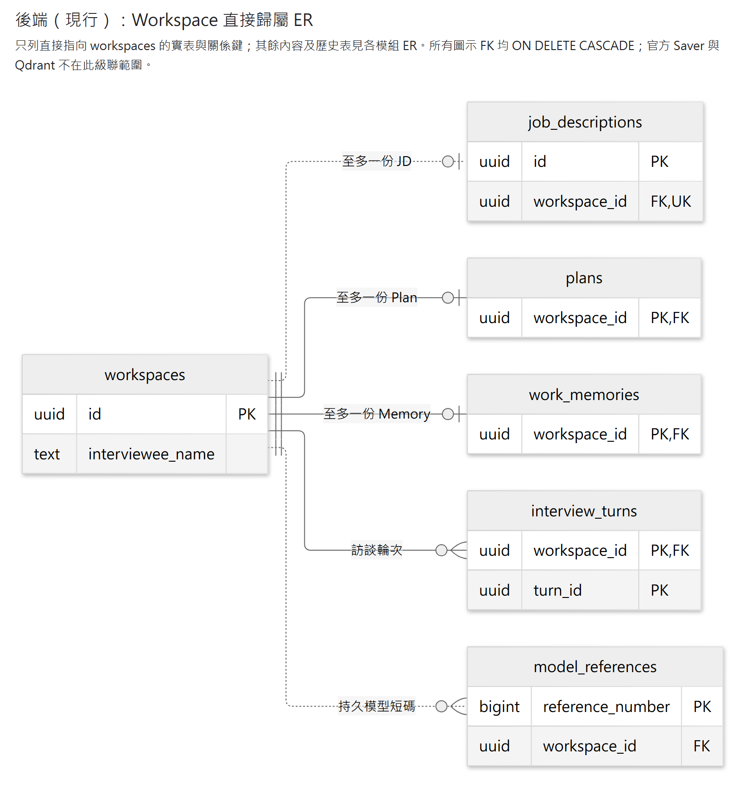
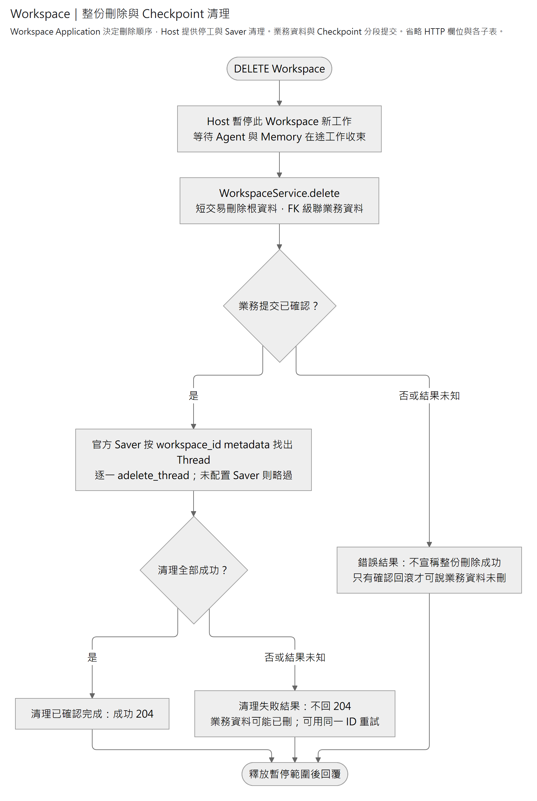

# Workspace

管理一份職務檔案的身分與受訪者姓名。內部功能由各自模組負責；刪除 Workspace 會在同一交易永久清除所屬業務資料與歷史，不影響其他 Workspace。Workspace 的刪除用例另要求清理官方 Checkpoint。

## 閱讀入口

- [WorkspaceService](application/workspace_service.py)提供獨立的 Workspace CRUD 與交易邊界。
- [生命週期用例](application/lifecycle.py)決定整份 Workspace 的建立、停工與刪除順序。[Host 接線](../../host/workspaces.py)提供初始化交易、Agent／Memory 停工、官方 Saver 清理與刪除工作生命週期。
- [Domain](domain/workspace.py)：Workspace 與姓名規則。
- [儲存契約](application/persistence.py) → [SQLAlchemy 實作](infrastructure/persistence/repository.py)。
- [公開持久查詢](infrastructure/persistence/public_queries.py)：`select_workspace_id` 只選指定 Workspace 的身分，供同庫呼叫端組合投影或加上 `FOR UPDATE`；執行與短交易由呼叫端管理，不暴露私有 ORM。
- [HTTP Router](presentation/api/router.py)與 [Request／Response](presentation/api/schemas.py)；欄位及路徑查執行中的 `/docs`。

## 資料歸屬

[放大 SVG](../../../../../../docs/diagrams/workspace/workspace-storage.svg) · [圖源](../../../../../../docs/diagrams/workspace/workspace-storage.mmd)

Workspace 自身只有 `workspaces` 表。此圖只列直接指向它的五張業務表及關係鍵，表名與基數沿實際 SQL 約束；不展開各模組內容、歷史或應用程式生命週期。每個 Workspace 至多一份 JD、Plan 與 Memory，可有多個訪談輪及短碼，圖示 FK 都以 `ON DELETE CASCADE` 保護所屬資料清理。

各表由 [JD](../job_description/README.md#資料關係)、[Plan](../plan/README.md#聚合與保存)、[Memory](../memory/README.md#資料與引用)、[Interview](../interview/README.md#資料關係)及[模型短碼](../model_references/README.md#資料表)擁有；Workspace 不直接管理其內容。官方 Saver 沒有 Workspace FK，刪除用例透過 Host 提供的介面清理；Qdrant 公版索引跨 Workspace 共用。Workspace 欄位與姓名約束見 [ORM](infrastructure/persistence/orm_models.py)。

## 呼叫限制

建立不按姓名去重，不使用冪等鍵或自動重試；失去回覆不能推定未建立。寫入在確認提交後回成功，內部錯誤回安全 `detail.code`；500 的 `X-Request-ID` 可對照 stderr 診斷，並非恢復操作的識別碼。

獨立 `WorkspaceService.create` 只建立 Workspace。完整 App 使用 Application 的 `create_workspace`，依序新增 Workspace、初始化空 JD 首版、保存固定 App 開場，再提交。Host 實作 `WorkspaceInitializationUnitOfWork`，讓三項寫入共用同一 SQLAlchemy Session 與交易。三項寫入同成同敗，確認提交後才回 201。建立不依 Agent 開關，讀取時也不補建。

清單採 UUID 游標分頁，跨頁不保證同一快照；並行改名採最後成功寫入生效。

業務資料由各模組的所有權 FK 級聯刪除。成功及重刪不存在的檔案，在確認清理後皆回 `204`。刪除後無可恢復的歷史。每次取鎖最多等待 5 秒，並非整個請求的總時限。DELETE 遭鎖逾時或死鎖拒絕、完成回滾後，回 `409 / workspace_concurrency_conflict`，`reason` 為 `lock_timeout` 或 `deadlock`；呼叫端可稍後重試。一般 `500` 或連線失敗須重讀核對，不能推定未刪。

Application 的 `delete_workspace` 先停工並等待在途 Agent／Memory 工作收束，再提交業務刪除，最後清理所屬官方 Checkpoint。Host 提供停工與 Saver 清理，管理刪除工作直到結束。HTTP 斷線時工作繼續，Host 關閉時等待工作收尾。業務刪除與 Checkpoint 清理不共用交易，清理失敗可用同一 Workspace ID 重試。共用公版索引保留。

## 整份刪除流程

[放大 SVG](../../../../../../docs/diagrams/workspace/workspace-deletion.svg) · [圖源](../../../../../../docs/diagrams/workspace/workspace-deletion.mmd)

[測試與啟動](../../../../README.md)沿後端共用命令。
